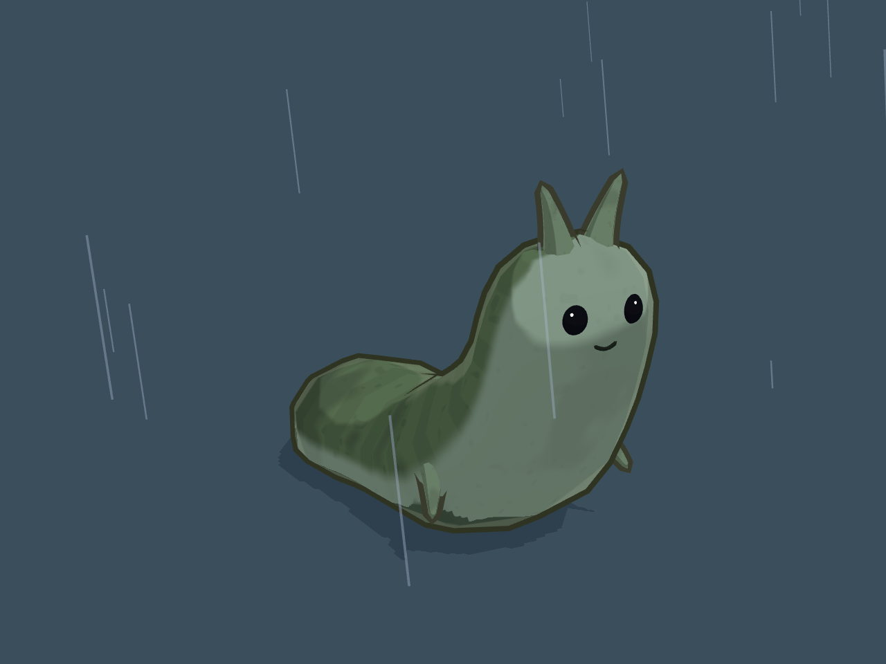

# キャラデザイン パラメータ一覧（現在値）

`SlugPop`（`Assets/Slug/Scripts/Runtime/SlugPop.cs`）の現在値。経緯は `character_design.md`。
スライダーはすべて 1.0 = ポップ側、0.0 = 本物のナメクジ寄り。一括スライダー `Pop` を動かすと全要素が同じ値に揃い、要素別を動かすとその要素だけが変わる。

- シーン：`Assets/Scenes/SlugLookbook.unity`（雨の暗い背景）
- スクリーンショット：`Screenshots/Character/`

## 要素ごとの現在値

| 要素 | 設定 | 現在値 | 内容 |
| --- | --- | --- | --- |
| 体のスタイル | `bodyStyle` | **V4Round** | 丸い立ち上がり体型（長さ 1.1、頭の持ち上げ 88°）。`Dignified`（長いS字の体、平面の顔）も残してある |
| 体の形 | `body` | **1.0** | |
| 模様 | `pattern` | **0.5** | 縞をやや薄く、まだら少し |
| 色 | `color` | **1.0**（苔系） | 体 `#6E7A4C` |
| 目 | `eyes` | **0.25** | 小さな黒い立体の目、小さなハイライト1つ（目の半径 約 0.023） |
| ほっぺ | — | **なし** | |
| 口 | `expression` | **0.5** | 小さな口（V4Round） |
| 触角：長さ | `tentacleLength` | **1.0** | 約 0.13 |
| 触角：太さ | `tentacleThickness` | **0.5** | 根元の半径 約 0.030 |
| 触角：向き | `tentacleDirection` | **0.5** | ほぼ真上（少し外向き） |
| 触角：形 | — | 円錐形 | 腕と同じ構造（根元が太く先端ほど細い、少し外へ曲がる）。這う動きに合わせてかすかに揺れる |
| 手 | `hands` | **1.0** | 先端ほど細い短い円錐形（長さ 0.08、根元の半径 0.022、先端は下へ少し曲がる）。指なし |
| おなかの長さ | `bellyLength` | **0.55** | 胸から尾までを短く（後ろ側を削る） |
| おなかの平たさ | `soleSquare` | **0.75** | 足の裏が平らにぺたっと地面に付き、ふちがはっきりする |
| 足のふちのひだ | `footFrill` | **0**（試して戻した） | 1 にすると、足のふちが這う動きに合わせて少し波打ち、ひだの線が入る |
| 陰影 | `shading` | **1.0** | トゥーン2段 |
| 輪郭線 | `outline` | **1.0** | 体色を暗くした色、太さ 0.009 |

目・口・触角・手は、付け根の皮膚の動きに合わせて動く（皮膚と同じ変位を与える）。

## 這う動き（ボーンなし、頂点シェーダー）
| 項目 | 値 |
| --- | --- |
| 全身の伸び縮み `_Stretch` | **0.035**（±3.5%。尾の先を固定して前が動く。大きいとヘルメットから体がはみ出す） |
| 波の振幅 `_WaveAmp` | 0.014（その場所の太さの −40%〜+25% に制限） |
| 波の数 / 速さ | 2.2 / 0.8 |
| 太さの倍率の下限・上限 | 0.4 / 1.3 |
| 縮むときの体積保存 | 前側（体の長さ方向 35%〜95%）だけがふくらむ。尾側は膨らまない |

しっぽの反転を防ぐ仕組み：変形量をその場所の太さで制限し、倍率に下限・上限を付けた。縮むときは前側だけが膨らむ。

## 決めていない・保留
- 輪郭線・陰影は 1.0 のまま。v4 の中央の個体は 0.5 だった。
- 縮んだ瞬間に首のあたりに少し段差が出る（前側のふくらみが急）。
- 立体の眼球（`eyeKind`）、平面の顔（マズル・鼻の穴・一本線の口）は `Dignified` / `eyeKind` 側に残してある（比較で使った）。

## 作り直す手順
Unity メニュー `Slug` から：`Lookbook Build Scene` → `Lookbook Capture Screenshots`。
値は `SlugLookbook.ApplyCurrent`（`Assets/Slug/Scripts/Editor/SlugLookbook.cs`）、形・顔・触角・手は `SlugPop.cs`、シェーダーは `Assets/Slug/Shaders/`。
