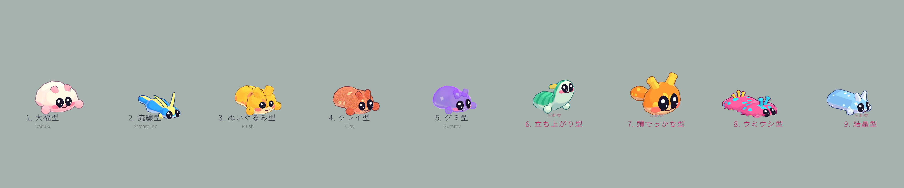

# ナメクジ キャラデザイン候補（試作9体）

`docs/spec.md` の「キャラの具体的なデザイン」【未決定】を詰めるための比較用プロトタイプ。
Unity 上で9体を手続き的メッシュ＋URPシェーダーで作り、1シーンに横一列で並べた。

- シーン：`Assets/Scenes/SlugGallery.unity`
- スクリーンショット：`Screenshots/`（全体像 `00_overview.png`、各案の `_front` / `_side` / `_angle`）
- 追加確認：`Screenshots/extra/`（うねりの2時点、手の出し入れ）



## 共通の条件（全9体で満たしていること）

| 条件 | 実装 |
| --- | --- |
| 這う体のそのまま型 | 胴を1本のロフト（楕円断面の連なり）で生成。底面は平らな足裏 |
| 指のない丸い手（出し入れ可能） | 短い腕＋球状のミトン。`SlugRig.handsExtend`（0〜1）で体内から出し入れ。0で非表示 |
| 触角は耳、目は顔 | 耳は体から生えるロフト。目は顔の前面に大きな楕円ドーム＋ハイライト2つ |
| ローポリ＋トゥーン調 | 胴は 8〜14 分割（ウミウシ型のみフリルのため縦に64分割）。光は3段のバンド＋太めの輪郭 |
| 色と模様はマテリアルのパラメータ | `Slug/Toon` のプロパティだけで色・模様・質感を変更。テクスチャは不使用 |
| 這う動きはボーンなし | 頂点シェーダーで尾から頭へ進むうねりを生成（`_WaveAmp / _WaveFreq / _WaveSpeed`） |
| 気持ち悪く見えない | テカり（スペキュラ）なしのマット。輪郭は丸く、目は大きく、頬と小さな口で表情を付けた |

## 暗黙の前提と、その反転案

ナメクジを描くとき、無意識に置いてしまう前提を4つ書き出し、それぞれを反転させた。

| # | 暗黙の前提 | 反転した案 |
| --- | --- | --- |
| 1 | ナメクジは地面にぺたりと**水平に**這っている | **立ち上がり型**：上体を起こして立つ。尻尾側だけが地面を這い、顔と手が目線の高さに来る |
| 2 | 体の大半は**長い胴**で、頭は先端のちいさなふくらみにすぎない | **頭でっかち型**：頭が体の主役。大きな丸い顔にちいさな胴がつく2頭身 |
| 3 | 体の色は**地味な単色**（茶・灰・黒）で、飾りはない | **ウミウシ型**：ポップな多色。体のふちにフリル、触角は先の丸い花のよう、背中にふさふさの突起 |
| 4 | 体表は**やわらかく滑らかな曲面**でできている | **結晶型**：かたい塩の結晶。面を切り出したファセット形状で、光は面ごとに段になる |

> 補足：「濡れてテカっている」「目が小さい」「触角が細長い」も前提だが、仕様側で
> すでに反転が決定済み（マット、目は大きく、触角は耳）なので、案としては立てていない。

## 5案

### 1. 大福型（Daifuku）
短く丸い、もちっとした体。胴と頭の境目をなくした一つのまんじゅう型で、触角は小さなこぶ耳。
クリーム色に淡いピンクの腹と頬。粉をはたいたような柔らかい縁（`_FuzzAmount`）で、もちもち感を出した。
うねりは小さく、ぷにっと潰れるように進む。

- 長所：いちばん「かわいい」が一目で伝わる。シルエットが単純で色替えが映える
- 懸念：這う体という印象が弱く、ナメクジに見えにくい

### 2. 流線型（Streamline）
細長く低い、速そうなシルエット。尾は先細りで、耳は後ろへ流れる細い葉のよう。
背中にレーシングストライプ（`_PatternType = 3`）。うねりは細かく速い。

- 長所：ナメクジらしさと速さを両立。体色の塗り分けでスピード感が出る
- 懸念：顔が小さくなるため、一人称のHUD（左上の体表示）では表情が伝わりにくい

### 3. ぬいぐるみ型（Plush）
フェルトの質感（`_FeltAmount` / `_FuzzAmount`）に、背中の縫い目と首まわりの縫い目（`_Stitch*`）。
ふっくら綿を詰めた体、ボタンのような目、パッチ模様。

- 長所：「ポップ」と「ぬくもり」が強い。縫い目は色と同様にパラメータで消したり出したりできる
- 懸念：縫い目はUV依存なので、体型を変えたときに位置の調整が必要

### 4. クレイ型（Clay）
手でこねた粘土のでこぼこ。大きなうねり（頂点のノイズ `_BumpAmp`）と、指でつついたような細かいくぼみ
（法線ノイズ `_DentAmp`）、素朴な点々模様。左右の目の大きさも少し違う。

- 長所：手作り感が出て、機械的なローポリ感がやわらぐ
- 懸念：細かいくぼみは遠目にはノイズに見えるので、HUD の小さな体表示では効果が薄い

### 5. グミ型（Gummy）
少し半透明でぷるぷる。ふちが濃く中心が透ける色味（`_Alpha` / `_AlphaEdge`）、砂糖粒のきらめき、
頂点のぷるぷる揺れ（`_Jiggle*`）。テカりではなく透け感で見せている。

- 長所：色が主役になるので「食べた植物の色が体に出る」仕様と相性がよい
- 懸念：半透明は描画コストと、背景との見分けやすさ（隠れやすさ）の調整が要る

## 反転4案

### 6. 立ち上がり型（Rear-up）　— 反転した前提：水平に這う
鎌首をもたげたように体を起こし、胸を前に出して立つ。ストライプ（`_PatternType = 2`）で体の曲がりが読み取りやすい。
手を使う姿がいちばんよく見える。

- 長所：手の出し入れ・耳の聞き耳が見せやすい。インベントリ画面の立ち姿に向く
- 懸念：「這って採る」手触り（柱2）とは逆向き。移動中ではなく待機・演出用のポーズ向き

### 7. 頭でっかち型（Big-head）　— 反転した前提：胴が長く頭は小さい
顔がほとんど全身。目と口が大きくなり、表情の情報量が最大。耳は先が丸い大きめの花形。

- 長所：表情で自己表現（柱3）がしやすい。HUD の小さな体表示でも読める
- 懸念：這う体の印象が薄れる。胴が短いのでうねりの見せ場が少ない

### 8. ウミウシ型（Sea-slug）　— 反転した前提：地味な単色
カラナクシ寄せ。幅広い体のふちにフリル（`_RuffleAmp`）、先の丸い触角、背中の房。
多色（ピンク×水色×黄）で、色と模様のパラメータで遊べる幅が最も大きい。

- 長所：色が戦利品になる仕様（食べた物で体色が変わる）と最も相性がよい。「世界はくすみ、キャラは鮮やか」を体現
- 懸念：フリルのために頂点数が多い（縦64分割）。体の「ナメクジらしさ」は薄まる

### 9. 結晶型（Crystal）　— 反転した前提：なめらかな曲面
塩の結晶をカットしたような面（`_Facet = 1` で面ごとの法線）。光は面ごとに段になり、
粘液のキラキラは結晶のきらめき（`_PatternType = 4`）に置き換わる。

- 長所：塩がテーマの世界観に直結する。ローポリ感を最も活かせる
- 懸念：硬質に見えるので「柔らかい生き物」という印象が弱まり、愛嬌は他案より控えめ

## 並べてみた所見（Claude Code の感想。最終判断はチームで）

- **「気持ち悪くなさ」**は、どの案も目の大きさとマットな質感でクリアしていた。差が出るのは「ナメクジらしさ」との引き換え。
- **ナメクジらしさ**が残る順：流線型 ≒ ウミウシ型 ＞ ぬいぐるみ型 ≒ クレイ型 ＞ グミ型 ＞ 大福型 ＞ 頭でっかち型。
- **かわいさ・表情の伝わりやすさ**は逆の並び（大福型・頭でっかち型が強い）。
- 案同士は排他ではない。例えば「体型は大福寄りに短く、質感はぬいぐるみ」のように、体型パラメータと
  マテリアルのパラメータは独立しているので組み合わせられる。
- 次の判断材料として、一人称の左上 HUD（小さく見える）と、拠点での立ち姿の両方で比べたい。

## 使い方

### 色や模様を変える
`Assets/Slug/Generated/<id>/Body.mat` のパラメータを触るだけ。主なもの：

| 目的 | プロパティ |
| --- | --- |
| 体色 / 影の色 / 腹の色 | `_BaseColor` / `_ShadeColor` / `_BellyColor`（`_BellyAmount` で幅） |
| 模様 | `_PatternType`（0なし 1水玉 2輪 3縦縞 4きらめき）、`_PatternColor`、`_PatternScale`、`_PatternSize` |
| うねり | `_WaveAmp` / `_WaveFreq` / `_WaveSpeed` / `_WaveHeadFade` |
| フェルト・縫い目 | `_FeltAmount` `_FuzzAmount` `_StitchAmount` `_StitchRingT` |
| 粘土 | `_BumpAmp`（大きな凹凸）`_DentAmp`（細かいくぼみ） |
| グミ | `_Alpha` `_AlphaEdge` `_JiggleAmp` |
| 結晶・ウミウシ | `_Facet`、`_RuffleAmp` |

手の出し入れは、プレハブの `SlugRig` の `Hands Extend` スライダー（実行時は `SetHandsOut(bool)`）。

### 作り直す
Unity メニューの `Slug` から。

1. `Slug > Build All Designs`　— メッシュ・マテリアル・プレハブを `Assets/Slug/Generated/` に再生成
2. `Slug > Build Gallery Scene` — 9体を並べたシーンを再生成
3. `Slug > Capture Screenshots` — `Screenshots/` に書き出し（うねりは固定時刻で撮影）

体型・顔・耳・手・色の定義は `Assets/Slug/Scripts/Editor/SlugDesigns.cs` に集約してある。

### 構成
```
Assets/Slug/
  Shaders/SlugToon.shader, SlugToonInput.hlsl   URP用HLSL（トゥーン＋うねり＋各質感）
  Scripts/Runtime/SlugMeshFactory.cs            手続き的メッシュ（ロフト）
  Scripts/Runtime/SlugRig.cs                    手の出し入れ
  Scripts/Editor/SlugDesigns.cs                 9案の定義
  Scripts/Editor/SlugBuilder.cs / SlugGallery.cs / SlugScreenshots.cs
  Generated/                                    生成物（メッシュ・マテリアル・プレハブ）
```

## 既知の制約

- 輪郭線は反転ハル法（背面を膨らませて描く）。グミ型は半透明のため輪郭線なし。
- 影は URP のメインライトのみ。追加ライトは未対応（トゥーン用に意図的に省略）。
- うねりは法線方向の膨らみ（蠕動運動）で表現していて、足裏の接地面は動かない。実際の這う動きとの合わせは、
  操作感の検証（Snake Pass 参考）の段階で調整が必要。
- 日本語ラベルは Noto Sans JP（SIL OFL）を `Assets/Slug/Fonts/` に置いて TextMeshPro で表示している。
