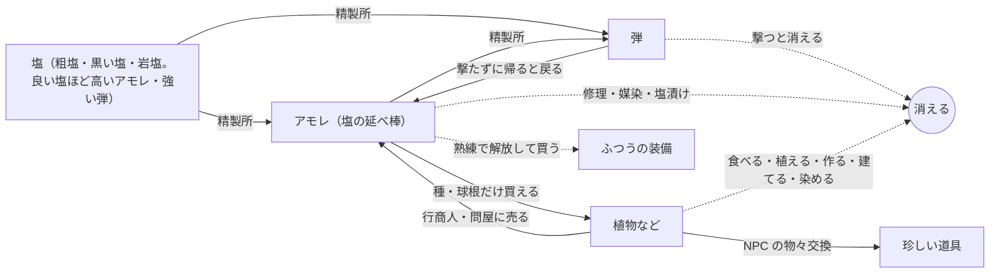

# ナメクジ脱出PvP 仕様メモ

Oct 3, 2026 · @わく

## 概要と柱

雨の夜、塩を撃ち合うナメクジたちの一人称PvP脱出ゲーム。見た目はシック×ポップ、失う痛みはハード。

凡例：【決定】話し合いで確定、【仮】方向性は決まったが調整予定、【未決定】これから決める。「案」は出たがまだ採用していないアイデア。

ほかの資料（進捗、キャラの経緯、話し合いの記録、作り方のメモ）の一覧は `README.md`。

- 【決定】ジャンルは一人称のPvP脱出（エクストラクション）。自然物を採取して換金し、プレイヤー同士で奪い合う
- 【決定】カジュアル要素はなし。失う痛みが大きいほど、持ち帰る喜びも大きい
- 【仮】最終目標はSteamでオンライン。可能ならSwitch・PS5でも
- 【決定】開発はUnity（URP）。Claude Code＋Unity CLIで進める。Built-inレンダーパイプラインは非推奨なので使わない

### ゲームの柱

1. 【決定】アイテムをゲットした高揚感、バッグが埋まっていく充足感、保持の緊張感
2. 【仮】雨に濡れた自然を、這って、採って、持ち帰る手触り
3. 【決定】自分らしさ。範囲（見た目だけか、戦い方も含むか）は【未決定】

柱1は「気持ち」、柱2は「世界の手触り」、柱3は「自己表現」を担う。迷ったらここに立ち返る。

## 世界観

人類が滅んだ後の自然の中で、ナメクジたちが自分たちの文明を築いて暮らしている。

- 【決定】人類滅亡後の世界。人間の痕跡はほぼ残っていない
- 【決定】ナメクジが主役の世界。親戚のカタツムリもいて、スカブ枠（NPC、失うもののない出撃）として出てくる。体はナメクジと同じで、見分けは背中だけ（ナメクジはバッグ、カタツムリは殻）。人・ドラゴン案は不採用
- 【決定】ナメクジは独自の文明を持ち、技術は人間の技術を受け継いだもの。「粘液工学」は不採用
- 【決定】採取の中心は自然物（作物、鉱石、自生する花、木など）
- 【決定】島は年々乾いていく。雨季が短くなり、湿った土地と資源が減るので奪い合う。ゲームとしては「自分で集めるより、集めた相手を倒す方が早い」も理由になる
- 【仮】なぜ島が乾くのかは謎のままにして、ストーリーの縦軸にする
- 【仮】雰囲気は「世界はシック、キャラはポップ」

参考：スプラトゥーン、星のカービィ ディスカバリー、ピクミン（人間が消えた後の自然）、Grounded（小さい視点での自然採取）。Rain Worldとは思想もグラフィックも違うので気にしない。

## 島と拠点

舞台は熱帯の島1つ。島全体が試合で区切られない1つの続いた世界で、いくつかの区画からなる。拠点は島全体で1つで、各区画の自分のベースキャンプから帰る。

- 【決定】採取場は1つの島の中に複数の区画。拠点から出撃先の区画を選ぶ
- 【仮】気候は熱帯のサバナ気候のイメージ。貿易風で風上側（東）は雨が多く沢と森、風下側（西）は乾いて塩田が多い。山や洞窟には岩塩と鉱石。地形で地点ごとの天気と資源が決まる（参考：ハワイ島の東側は雨が多く、西側は乾いている）
- 【決定】地点ごとの天気予報がわかる。予報は拠点で順次開放
- 【決定】天気予報は全員共通（地点と時間ごとに晴れ・曇り・雨）。天気は島全体の共通の時計で動き、時刻から計算できるようにする
- 【決定】拠点の「観測所」を育てると、予報の時間の刻みが細かくなり（例：半日ごと → 1時間ごと）、天気の強さ（小雨・大雨など）が分かる
- 【決定】拠点は島全体で1つ。拠点の場所で予報がブレる、は外した。拠点の場所を選ぶ意味を残すかは【未決定】
- 【決定】拠点は襲撃されない
- 【決定】拠点の種類は3つ（岩の隙間、木の根っこ、倒木の中）。最初に雰囲気で選び、大干ばつのたびに選び直せる。性能の差は3%くらい（季節の得意・不得意）で、プレイヤーがほぼ気づかない程度。あくまで見た目の違い
- 【決定】飾り枠をいくつか用意し、飾った物に来歴の札（いつ・どこで・どんな雨で・どう持ち帰ったか）を付ける。家具の自由配置は【未決定】
- 【仮】マルチでは自分の拠点に友達を招き、出撃口の地図の台を囲んでそのまま一緒に出撃する（集会所）
- 【未決定】拠点を飾れるようにするか（あつ森のような家具配置など）、拠点の引っ越し

- 【決定】世界は普通の大きさ（ナメクジにとって等身大）。巨大な自然にすると天気予報が破綻するため。ばかでかい木や岩を置くのはあり（目印・遮蔽・日陰）
- 【決定】1つのマップ（区画）は一辺 800 m（約 0.64 km²）。這う速さ 1.2 m/s で、軽ければ約 11 分、重いと約 37 分で横切る。速い道（沢の流れ、滑る坂、ぬめり跡）を組み込む。話し合い：`discussions/map_discussion_2.md`
- 見直し中：灰色の区画を遊んで、広すぎるかも（作る量も重い）。区画の性格で広さを変える（森は狭くごちゃごちゃ、塩田はだだっ広い）、巣穴で帰り道を縮める、作り込むのは名所だけ、などの案。話し合い：`discussions/map_size_discussion.md`
- 【決定】雄大さは広さではなく高さと見晴らしで作る（グランドキャニオン、ヴィクトリアの滝の規模感）。体高 0.5 m のナメクジには深さ 100〜150 m の谷で十分。遊べる範囲が小さくても、隣の区画の山や滝が遠くに見える（借景）。谷は低密度で縦、森は高密度。話し合い：`discussions/grand_nature_discussion.md`
- 【決定】ナメクジは 80° までの斜面に張り付いて登れる。どうしても登らせたくない場所は 90° にするか、「登れない」判定を付ける。上り下りの速さは今のまま
- 【決定】名所の間はコードで並べ、生成した物は固定して人が直す。地形の侵食はまず Unity 上（コード）で作り、Unity で微調整する。どうしても完成度が足りなければ Gaea に切り替える
- 【仮】地形は現実の決まりに合わせる（例：砂丘は風向きに沿って規則的に並ぶ三日月形、塩田は六角形のひび割れ、谷は地層ごとの段々。`discussions/grand_nature_discussion.md` のあと）
- 【仮】人数は 20 人くらい（パーティを組めるように）、1回の出撃は 30〜50 分くらい（探索したい）。少ない人数でも成り立つように、人数に合わせて区画のコピーを増減する
- 【決定】島全体を1つの続いた世界にする（試合で区切らない）。天気と昼夜がペースを作る。大干ばつ（ワイプ）で島がリセットされる。話し合い：`discussions/persistent_island_discussion.md`
- 【決定】出撃＝拠点から区画へ出る。脱出＝自分のベースキャンプから拠点に帰る（巣穴はやめて、モンハンワールドのようなベースキャンプにした）。帰るまで持ち物は確定しない
- 【決定】ベースキャンプの役割は出撃と帰還だけ（装備を替える・治すのは拠点）。1区画に2つまで。最初は自分で選んだ2か所。そのあと、出撃中にキャンプを建てられそうな場所を見つけ、その場所の材料で建てると、そこへ移せる
- 【仮】キャンプは開けた人（とパーティ）にしか見えない（ほかの人には崖の窪みなどにしか見えないので、待ち伏せが分散する）。出撃もキャンプから。良い場所ほど行きにくい（崖の中腹、滝の裏、塩田の真ん中の大岩の上）
- 【未決定】最初に選べる場所と、あとで建てられる場所の数・置き方（区画を一度作ってから決める。必ず通る場所の近くに集めない）
- 【決定】区画の間の移動は拠点を通る（メリハリをつけるため。区画の端から隣へ歩いて行くことはしない）
- 【決定】島で抜けると、その場で丸まって眠る。眠っている間は撃たれうる。眠る時間は 10 分くらいから試す。ベースキャンプで抜ければ安全
- 【仮】1区画＝1つのサーバー（20 人まで、パーティは4人まで）。人が多いときは同じ区画のコピーを増やし、少ないときは減らして人を集める
- 【仮】サーバーの節約：誰もいない区画は眠らせ、入ったときに時刻から天気と資源を計算して起こす。落ちた物は雨と乾きで消える（覚えておかない）
- 【仮】人の多さが読める（ぬめり跡、音、雨の強さ、予報）。区画ごとに稼ぎと危なさが違い、静かな区画もある。人がまったくいない時間のために、カタツムリ（スカブ枠）は常設でも要る
- 【未決定】将来、有志の島（プレイヤーが立てるサーバー、進行は島ごと）を用意するか
- 【決定】区画は、とりあえず5つ。山を囲む輪（案B'）：真ん中に岩塩の洞窟の山（一番稼げて一番危ない）、東に雨の森、西に干上がった塩田（端に川が流れ込む場所がある）、北に黒い溶岩台地（溶岩洞が主役の近距離）、南に花の草原（稼ぎは少ないが静か。夜だけ咲く花などで、たまに人が来る理由を作る）。真ん中の山が雨雲をさえぎるので、東は雨、西は晴れ（雨陰）。話し合い：`discussions/regions_discussion.md`
- 【決定】滝は区画にせず、名所にする（区画の中の山場で、マップを覚える手がかり）。ほかの候補（倒木、マングローブ、霧など）も名所に回す
- 【決定】区画ごとに目印になる大きな物を1つ。開けた区画でも 15〜30 m おきに隠れる物を置く
- 【決定】区画を増やすときは、天気や季節で開く区画にする（枯れ川は乾季だけ、海岸の磯は大潮のときだけ、霧の高原は霧の朝だけ、など）
- 【決定】区画どうしは天気と水でつながる。上流（山や森）で大雨が降ると、遅れて下流の川が増水する。川の水位も時刻から計算する
- 【決定】大干ばつ（ワイプ）のたびに、地形は同じまま、採取場とキャンプを建てられる場所の配置だけ少し変わる
- 【未決定】縦に重なる区画（岩塩の洞窟の山を何層にも）。80° まで張り付いて登れるのと合わせて考える
- 案：マップは区画の集まりとして作る。最初に作る灰色の試作用の区画は「河口の塩沼」（全部入り。本番の5区画とは分けて考える）：東の森（植物、遮蔽が多い）→ 真ん中の沢（渡れる場所が限られる）→ 西の干上がった塩田（粗塩、開けている）、北のはずれに岩場と小さな洞窟（岩塩）。（「脱出口の1つは沢に流されて帰る」は、ベースキャンプに替えたので古い）。話し合い：`discussions/map_discussion.md`（雨で地形が変わるか、苔の壁を登れるかは【未決定】。「雲が横切る時間＝1試合」は2回目で取り下げ）

出た案（未採用）：塩田の多い島、沢の多い島のように島を分けるのは、後で新しい島を追加するときに取っておく。

## 長期目的と成長

長期の目的は、拠点を育てて暮らしを安定させること。キャラは「使って育つ」「体を鍛える」「秘伝書」の3つで強くなる。

### 拠点とシーズン

- 【決定】長期目的は「拠点を育てて安定して暮らす」。進歩が目に見えることが大事
- 【仮】拠点の設備案：観測所（天気予報）、精製所（塩を弾にする）、乾燥室（採取物が傷むのを遅らせる）、工房（装備）
- 【決定】植物・石の図鑑
- 【決定】ワイプは「大干ばつ」。乾季が極まると全部リセットされ、新シーズンは大雨季から始まる
- 【仮】リセットのきっかけは、大干ばつが終わって雨季に切り替わるときの大雨。島じゅうが流される（キャンプ、拠点、落ちている物）。川の流れや中州が変わり、採取場とキャンプの場所が少し動く理由にもなる
- 【決定】大干ばつでは全部失う（拠点、持ち物、隠し場所、熟練、なじみ、図鑑、体の色）。新しいナメクジとして始まる
- 【仮】乾燥が進むほど塩が増え、シーズン終盤はインフレしてもよい。弾は撃ち放題になり、逆に植物が希少になって値上がりする。大干ばつ前の最後の祭り
- 【未決定】商人クエスト（後回し）

### 熟練・特性・ギア

- 【決定】次の3つを組み合わせる
  - 使って育つ熟練（WARDOGS型）：粗塩の散弾で倒すと近距離熟練、岩塩で狙撃すると狙撃熟練、採取すると採取熟練が伸びる
  - 体を鍛える（タルコフの筋トレ型）：重い荷物で這うと筋力、雨の中を長く這うと乾燥耐性
  - 秘伝書（妖怪ウォッチ型）：採取場でまれに拾えて、使うと熟練が一段上がる。持ち帰らないと使えず、高く売ることもできる
- 【決定】レベルアップや秘伝書を読むときの演出（音・光）も世界観の一部として作り込む
- 【仮】熟練はキャラ本体に付くので死んでも残る。大干ばつ（ワイプ）でリセット
- 【仮】熟練で装備が解放され、塩で購入する二段構え（WARDOGS型）。塩の使い道が撃つ以外にも増える
- 【未決定】変な稼ぎ方（タルコフのジャンプ連打のような）を防ぐ条件

## キャラクター

プレイヤーは這う体のナメクジで、指のない手を生やして物を扱う。

- 【決定】見た目は「そのまま型」。這う体に、ドラえもんのような指のない手が生える
- 【決定】触角は耳。目は顔につく
- 【決定】キャラ本体（種族・見た目）は死んでも失わない
- 【仮】手は普段しまっていて、採取や射撃のときだけ生える
- 【仮】触角だけ物陰から出して聞き耳を立てられる。触角を撃たれると耳が遠くなる
- 【決定】カスタム範囲は、銃・ヘルメット・アーマー・バッグ・体の色
- 【決定】体の色は変えられるが、コストをかける（DQMJ3のカラーフォンデュのように）
- 【仮】食べた植物や寄った地点で出撃中だけ色が変わる。生きて帰れたら拠点で塩を払って定着、死んだら元に戻る。色そのものが持ち帰る戦利品になる（ウミウシには食べた物の色素で体色が変わる種類がいる）
- 【決定】デフォルメは「丸い立ち上がり型」：上体を起こし、尾側だけが地面を這う。小さな黒い目、小さな口、苔色。気持ち悪く見えないことが最重要。9案を試作して比べた経緯と今の値は `character/`
- 【未決定】輪郭線・陰影の最終値、左上の小さな体表示での見え方
- 【仮】モデリングの方針：形は数式やBlenderのスクリプトで作る。テクスチャは描かずシェーダーで、色と模様はパラメータで変える。這う動きはボーンなしでシェーダーで体を波打たせる

出た案（未採用）：

- 銃のパーツ交換（銃身・タンク・照準）
- キャラの形の候補：大福型、流線型、ぬいぐるみ型、クレイ型、グミ型、頭でっかち型、ウミウシ型、結晶型（`character/history/`）

デザインの指針（案）：濡れたテカリを描かずマットな単色、輪郭は丸く、目は大きく表情を出す、ぬめり跡は水っぽさよりキラキラで見せる。

参考：R.E.P.O.（腕なしで物を扱う）、Fortniteのフィッシュスティック、城ドラのデフォルメ、ポケモンのカラナクシ（ウミウシをかわいくした例、色違いあり）、Snake Pass（這う動きの操作感）。

## 経済（塩）

塩は「掘る資源」「弾」「通貨」を兼ねる。撃つたびに財布が減るのがこのゲームの経済の軸。

- 【決定】塩＝掘る資源・弾・通貨
- 【決定】塩の産地はマップごとに分ける（例：干上がった塩田、岩塩の洞窟）
- 【仮】塩の種類（産地）で変わるのは「質」：良い塩ほど、強い弾にも、高いアモレにもなる（わくさんの案）。撃つか、貯めるかが悩みになる。一番危ない岩塩の洞窟の山の塩が一番良い（一番稼げて一番危ない、と合う）
- 【仮】弾の形（散弾・連射・狙撃）は、どの塩からでも精製所の挽き方で作る（粗く砕く＝散弾、細かく挽く＝連射、塊のまま削る＝狙撃）。前の「産地ごとに取れる塩＝弾種」「粒の大きさで弾種を分ける」から変えた
- 【仮】「弾の強さ」は、防具への強さ（貫通）で出す（タルコフの弾と同じ考え）。むき出しの体に何発で倒れるか（型B）は塩の種類で変えない。良い塩の弾ほど、防具の上からでも効く（防具の上から 0.6倍 → 良い塩なら 0.8倍、のように）。Claude の案、確かめ中
- 【仮】採取した自然物は倉庫でだんだん傷む。塩は傷まないので、早めに塩へ換金したくなる
- 【仮】岩塩の採る場所の形は「塩のきのこ」（わくさんが10種類から選んだ）。設定：塩は雨で溶け、乾くと育つので、根元（はね返りの雨と流れる水が当たる）が先に細り、乾きやすい上に塩が育ってかさが広がる。死海にも本当に塩のきのこがある。掘られたきのこは、乾いた天気が続くとかさが育って戻り、雨が続くと細る（塩が戻る様子が形で見える）
- 【仮】「塩だ！掘ろう！」と思わせる手がかり（案、見比べ中）：かさの上の立方体の結晶（冠）、かさの欠けた割れ口から真っ白な新しい塩がのぞく、足元の欠片、柄の水位の跡の輪、掘るほど形が減る（満タン → 掘りかけ → 切り株）
- 【仮】塩を扱う危険を仕組みにする。案：岩塩の洞窟に長居すると体が縮む（バッグを撃たれると塩が漏れる案は、漏れなしに決めたので不採用）
- 【仮】弾は拠点の精製所で加工して持ち込んだ物だけ。出撃中に採った塩は持ち帰る荷物で、次の出撃の弾の材料になる。撃たずに帰った弾は財布に戻る
- 【仮】お金の名前は「アモレ」（塩の延べ棒。わくさんの図から）。今まで「塩の板」と呼んでいた物。エチオピアでは本当に、アモレという塩の延べ棒がお金として使われていた
- 【決定】店はカタツムリの行商人が3人。拠点に来る（町は作らない）。【仮】役割：問屋（いつもいる、少し安く買う）、花と草の行商人（来る日がある、植物を高く買う、種・球根を売る）、道具の行商人（来る日がある、装備をアモレで売る、珍しい道具を物々交換で出す）。話し合い：`discussions/market_discussion.md`（タルコフの商人とフリーマーケットのおさらいつき）
- 【決定】値段は島じゅう共通で動く。みんなが売ると下がり、誰も売らないと少しずつ上がってふだんの値段に戻る。季節でふだんの値段が変わる（乾季の終わりは植物が高い）。品薄のときに放出して稼げる。グラフは出さず、行商人の値札（お金の数字）とひとこと（「近ごろ○○が入らなくてねえ」）、拠点の帳面に前に売った値段
- 【決定】プレイヤー同士は手渡しだけ（島で落とす・投げる、拠点に招いたときに渡す）。出品して知らない人が買う市場は作らない
- 【決定】NPC との物々交換あり。珍しい道具は、アモレでは買えず、植物などとの交換でしか手に入らない
- 【決定】なじみ（タルコフの信頼の段）：たくさん売ると深まり、少し高く買う、珍しい品を見せる。数字は出さず、態度と品ぞろえで分かる。大干ばつでリセット
- 保留：注文の札（行商人が「○○を3本、5日のうちに」と注文を持ってくる）
- 【仮】手渡しできるのは物だけで、お金（アモレ）は渡せない（現実のお金での売り買いを防ぐ）

- 【決定】アモレで買える植物は種と球根だけ（花や作物は買えない。安く買って品薄で売る、を防ぐ）。アモレは塩に戻さない（弾はアモレから直接作れる）。物々交換は植物 → 珍しい道具の一方通行（植物が使われて消える）

お金の流れ（わくさんの図。点線はこれまでの仕様から足した物）：

- 【未決定】貧乏で戦えない人の救済（最低限の塩をタダで支給など）
- 【未決定】塩を掘るのが一番効率的にならないようにする調整（案：掘れる量の上限は湿り気が決める。塩の上は2倍で乾くので、岩塩の山で掘っていられるのは苔玉込みで約20分）
- 見直し中：経済の数字のバランス（案）。単位はアモレで小さい物が 1（粗塩 1、黒い塩 2、岩塩 3、雨カブ 1、ツキシロ 18）。塩のきのこは叩く6回で岩塩3個、乾いた天気で育ち直す。弾はアモレ1本でライフル10発・拳銃15発・散弾銃3発・狙撃銃1発（むき出しの相手を倒すのに岩塩1個分くらい）。ふつうの装備一式は約31で稼ぎの1.5〜2回分。相場は植物だけ 0.5〜2.0倍で動く。出口は、死んで失う装備（すでに大きい）、弾、修理に加えて、遊び方ごとの使い道（良い弾、図鑑と飾り、染め、苗床と寝かせ、ベースキャンプ）。【決定】拠点の必須の育て方は全部で 150〜250（手残りの2割くらい）。【決定】遊び方ごとに好きに使える先を用意する（撃ち合い：良い弾・装備・修理、集める：図鑑の棚・飾り枠・苗床の枠、見た目：染め、相場：苗床・寝かせ、探検：ベースキャンプ）。【決定】一部の成長はお金でなく遊んだ量で開く（図鑑の棚、なじみ）。最低限の道具をタダにする案と、塩蔵のアモレが湿気る案はなし（わくさん）。取りこぼしと改善案（`discussions/economy_review_discussion.md`、わくさんが賛成。数字は仮）：【決定】基本の道具は布の袋 1・ピッケル 2・エコバッグ 1・苔玉 1（ベルトと背負い紐は失わない）。【決定】シーズンの始めは軽い装備一式と 10 アモレ（1回だけ）。【決定】カタツムリでの出撃は、戻ると疲れて殻にこもる（島時間3時間、小屋で休む姿が見える）。【決定】装備は問屋が4割で買う。【決定】撃たずに帰った弾は作った塩の値打ちで戻る。【決定】ベースキャンプはその区画の材料だけで建てる。【決定】秘伝書の売値は 15〜20。【決定】苗床の球根は買うと 4、売ると 2、苗床育ちは6割。【決定】シーズンの始めは塩が少なく弾が貴重、終わりは弾が安く撃ち合い（狙い）。【決定】岩塩の山は秘伝書が出やすい（2倍）、足りなければ大きいきのこ。あとで回すつまみは4つ（弾の数、塩をアモレにする比率、相場の基準の量と戻る速さ、きのこが育ち直す時間）。話し合い：`discussions/economy_balance_discussion.md`

- 【決定】銃の動力は炭酸ガス（カラーボール銃のように）。火薬を使わないので雨でも撃てる。撃つと銃口からガスが吹く（光らない）
- 【決定】銃の使い方（構え・連射・ポンプ・ボルト・リロード）は今のまま。ただしアサルトライフルだけは、カラーボール銃のように上から塩を注いでリロードする（小さな注ぎ口。マガジンの見た目は残す。手袋の手で塩を直接つかんで注ぐ）
- 【決定】メイン銃（散弾銃・ライフル・狙撃銃）は全体を小さくし、そのぶん銃身を長くする。手が短くて済み、銃には見える形。炭酸ガスのボンベが見える（ライフルは銃床がボンベ、散弾銃は銃床の下、狙撃銃は先台の下）
- 出た案（不採用）：ナメクジの体に合わせて構造から作り直す4案（ふいご砲・塩噴き・ゴム弓・スポイト銃）。`discussions/slug_gun_discussion.md`

| 塩の種類（産地） | 質 | 弾にすると | アモレにすると |
| --- | --- | --- | --- |
| 粗塩（干上がった塩田） | ふつう | 防具に弱い | 安い |
| 黒い塩（黒い溶岩台地） | 良い | 防具にやや強い | 中 |
| 岩塩（岩塩の洞窟の山） | とても良い | 防具に強い | 高い |

（仮。塩の種類はこれから増やせる。前の表「粗塩＝散弾、精製塩＝連射、岩塩の塊＝狙撃」は、弾の形を挽き方で決めることにしたので、上の表に置き換えた）

塩が通貨になる理由（仮）：ナメクジを倒せる唯一の力なので誰もが欲しがる。腐らない。粒にすれば細かく分けられる。前例はメトロ2033（軍用弾が通貨兼最強の弾）。

## 天気と季節

雨雲の下が安全地帯で、その雲が風で流れていく。Fortniteのストームの逆。

- 【決定】雨雲がマップ上を移動する天気システム
- 【決定】乾きは「体の湿り気」。晴れると減り、水・日陰・雨・夜の露で戻り、ゼロで削れ始める（晴れ＝ゲームオーバーにはしない。塩の採掘が常に不利にならないように）。話し合い：`discussions/map_discussion_2.md`、数字は `discussions/moisture_discussion.md`
  - 【決定】湿り気は 0〜100。出撃は 100 で出る。雨と水場では 120 までためられ、100 を超えた分は1分に 5 ずつ抜ける
  - 【決定】1分あたり：晴れ・昼・日なた −20（5分で0）、晴れ・昼・日陰 −4（25分）、曇り・昼 −5（20分）、夜は 0（露で止まる）、小雨 +20、大雨 +50。水に触れる（水たまり・沢・濡れた苔）と1秒に +10
  - 【決定】塩の上（塩田、岩塩の洞窟）は、昼は減り方が2倍（日なた −40、日陰 −8、曇り −10）、雨の戻りが半分。夜は1分に −25（満タンから4分。夜でも塩は体の水を吸う）
  - 【決定】30 を切ると見た目が変わる（つやが消え、色がくすみ、少し縮む）。自分にも相手にも見える。能力は変わらない
  - 【決定】0 になると這う速さ ×0.8、体力が減り始める（満タンから約90秒で倒れる。体力の量が決まったら割合を合わせる）
  - 【決定】水の苔玉：ベルトに2つまで。1つで +40、使うのに2秒（撃てない）、手を通さずに使う。水場に触れたまま3秒で浸し直す。仲間にも使える
  - 【決定】湿り気と体力は別
  - 見直し中：表示。わくさんの方向は「この世界にはあまり数字を乗せたくない。調べて分かるくらい、必要ならゲージ。現実みたいな不便さもいい」。体の見た目・音・画面の端で伝え、細い線と Q の数字はなくす案
  - 【仮】カタツムリ（スカブ枠）は減り方 ×0.5（殻にこもれる）
  - 案：乾いていると、ぬめり跡が薄くなる。寄り添うと減りが遅くなる
- 【仮】天気ごとに稼ぎと危なさが入れ替わる。雨は乾かず足音が消え、植物が育つ（近い戦い）。晴れは塩が浮いて取り放題、遠くまで見えて狙撃が強いが、水と日陰が要り、足音が響く。晴れで塩を稼いで雨で使う流れ
- 【決定】晴れの日は、巨大な木と岩の影が安全地帯。影は太陽と一緒に動く（雨の日は雲、晴れの日は影が動く安全地帯）。影の中でも少しずつ乾くので、居座りは弱い
- 【決定】夜は露で乾きにくい（塩の上は別で、夜でも厳しい）
- 【決定】ぬめり跡が道になる。ほかのナメクジ（自分も）の跡に乗ると速く這える。跡は人がいた手がかりにもなる。晴れると早く乾いて消え、雨の日は長く残る（粘液工学は不採用なので、ただの濡れた跡として扱う）
- 【仮】雲の端が自然と戦場になる
- 【決定】制限時間はない（島は試合で区切らない）。天気と昼夜と湿り気がペースを作る
- 【決定】出撃前に天気予報を見られる。【仮】予報は外れることもある
- 【仮】大雨の場所では足音が雨音に消える
- 【仮】雨の強さでマップの明度・彩度が変わる。大雨では鮮やかな色ほど目立ち、晴れ間の花畑ではカラフルな方が溶け込む。予報を見て着ていく色を決める
- 【決定】数週間ごとに雨季と乾季が切り替わる。全員に平等に起きるので、ワイプ直後に張り付く人が有利になりすぎない
- 【決定】植物などの資源は雨で回復する。塩は逆に雨で流され、乾くと回復する
- 【仮】乾季は塩が豊富だが、雨が少なく地上にいられる時間が短い。雨季はその逆
- 【未決定】雨雲の動き方の詳細、季節の長さ
- 【決定】島の1日は現実の9時間（毎日8時間ぶん早まり3日で一周、毎週もずれて3週で一周）。夜が長いので、時間帯を狙った計画が立つ。話し合い：`discussions/island_clock_discussion.md`
- 【決定】朝焼け・夕焼けの時間は変えない（短いから感動が大きい）
- 【決定】月と潮の時計を、太陽の時計とは別に持つ。周期をずらして、「満月の夜」「大潮」がたまにだけ来る。潮で海辺や河口の地形（渡れる・渡れない）が変わる
- 【決定】季節で昼と夜の長さを変える（乾季は昼が長い、雨季は夜が長い。大干ばつの前が一番昼が長い）
- 【決定】夜でも採取できる明るさにする（夜が長いので）
- 案：島の時刻と予報を、ゲームの外（Web、スマホ、Discord）でも見られる

## 装備・死亡・隠し場所

死んだら装備は全部失うが、キャラ本体と、体の中の隠し場所の物は残る。保険はない。

- 【決定】死んだら装備は全部失う
- 【決定】保険はなし。代わりに体の中の隠し場所（1つ、死んでも残る）。詳しくは「採取とバッグ」
- 【決定】防具はヘルメットと胴防具。塩の貫通を防ぐ。シールド型にはしない
- 【決定】ヘルメットのトレードオフ：触角を覆うタイプは音が聞こえにくい。触角を出すタイプは聞こえやすいが弱点を撃たれやすい
- 【決定】何発で倒れるかは型B（むき出しの体に当てて：ライフル8発、拳銃12発、散弾銃は近くで全部当てて2発、狙撃銃は体2発・頭1発）。顔の倍率は上げないが、狙撃銃だけは頭に当たると強い（頭1発で倒れる）。話し合い：`discussions/health_damage_discussion.md`
- 【決定】体力の回復：湿り気が一定以上のとき、体力がほんの少しずつ戻り、そのぶん湿り気が少しずつ減る（体を治すのに水を使う）。拠点に帰れば全部戻る
- 【決定】ダウン（倒れたら丸まって仲間が起こす）はなし。体力がゼロで倒れる
- 【決定】倍率は触角だけ（1.4倍）。顔はとりあえず体と同じ
- 【決定】撃たれた量は見た目でも分かる：体が少し縮んで、塩で白くなる（当たり判定は変えない。乾いたときの縮み方とは見分けがつくように）
- 【決定】乾いている相手には塩が少し効きやすい（例：湿り気 30 未満で 1.2 倍）
- 【決定】部位ごとの効果：触角に当たると耳が遠くなる、顔に当たると視界が白くなる（塩が目に入る）
- 【仮】塩の希少性は、体力ではなく弾の値段（精製の値段）で調整する。体力の数字はシーズンを通して同じ
- 【仮】殻アーマーは耐久を持ち、削れ具合が見える。割れたら素の体に通る。直すのに塩がかかる
- 【仮】倒されたら、拠点に戻ってから「どこから、何で撃たれたか」が見られる
- 【未決定】1人を倒すのに使う塩の目安（経済とつなげる基準）。慎重に決める
- 【仮】ダメージ倍率：触角 1.4倍、防具の上から 0.6倍（防具ごとに 0.n倍で変える）、むき出しの頭・体 1倍（顔の倍率は上げない）。背中の物（バッグ・カタツムリの殻）に当たったときは、耐久値が減り、バッグの種類によって弾が貫通したり、体へのダメージが減ったりする
- 【仮】胴防具は「殻アーマー」（外套膜にかぶせる殻の板。渦巻きの殻はカタツムリだけ）
- 【決定】スキン（持ち主の見た目設定）はなし。見た目は体の色（ゲームの中で染める）と、拾って使う装備そのもの。課金の仕組みは今のところ考えていない（前の案「どのヘルメットを被っても持ち主の迷彩柄、拾った人の手元ではその人の柄」は取りやめ）
- 【仮】初心者の救済は、カタツムリでの出撃（タルコフのスカブのような、失うもののない出撃）。殻が防具の代わりで、遅いが硬い

## 採取とバッグ

叩いて採る気持ちよさと、バッグが物理的に埋まっていく充足感を狙う。バッグまわりをまとめた仕様書は `bag_spec.md`。

- 【仮】採取はFortniteの木・レンガ採取やForest Hustleのような「叩いて採る」感触
- 【決定】出撃中の操作は **入れる・落とす・投げる・覗く** の4つ。整理は拠点で
- 【決定】インベントリ画面は作らない。長押しで体を曲げて背中を覗き込む（その間は前が見えず、遅い）
- 【決定】数字の出し方：常時は左上の体表示に荷物の影、覗いたときだけ数字、拠点では全部数字
- 見直し中：この世界にはあまり数字を乗せたくない（わくさん）。島でも拠点でも数字なしにした場合の話し合い：`discussions/no_numbers_discussion.md`（天秤で払う、拠点の秤で測る、重さは体で感じる、図鑑は体験で埋まる、色だけの合図はやめる）
- 【仮】お金としての塩だけは数字を入れる（銃を作れる文明に、お金の数字がないのはおかしい。天秤・分銅・秤（解放？）があってもいい）。話し合い：`discussions/no_numbers_discussion_2.md`（数字は人が作った物にだけある、拾った物は拠点で量って塩の板にする、お金は島に持ち出さない、などの案）
- 保留：お金を島に持ち出せるか。島の中に使い道（カタツムリの行商人、キャンプを建てる代金、渡し賃など）を作るときに、あとから足す
- 【決定】手に持つ道具はスロット（数字キー）
- 【決定】体の中の隠し場所は1つ。死んでも残る。保険はない
- 【決定】盗みはなし
- 【決定】荷崩れはなし。漏れるのもなし
- 【決定】バッグは中身で膨らんでいく
- 【決定】中身は外から見えない（網バッグを除く）。覗き込むと、一番上に何が入っているかが分かる
- 【決定】布と革の袋は上限なし、それ以外（殻の箱・網バッグ・エコバッグ・カタツムリの殻）は上限あり。重さが閾値を超えると、超えるほど少しずつ遅くなる（閾値まで −15%、そこから重さ 10 ぶん超えるまでに ×0.3。Oct 5 に変えた）
- 【決定】膨らみ方は「かさ」で決める（重さとは別。作物は軽いがかさばる、塩は重いが小さい）
- 【決定】隠し場所には、物を体の中に突っ込む
- 【決定】閾値を超えたら、超えるほど少しずつ遅くなり、たくさん超えると速さ 30%（前は超えた瞬間に 30%）
- 【決定】バッグを地面に下ろせる（C 長押し、0.8 秒）。背負っているときは今までどおり。地面に置いたバッグは、出し入れがとても速い（0.12 秒）。誰のバッグでも出し入れでき、背負える。倒した相手の荷物を移すときは、自分のバッグも横に下ろすとスムーズ。倒れたナメクジのバッグは中身ごと地面に落ちる（約45分）。詳しくは `bag_spec.md`
- 【決定】物はすべて手を通る：採取すると 20 cm くらいの岩塩（手に持つと 30 cm くらいに見せる）が 1 個ずつ出てきて、それを手でつかんで持ち、手でバッグに入れる。バッグから出すときも、いったん手に持ってから落とす・投げるなどを選ぶ。手に持っている間は道具を使えない
- 【決定】ナメクジが塩をつかめるのは、いつも手袋をしているから（粘液工学は不採用なので）
- 【決定】覗くと、周りからは頭だけを右へ 90° 回して背中を見ようとする姿で（体はそのまま）、バッグのふたが外側へ開く。自分の画面だけ、背負っているバッグが視点に向かって傾いて大きく見え、口の中に中身がデフォルメされて上から 2 つ（パンパンなら 3 つ、あふれそう）見える
- 【決定】バッグに耐久値。耐久はバッグの種類だけで決まる（中身では変わらない）。0になると壊れて、中身が全部その場に落ちる（自分も相手も拾える）
- 【決定】背中に当たった弾は、バッグの種類によって貫通したり、体へのダメージが減ったりする
- 【決定】予備の弾はベルトに入れる（バッグとは別）
- 【決定】拠点で持ち帰ったバッグの中身を広げる演出を作り込む（柱1）
- 【仮】塩も採取物も同じ袋にごちゃまぜ。取り出すのは一番上から（話し合い：`discussions/bag_ui_discussion.md` → `_2` → `_3`）
- 【仮】膨らむほど背中の当たり判定が大きくなる（欲張るほど撃たれやすく、壊れやすい）
- 【仮】重さの閾値は、体を鍛える（重い荷物で這う）と上がる
- 【仮】死んだ相手の弾は拾える
- 【決定】倒されたナメクジの荷物（バッグの中身と装備）は、その場に島時間2時間（約45分）残り、そのあと雨と乾きで消える。倒された本人は取りに行けない（リベンジはなし）。倒した人や、通りかかったほかの人は拾える
- 【決定】NPC のカタツムリの殻には、ふだんは少し（1〜3アモレ分）、ときどき珍しい物（ツキシロ、秘伝書など）が入っている
- 【決定】手に持つと、値打ちが体で分かる（数字や色ではなく、手の動きや小さな声など。「すごく良い」「ふつう」くらい。カジュアルさが出る）。見せ方は【未決定】
- 保留：雨乞い（シーズンの後半、塩を持ち寄ると一度だけ大雨が来る）
- 【決定】道具の置き場所：背中に大きめの銃1丁とピッケル、腰に小さめの銃かナイフ（話し合い：`discussions/tool_carry_discussion.md`）
- 【決定】背中から取るのは時間がかかる（伸びる腕が肩越しに回る）。腰の物は速い。差は 0.2〜0.5 秒から試す
- 【決定】折り畳みエコバッグを標準装備（ベルトに畳んで入れておく）。容量も耐久もほんの少しで、上限あり。広げるのに3秒（その間は無防備）
  - 使う場面：逃げている途中で撃たれてバッグが壊れ、全部落としたあと少しでも持って帰りたいとき。バッグなしで出撃して何か手に入れたとき
- 【仮】道具は背負い紐（バッグの枠）と腰のベルトに付く。袋が壊れても、バッグなしで出撃しても、紐とベルトと道具はある。道具は体に見える
- 【仮】ベルトには予備の弾と畳んだエコバッグも入る
- 【仮】持ち替えは数字キーとホイール
- 【仮】銃の重さもバッグの重さに足す
- 【仮】大物（大きな結晶など）は、ピッケルでもう一段階割って小さくできる。割らずにそのまま持ち帰ると、大きさを自慢できる・拠点の拡張に使える。そのままならバッグが大きく膨らんで重い（上限なしなので入る）
- 【仮】網バッグ：別の種類のバッグ。中身が見える代わりに良さ（軽い・大きいなど）がある。後回し
- 【仮】隠し場所に塩は入れられない（ナメクジは塩で溶ける）。秘伝書、種、珍しい花などを入れる
- 【仮】カタツムリ：殻がバッグの代わり。渦巻きの奥から詰まり、口に近い物から出す。小さいが硬い（耐久が高い）。隠し場所はない（失うもののない出撃なので）
- 【仮】オンラインでの同期：中身は順番つきのリスト。壊れて落ちた物だけ物理で落とす

出た案（未採用）：

- 弱点を叩くと速く採れる（Fortnite型）。採取にうまさの差が出る
- 採取の音で位置がバレる（Hunt: Showdownの環境音の考え方）
- バッグを断面図で見せ、重い鉱石の下に花を置くと潰れて価値が下がる
- 後ろから忍び寄って相手の荷物を盗む（不採用）
- 実物が背中に積み上がり、高く積むと荷崩れする（不採用）
- 撃たれた穴から中身が漏れる（不採用。耐久値で壊れる形にした）
- 塩袋と背負い袋を分け、採った塩をその場で弾にする（不採用。ごちゃまぜ、弾は持ち込みだけにした）
- 中身で耐久が変わる（不採用。バッグの種類だけで決める）
- 道具は1つしか持てない（極端案。持てる数を絞る考えだけ採用）
- 手ぶらだと少し速く這える（不採用。ナメクジはもともと這って移動するので）
- 大物は両手で抱えて運ぶ（不採用。モンハンの運搬クエストのように、だるさが勝ちそう。代わりに一段階割れるようにした）
- 中身は帰るまで自分にも分からない（極端案。拠点で開ける演出の考えだけ採用）
- 雨でバッグの塩が溶ける（雨の意味がぶれるので不採用）
- バッグ＝殻。荷物が増えるほど殻が大きくなり、カタツムリっぽく見える（→ 殻はカタツムリ（スカブ枠）の目印にした。ナメクジのバッグは普通の袋）

## 植物

塩は重くて小さい、晴れと乾きの資源。植物は軽くてかさばる、雨と湿り気の資源。バッグを膨らませるのは植物、重くするのは塩。話し合い：`discussions/plants_discussion.md`（わくさんに「決めてみて」と言われて Claude が決めた。数字は【仮】）

- 【決定】レア度は確率ではなく条件で決まる。いつ生えるかは島の時計（天気・時刻・月・季節）から計算し、予報と図鑑を読めば狙える。どこに生えるかだけ、候補の場所から種の数字で選ぶ（珍しい物は毎回候補の一部だけ）
- 【決定】レア度の段（ふつう・ときどき・まれ・幻）は作る側の目安だけ。ゲームには色や星で出さない。珍しい物は形（大きさ、花の形、かすかな光）で分かる
- 【決定】1種類ごとに「その植物だけの理由」を1つ持たせる。値段だけ違う植物は作らない
- 【決定】採り方は2つ。柔らかい物（花、キノコ）は手で摘む（近づいて押す、0.5秒くらい）。硬い物・根・苔はピッケル。花やキノコをピッケルで叩くと潰れて値打ちが下がる
- 【決定】ツユリとツキシロは、花だけ摘むとまた咲き、ピッケルで根ごと掘ると球根・根株（安いが傷まない、拠点の苗床に植えられる）。掘った場所には次の季節まで生えない
- 【決定】名前の決まり：ふだんの呼び名はカタカナ中心で、漢字が少し入ってもいい（雨カブのように）。3〜5音、語尾を重ねない。「いつ・どこで出会うか」か「ナメクジにとって何か」から付ける。図鑑の古い名前（人間から受け継いだ言葉）は、ストーリーに関係する物だけ（例：ヒデリベニの古い名前「サンゴソウ」。なぜ陸のナメクジが海の言葉を？）。話し合い：`discussions/plant_names_discussion.md`
- 【決定】名前：雨カブ、ウゴタケ（雨後茸。「雨後の筍」から）、ヒデリベニ（日照り紅。乾くほど紅くなる）、ツユリ（雨上がりの晴れ間に咲く白い花）、ツキシロ（月白。満月の夜にかすかに光る白い花。月が昇る前に東の空がほの白くなることを言う古い言葉）
- 【決定】苗床で育った物には「苗床育ち」の札が付く。島で採った物より安く、図鑑の「初めて採った」にもならない。品薄のときに放出して稼げる（わくさんの案）。苗床の枠は少ない（最初は2〜3つ、拠点を育てると増える）、ゆっくり増える（1つが1季節で2つくらい）。苗床の花も島と同じ条件で咲く（満月の夜に拠点で光る）。成長は時刻と天気から計算する（ログアウト中も進む）。話し合い：`discussions/plant_uses_discussion.md`
- 【決定】食べて変わるのは湿り気と体の色だけ（数字の強化はしない）。島で使える植物は3〜4つまで：雨カブ（かじると湿り気 +15）、しぶき苔（苔玉に足すと浸し直し1回ぶん）、色花（出撃中だけ色が寄る）、ベースキャンプの材料（その区画の植物）
- 【決定】出撃前の食事：拠点で1回、その出撃だけ効く。効果は「湿り気があふれた状態（110〜120）で出る」と「色」の2つだけ。食べ物の種類が増えても効果の種類は増やさない
- 【決定】染め場：体の色を定着させるとき、媒染（色を留める物。灰、岩塩、黒い塩など）で色が変わる。「塩を払って定着」を「塩を媒染に使う」にして塩の使い道にする。赤い花で銃やバッグも染められる
- 【決定】乾燥室で「干す」（安い、値打ちが少し落ちる）か「塩漬け」（塩がかかる、値打ちが落ちない）を選ぶ
- 【決定】工房で作るのは今ある道具の上の版だけ（しぶき苔で大きい苔玉、嵐の実の殻で殻の箱）。1つの植物に、売る以外の使い道は1〜2つまで
- 【決定】サーバーで覚えるのは、生える場所ごとの「最後に摘まれた時刻」と、根ごと掘られた場所の「掘られた季節の番号」だけ。季節が変われば計算でもう生えている（リセットの作業なし。眠っていた区画を起こしても分かる）
- 見直し中：区画のコピーと珍しい花。全部のコピーで共通にすると手に取れる人がとても少ない、島の1日のあいだ同じコピーに入る案は、人がいない時間ができて同じ人に出くわすのでよくない（わくさん）。今の案：記録はコピーごと（人が増えれば花も増える）。コピーは自分で選べず、空いている所に入る（人が減ればまとめる）。渡り歩きは、珍しい花の咲く時間を短くして防ぐ（ツユリは晴れ間の島時間1時間、ツキシロは月が高い島時間2時間＝現実の約45分。帰って出直すと間に合わない）。根ごと掘った記録もコピーごと。`discussions/plant_uses_discussion.md` の「コピーの見直し（2回目）」
- 【仮】ふつうの植物は、採ったあと雨で戻る（島時間で合計1時間の雨、大雨なら半分）。乾季は生えている場所が半分
- 【仮】拠点での傷み方は、しおれて見せる（数字なし）。花とキノコは早い、雨カブ・ヒデリベニ・嵐の実はふつう、球根・種・根株・しぶき苔は傷まない。乾燥室で干す（干しキノコ、押し花）と長持ち
- 【仮】植物は全部、隠し場所に入る
- 【仮】図鑑には、採った場所・天気・時刻・月が自動で書かれる。まだの物は形の影とヒント1行だけ
- 【仮】予報の板に月の満ち欠けも載せる

| 名前 | 段 | 区画と場所 | 出る条件 | 採り方 | 重さ／かさ | 値打ち | その植物だけの理由 |
| --- | --- | --- | --- | --- | --- | --- | --- |
| 雨カブ（済） | ふつう | 雨の森の林床、河口・沢の岸 | いつも（雨で戻る） | ピッケル | 0.5／1.2 | 8 | その場でかじると湿り気 +15（2秒、撃てない） |
| ウゴタケ | ときどき | 雨の森の倒木・巨大な木の根元・日陰。1か所に3〜5本 | 雨が上がって島時間2時間後に出て、日なたが2時間続くと消える | 手 | 0.15／0.5 | 1本 12 | 雨上がりの短い時間だけ。拠点ですぐしぼむ（干すと長持ち） |
| ツユリ | まれ | 花の草原、塩田のふちの湿った窪み | 大雨が止んで晴れ間が出たら島時間1時間だけ。毎回候補の3分の1 | 手／球根はピッケル | 花 0.05／0.2 | 花 45、球根 20 | 晴れ間の1時間。摘むか掘るか |
| ツキシロ | 幻 | 花の草原 6 か所 | 満月の夜、月が高い島時間2時間だけ（2〜3日に一度、時刻は毎回ずれる）。毎回2〜3か所。かすかに光る | 手／根株はピッケル | 0.1／0.3 | 140 | 静かな草原が満月の夜だけ取り合いになる |
| ヒデリベニ | ふつう〜ときどき | 干上がった塩田の、川の流れ込む端と割れ目 | いつも。雨季は緑、乾季が深まるほど赤い | ピッケル | 0.2／0.8 | 緑 5、赤 18 | 季節で姿が変わる。塩の上なので採るほど乾く。白い塩田の赤い目印 |
| しぶき苔 | ときどき | 滝のしぶきが届く崖、洞窟の入り口の湿った壁 | いつも。晴れが島で1日続くと縮む | ピッケル | 0.1／1.0 | 6 | 工房でいい苔玉を作る材料。崖の高い所ほど多い |
| ヒバナ | まれ | 黒い溶岩台地の割れ目、溶岩洞の天窓の下 | 溶岩台地に雨が降った翌日（島時間）だけ | 手 | 0.1／0.3 | 50 | 雨陰の区画の雨を予報で読む。赤い色（染め場） |
| 色花 | ふつう | 花の草原一面、森の明るい所 | いつも。色は季節と場所で | 手 | 0.02／0.1 | 2 | 食べると出撃中だけ体の色が寄る |
| 種の房 | ときどき | 花の草原 | 乾季の後半 | 手 | 0.05／0.1 | 4 | 拠点の苗床に植える |
| 嵐の実 | まれ | 雨の森の巨大な木の下 | 大雨が島時間3時間以上続いたあと1〜2個 | 拾う（大物、ピッケルで4つに割れる） | 4.0／5.0 | 丸ごと 160、割ると 30×4 | 割らずに持ち帰ると高い（自慢・拠点の拡張）。バッグが大きく膨らむ |

- 【仮】作る順番：手で摘む操作＋ウゴタケ → ツユリ → ツキシロ → ヒデリベニ。残りは区画を作るときに一緒に作る。形は Blender のスクリプトで作り、Slug/Toon で描く
- 【決定】香りで探すのはなし（画面がうるさくなる）。珍しい花は形とかすかな光で見つける

出た案（未採用）：触角で花の香りの方向が分かる（画面がうるさくなるので不採用）、植物が地形の役割を持つ（背の高い草で隠れる、乾いた草は音が鳴る、ねばつく草で遅くなる）、大干ばつの前に区画ごとに1本だけ咲く大きな花、カタツムリが珍しい花に集まる、ヒデリベニを煮ると少し塩が取れる、種を隠し場所に入れて大干ばつを越す（大干ばつでは全部失うので不採用）。食虫植物が襲ってくる（極端案、作る量が敵1種類ぶん）

## 視点・UI

一人称で、自分の姿は左上の体表示とインベントリで見せる。

- 【決定】一人称視点。インベントリを開いたときに自分の姿が見える（画面を開く代わりに、体を曲げて自分の背中を覗き込む）
- 【決定】左上に常に自分の体を表示
- 【仮】体表示は体力・状態表示を兼ねる（被弾した部位が赤くなる、塩を浴びると白くなる、殻アーマーの削れ具合など）
- 【未決定】一人称での手や触角の見せ方、視点の低さや這うときの揺れの表現

## 音と見た目のトーン

音には強くこだわり、モデルとテクスチャはあえてシンプルにする。

- 【決定】効果音にこだわる。参考：妖怪ウォッチ、あつ森のボタン音
- 【決定】BGMにこだわる。参考：妖怪ウォッチ（和風のVS曲、街の曲）、どうぶつの森シリーズの時間帯ごとの曲、Undertale、Fortniteの待機画面、ペルソナの戦闘曲
- 【決定】モデリング・テクスチャは高度にしない
- 【仮】ローポリ＋フラットな色＋トゥーン調。単色ベースなので色変更はパラメータだけで実装できる
- 【決定】世界の物（岩塩、植物など）は、形はポップ、質感はリアル度 0.2（岩塩の 6×6 の見比べで決めた。ポップ寄りで、透明感はなし）。ナメクジと同じ Slug/Toon で、輪郭線と段のある陰影はナメクジに近く、少しだけやわらかい。共通の値は `Assets/Art/Editor/WorldLook.cs`
- 【仮】世界は雨に濡れたくすんだ色、キャラだけが鮮やか
- 【未決定】場面ごとにどんな気分にさせたいか（拠点、採取中、接敵、脱出直前など）

## 未決定リスト

実装の状況と次にやることは `progress.md`。

- [x] 拠点と採取場の具体的な場所
- [x] プレイヤーの長期的な目的と、奪い合う理由
- [x] キャラの具体的なデザイン（丸い立ち上がり型。細部の残りは `character/character_design.md`）
- [x] 特性・ギアの仕組み（方向性は決定、細部は調整）
- [ ] 柱2の確定、柱3の範囲
- [x] 1マッチの時間・人数（試合で区切らない続いた島。1区画 20 人くらい、パーティ4人まで、1回の出撃 30〜50 分）
- [ ] 区画の広さ（一辺 800 m から見直し中：雄大さは高さで作る、区画の性格で広さを変える案）
- [ ] 初心者の救済（保険はなしに決定。カタツムリでの出撃が【仮】）
- [ ] 貧乏で戦えない人の救済と、塩採掘の効率調整
- [ ] 雨雲の動き方と季節の長さ（島の1日は9時間に決定。季節の長さ・月の周期は仮の値）
- [ ] 何発で倒れるか以外の戦い：回復の量、1人を倒すのに使う塩の目安（慎重に）
- [ ] 数字の見せ方（お金の塩だけは数字、ほかは見直し中）
- [x] 大干ばつの大雨で何が流され、何が残るか（全部失う。新しいナメクジとして始まる）
- [x] バッグのUI（操作・表示・上限なし・耐久値・道具の置き場所・エコバッグは決定。`discussions/tool_carry_discussion.md`）
- [ ] 拠点を飾れるようにするか
- [ ] 商人クエスト（後回し）
- [x] 島に生える植物（10種類、場所・条件・値打ちは【仮】。`discussions/plants_discussion.md`）

最初の試作（案）：1マップ、塩と作物1種類、2〜4人、物理バッグなし。カプセルと箱だけで「採って逃げる」が楽しいかを確かめる。（ソロの部分はできた。今は ExtractTest と、一辺 800 m の灰色の区画 RegionTest がある）
