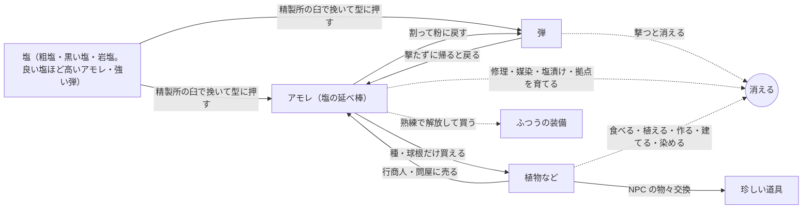

# ナメクジ脱出PvP 仕様

Nov 3, 2026 · @わく（Oct 3 に始め、Nov 3 に「いまの決まり」だけに書き直した）

雨の夜、塩を撃ち合うナメクジたちの一人称PvP脱出ゲーム。見た目はシック×ポップ、失う痛みはハード。

凡例：【決定】話し合いで確定、【仮】方向は決まったが数字などを調整する、【未決定】これから決める、保留：決めずに取っておく、見直し中：決まっていたが考え直している、案：出たがまだ採用していない。（Claude 案）はわくさんが任せて Claude が決めた叩き台。

- このファイルは**いまの決まりだけ**。前の決まり・不採用の案・古い拠点の案は `spec_history.md`、決めた理由は `discussions/`
- 決まりが変わったら、ここを書き換えて、前の形を `spec_history.md` に移す（ここに「前は〜」を残さない）
- 実装の状況と次にやることは `progress.md`、コードの数字とのずれは `tech/code_spec_gaps.md`、ほかの資料の一覧は `README.md`

---

## 1. 概要と柱

- 【決定】ジャンルは一人称のPvP脱出（エクストラクション）。自然物を採取して換金し、プレイヤー同士で奪い合う
- 【決定】カジュアル要素はなし。失う痛みが大きいほど、持ち帰る喜びも大きい
- 【仮】最終目標は Steam でオンライン。できれば Switch・PS5 も
- 【決定】一番喜ばせたい人は「友達と2〜4人で、重い荷物を持って帰るのが好きな人」（目安にとどめ、とらわれすぎない）。ソロで撃ち合いたい人は二番目。話し合い：`discussions/who_what_scope_discussion.md`
- 【決定】島づくりを一度止めて、「奪い合いは面白いか」を先に確かめる。順番は、追ってきて撃つボット1体 → 2人で同じ場所に入る（ホストする人のパソコンがサーバー）→ 友達数人。場所は灰色の島の岩塩の山のまわりだけ。「面白い」の目安：撃ち合いで逃げ切れた・倒した・隠れて見逃した、が全部起きる／撃たれていなくても重い荷物で帰るのが怖い／終わって「もう1回」と言う
- 【決定】最初の版は試合型（出撃ごとに島はまっさら。時計と天気は島の時刻のまま）。ずっと続く島（3章）は、人が集まったあとの大きな更新で。ボットだけの島（PvE）は作らない
- 【決定】最初の版から外す：ずっと続く島、島のコピー、群島、動く相場、行商人（問屋1人だけ残す）、拠点の設備（精製所と観測所だけ残す）、熟練・体を鍛える、染め、苗床。植物は3〜4種類。残す：乾きと天気と島の時計、塩の弾と経済（数字は小さく）、死んで失う、地面のバッグ、カタツムリ（ボットとして）、塩の魚（珍しい拾い物1つ、6章）
- 【決定】ネットワークは Fish-Net ＋ Steam のロビーと中継（ホストする形から専用サーバーまで同じコード。`tech/network_notes.md`）
- 【決定】開発は Unity（URP）。Claude Code ＋ Unity の MCP で進める。Built-in レンダーパイプラインは使わない

### はじめての1時間

話し合い：`discussions/first_hour_discussion.md`（agenda 2-1）

- 【仮】最初から、ほかのプレイヤーがいる島に出す。初心者用のマップは作らない（カタツムリは失う物がなく、倒しても稼ぎにならないので、ベテランに狩る理由がない。人が少ない時期に島を分けない）
- 【仮】ベースキャンプから初めて脱出できるまでは、キャンプまでの道が光る
- 【仮】最初はカタツムリで出撃する。3回までは待ち時間なし。3回出たら（帰れても倒れても数える）ナメクジが使えるようになる。カタツムリのうちも、ナメクジの友達と同じパーティで出られる。カタツムリには体の隠し場所がなく、殻がバッグの代わりなので、最初に覚える物が自然に減る
- 【仮】指さしを、エモートのような動作として足す（12章の合図）
- 【仮】パーティは一斉に帰る。生きている全員がベースキャンプにそろったら、みんな一緒に脱出する。それぞれで帰るのはなし（島は終わりがないので、パーティの帰りでメリハリを付ける）
- 【仮】倒れた仲間は待たない。生きている全員がそろえば帰れる。倒れた人も拠点で一緒にバッグを見る。一人だけ先には帰れない（抜けるとその場で丸まって眠る。キャンプで抜ければ安全）
- 【仮】全員で帰ったときの報酬は、お金や物ではなく、みんなでバッグを広げる場面そのもの（お金を付けると、倒れた一人が「みんなの報酬を潰した」と感じる）。全員が広げたあと、帳面に「今日のみんなの合計」を1行だけ出す（お金は配らない）

### ゲームの柱

1. 【決定】アイテムをゲットした高揚感、バッグが埋まっていく充足感、保持の緊張感
2. 【仮】雨に濡れた自然を、歩いて、採って、持ち帰る手触り
3. 【決定】自分らしさ。範囲（見た目だけか、戦い方も含むか）は【未決定】

柱1は「気持ち」、柱2は「世界の手触り」、柱3は「自己表現」を担う。迷ったらここに立ち返る。

---

## 2. 世界観

人類が滅んだ後の自然の中で、ナメクジたちが自分たちの文明を築いて暮らしている。

- 【決定】人類滅亡後の世界。人間の痕跡はほぼ残っていない
  - 【仮】人の物で残るのは、ガラスや塩に守られた物だけ（熱帯の雨がほかを腐らせる）。いまは海岸のボトルシップ1つ（6章の珍しい拾い物）
- 【決定】ナメクジが主役。親戚のカタツムリもいる（11章）
- 【決定】ナメクジは独自の文明を持ち、技術は人間の技術を受け継いだもの。粘液で作る魔法の道具（粘液工学）はない
- 【決定】採取の中心は自然物（作物、鉱石、自生する花、木など）
- 【決定】島は年々乾いていく。雨季が短くなり、湿った土地と資源が減るので奪い合う。ゲームとしては「自分で集めるより、集めた相手を倒す方が早い」も理由になる
- 【仮】なぜ島が乾くのかは謎のままにして、ストーリーの縦軸にする（植物の図鑑の古い名前に、なぜか海の言葉が残っている、などで少しだけ手がかりを出す）
- 【仮】雰囲気は「世界はシック、キャラはポップ」

参考：スプラトゥーン、星のカービィ ディスカバリー、ピクミン（人間が消えた後の自然）、Grounded（小さい視点での自然採取）。Rain World とは思想もグラフィックも違うので気にしない。

---

## 3. 島と区画

舞台は熱帯の群島。島はいくつかあり（最初は1つ）、どの島も試合で区切られない続いた世界で、いくつかの区画からなる。区画どうしは地続きで、歩いて行き来できる。島と島の間は拠点を通る。拠点（10章）から島へ出撃し、その島の自分のベースキャンプから帰る。最初の島の地図：`island_map.svg`（わくさんの絵は `island_sketch.webp`）。灰色の島（IslandTest_800）の作り方と測った値は `tech/island_test_notes.md`。

この章の道のりの時間（端から端まで約13分など）は、前の体の速さ（1.2 m/s）で測った。2本足（いまのコードの初めの値 1.6 m/s）なら、およそ 3/4 になる。

### 島のつくり

- 【決定】島全体を1つの続いた世界にする（試合で区切らない。最初の版は試合型で始める、1章）。天気と昼夜と湿り気がペースを作り、制限時間はない。大干ばつ（ワイプ）で島がリセットされる。話し合い：`discussions/persistent_island_discussion.md`
- 【決定】群島。1つの島は 800 m 四方くらい（端から端まで軽くて約13分、雨カブでいっぱいで約16分。索敵しながら歩くのが楽しい広さ）。島の中はシームレス、島と島の間は拠点を通る（島の間の海がメリハリになる）。島の数は最初1つ、あとから足す。話し合い：`discussions/archipelago_discussion.md`
- 【決定】小さくて深く：ゼルダの「三角形の法則」（丘や山の向こうが隠れ、登ると次の目印が見える）を島の小ささに合わせて使う。目安は、歩いて1分ごとに新しい物が見える密度
- 【決定】島ごとに性格を変える（色違いにしない。1つの島に2〜3の性格）。天気は全部の島で共通の時計。高い島が雨雲をさえぎって、隣の低い島が乾く（ハワイのカウアイとニイハウ）。どの島からも海の向こうに隣の島が見える（借景）
- 【決定】最初の島は、今の地図（岩塩の山、溶岩原、砂漠、森、花の草原の全部入り）を 800 m にしたもの（`discussions/island_height_discussion.md`）。2つ目からは性格を偏らせる（雨陰の乾いた島、若い火山の島、珊瑚の低い島など）。案：大潮のときだけ歩いて渡れる小島（珍しい物が採れる）
- 【決定】区画は5つ。山を囲む輪：真ん中に岩塩の洞窟の山（一番稼げて一番危ない）、東に雨の森、西に砂漠（低い砂丘の砂漠と、山寄りの赤い台地・岩山。台地を枯れた谷が割る。南は低い土地で、川の行き止まりに塩田）、北に黒い溶岩原（冷えた火口の丘と溶岩の流れ。溶岩洞が主役の近距離）、南は森の続きと花の草原（低い土地。稼ぎは少ないが静か。夜だけ咲く花などで、たまに人が来る理由を作る）。真ん中の山が雨雲をさえぎるので、東は雨、西は晴れ（雨陰）。話し合い：`discussions/regions_discussion.md`
- 【決定】島の形はわくさんの絵：真ん中の岩塩の山がどの区画とも陸でつながる。区画の広さは絵の比率（森（東と南）と砂漠が約3割ずつ、岩塩の山が約2割、溶岩原が約1.5割、花の草原が1割弱）。島のまわりの海は塩水で、入ると傷む（体力が減る。ナメクジは塩で溶ける）。泳いで遠くへは行けない（島の端）
- 【決定】川は2本。東の川：溶岩原のふちの泉（森に降った雨が溶岩に染み込んで、ふちから湧く）→ 森 → 東の海。南の川：岩塩の山の南の中腹の平場にある、たまり池（雨水がたまる）→ 滝 → 花の草原の北 → 低い土地を西へ → 塩田で干上がる（海へ抜けない行き止まり）。溶岩原の上には川がない（溶岩は水を吸う）
  - 【仮】形は本物の小川に寄せる：平らな所ほど蛇行し、下流ほど広く深い。川床はいつも下流へ下がり、盛り上がった所は削って小さな谷、急に下がる所は早瀬と滝。曲がりの外側は削れた急な岸と淵、内側は砂利の州。東の川は森の浅瀬で広く浅く、河口で広がる。南の川は塩田で薄く広がって消える
  - 【仮】滝：たまり池から 16 m 下流で 12 m 落ちる。滝つぼは直径 15 m の丸い岩の壁で、下流へ短い峡谷。滝の真後ろに岩棚（水際から 1.8 m 上、奥行き 3 m）があり、西の壁沿いの崩れた坂から上がれる。滝の裏はしぶきでいつも濡れている
- 【決定】**枯れた谷**は、赤い台地（高さ 50 m）を東西に割る短い谷（西の海岸から 200〜350 m）。谷底は西の口（約 9 m）から奥へ 6 m だけ上り、深さは 40〜45 m。西の口で低い砂漠へ開き、山側の奥は涸れ滝の行き止まり（壁に塩が白く吹いて、山の中が塩だと分かる）。奥の北東の脇の谷から台地の上へ登れる裏口がある。昔は川が山から西へ流れて台地を削った。低い南へ流れる沢が山の近くで川を奪い（河川争奪）、今は南の川になって、谷には水が流れていない。谷の中は曲がり角2つと石橋で景色が3回変わる
  - 【仮】本物の砂岩の谷の形にする：壁は地層の段（下から、崖から落ちた岩のすそ、下の崖、岩棚、柔らかい岩の斜面、細い岩棚、上の硬い崖）で、両側とも同じ層が並ぶ。谷底は砂で、涸れ川の筋がうねる。谷は蛇行して、ふくらむ所（岩の窪み）と細る所があり、奥ほど細い。脇の短い谷が3本、壁の高い所で終わる。ところどころ壁が崩れて坂になり、谷から登れる。口から砂漠へ扇状地が広がる。壁は赤と白っぽい縞
  - 案：大雨が続くと、南の川からあふれた水が昔の谷にも流れ込む（天気で変わる地形）
- 【決定】高さ（わくさんが図で調整）：岩塩の山 113 m（すその広がり 190 m、北は少し急）、低い土地・花の草原・砂漠 8 m（砂丘 3 m）、塩田 1〜2 m、赤い台地 50 m、枯れた谷の底 9〜17 m、火口の丘の縁 55 m（火口の底 40 m）、溶岩原 11 m（海の崖 8 m）、山と火口の丘の鞍部 34 m、森のうねり 12 m。区画どうしの高さの差を小さくして島をひと続きの地面に見せ、雄大さは山と枯れた谷と火口の丘に絞る
- 【決定】山には平場（高さ 19 m ごと、1段の 3 割が平ら、所々にまとまって）。斜面が続きすぎないように、休める所、湧き水、見晴らし、キャンプの場所にする
- 【仮】塩の流れが島の筋書き：岩塩の山の塩が雨で溶け、南の川で運ばれ、低い土地の行き止まりで水が蒸発して粗塩の塩田になる（死海・デスバレーと同じ）。手本はカウアイ島（雨の多い真ん中の山、乾いた西、川が削ったワイメア渓谷）。冷えた火口の丘の切れ目から、溶岩原の下を通って海へ溶岩洞が延びる（天窓が3つ）
- 【仮】気候は熱帯のサバナ気候のイメージ。貿易風で風上側（東）は雨が多く沢と森、風下側（西）は乾いて砂漠。山や洞窟には岩塩と鉱石。地形で地点ごとの天気と資源が決まる（参考：ハワイ島）
- 【決定】滝は区画にせず、名所にする（区画の中の山場で、マップを覚える手がかり）。倒木、マングローブ、霧なども名所に回す
- 【決定】区画ごとに目印になる大きな物を1つ：雨の森は大ガジュマル、岩塩の山は山そのもの、溶岩原は火口の丘、砂漠は赤い台地と枯れた谷、花の草原は菌輪。開けた区画でも 15〜30 m おきに隠れる物を置く
- 【決定】雨の森の目印は**大ガジュマル**（嵐の実の木）。高さ 40 m、傘の差し渡し 80 m の傘の形で、遠くからは森の上に広がる傘に見える。垂れた根が地面に刺さって柱になり、木の下は柱の林（3〜5 m おき。物陰だらけで、近い距離の戦いの場所）。根は曲がった管なのでコードで並べる。形はモデル票 `modeling/big_banyan.md`、話し合い：`discussions/forest_landmark_discussion.md`
  - 【決定】斜めの根や枝の付け根を伝って、島を見渡すてっぺんまで登れる。登る道は3本（約 120° ずつ離す）、てっぺんは葉の上に出る見晴らし台（開けていて、見られもする）。木の上を渡り歩く道や、上での採取はなし。降りるのは根を滑り降りて速い。東の川は木の下を通さない
  - 【決定】嵐の実は大ガジュマルだけに落ちる。大雨の間は枝になった実が見えていて、落ちてから拾う
  - 【決定】木の下は、晴れの昼でも日陰で乾きにくい（森の安全地帯。そのぶん人も集まる）
- 【決定】花の草原の目印は**菌輪（妖精の輪）**：草原の真ん中に直径 60〜80 m のキノコの輪。キノコの菌が地下で輪に広がり、輪の上だけ草の色が濃い（本当にある現象）。山や台地から見下ろすと輪が見えて、だいたいの位置が分かる。キノコは草より少し低いので草原の中からは見えず、足元にキノコが見えたら輪の上にいると分かる。話し合い：`discussions/meadow_landmark_discussion.md`
  - 【決定】輪のキノコはウゴタケとは別の種類で、採れる（採っても輪の草の色は残る）。名前、値打ち、生える条件は【未決定】
  - 【決定】ツキシロは輪の上に咲く。満月の夜は、かすかに光るツキシロが輪の形に点々と並ぶ
- 【決定】区画を増やすときは、天気や季節で開く区画にする（枯れ川は乾季だけ、海岸の磯は大潮のときだけ、霧の高原は霧の朝だけ、など）
- 【決定】区画どうしは天気と水でつながる。上流（山や森）で大雨が降ると、遅れて下流の川が増水する。川の水位も時刻から計算する
- 【決定】大干ばつのたびに、地形は同じまま、採取場とキャンプを建てられる場所の配置だけ少し変わる
- 【未決定】縦に重なる区画（岩塩の洞窟の山を何層にも）。50° まで登れるのと合わせて考える
- 【未決定】島に建物を置くか（近い距離の上下、呼び名、屋根の日陰）。置くなら昔のナメクジの物（東屋・高床の小屋、または枯れた谷の崖の村）。話し合い：`discussions/buildings_discussion.md`
- 【未決定】将来、有志の島（プレイヤーが立てるサーバー、進行は島ごと）を用意するか

### 区画の境目と道

- 【決定】区画どうしはどこでも越えられる。崖は短いものをときどき（長さ 40〜60 m、高さ 5〜15 m。横へ回れば 30 秒）で、通せんぼではなく隠れる場所と目印。大きい崖は北の海（火口の丘の西の裾が海に削られた崖）と枯れた谷だけ。話し合い：`discussions/island_height_discussion.md`
- 【決定】山へは、濡れた東と南からは楽、乾いた西と溶岩の北からは少し急（雨陰がそのまま近づきやすさになる）
- 【仮】動線：区画の中は自由に歩ける。区画の間と山の上に「門」（2〜4本、種類を変える）。岩塩の山の上の方（62〜88 m）を崖の帯で囲み、**尾根4本**（北：鞍部と火口の丘から、東：森から、南：たまり池から、西：赤い台地から。幅 10 m くらい、約 33°）だけが帯を抜けて山頂の頭（112 m）へ。帯の下に**肩**（幅 25 m くらい、62 m）と、山をひと回りする**肩の道**（南西は谷の頭を石橋で渡る）。通りは3段：山を越える（尾根。速いが見られる）、肩を回る、低い所を大回り（遅いが隠れる）。枯れた谷の奥には台地の上へ登れる裏口があり、行き止まりは北の黒い砂の浜だけ。話し合い：`discussions/island_flow_discussion.md`
- 【仮】（Nov 4 わくさん。ケルン風）岩塩の山は**高さ＝掛け金**：いい物ほど高い所にあり、高いほど帰り道が長い。形は**わくさんが手で直す**（Nov 4「全部なし。おれが手で修正できるようにしてほしい」）：コードで作った段の山はやめて前の山に戻し、地形のブラシと、手で置く部品（坂の道・踊り場・よじ登る段・壁の岩）で直す。めざす形は、ごつごつした地形に横に歩ける道と、ときどき上へ行ける道（坂の道とよじ登る段）。にせの山頂はあり、キレットはいったん外す。部品と置き方：`ideas/cairn_terrain_ideas.md` の13章。下調べ：`ideas/mountain_other_games.md`
- 【決定】雨の日でも登れる角度は変えない（崖の帯は尾根からだけ）。山頂に採れる物（岩塩）を置く。滝の裏の奥は岩塩の洞窟の入口
- 【決定】洞窟は大きくしない：出入り口2つ、中は少しごつごつした半球の部屋。岩塩の洞窟は滝の裏の岩棚から入り、東の斜面へ抜ける
- 【仮】溶岩原の海岸は波にえぐられた崖で、崖の下に波食台（海から 1 m くらい、幅 6 m くらい）。溶岩洞は流れの下を通り、陸からは火口の切れ目の崩落口と、天窓の1つ（崩れた岩の山）から出入りできる。ほかの天窓は飛び降りるだけ
- 【決定】溶岩洞の海の側は**入江**1つ。場所は東の海の崖（なめらか溶岩の流れが海に落ちる所、溶岩洞の終点）。天井のない細い湾に海が入り、まわりを岩棚（波食台と同じ高さ）が馬てい形に囲んで、口で外の波食台に南北へつながる。奥から上る通路2本（天井のある洞窟の通路。溶岩洞で火口へ、南のキプカのふちの落ち穴へ）。湾の奥の水の真上に天窓があり（そのために湾の奥の数 m だけ天井を残す）、飛び降りれば近道だが塩水に落ちる。しぶきが乾いて岩棚の壁に黒い塩が育つ（海沿いを一周する動機）。【仮】湾は幅 約18 m・奥行き 約22 m・水深 2.5 m、岩棚 幅 4.5 m。天窓は半径 3.4 m、水から上がれるのは天窓の下のゆるい所だけ
- 【未決定】島の外周（海沿い、約 2.1 km、軽くて 30 分）をひと回りしたくなる動機
- 【仮】道は2種類：整備された道（昔の塩運びの道。つづら折りで坂は 15° まで。迷わないが、開けていて人と出会う）と、けものみち（細い近道。40° までの急な所もある。見つかりにくい）。道を歩いても速さは同じ（坂がゆるくて迷わないだけ）。15° を超えない所だけを通る道を探すと、山ではひとりでにつづら折りになる（灰色の島に道3本とけものみち5本）
- 【仮】境目の様子：

| 境目 | 様子 |
| --- | --- |
| 山と砂漠・赤い台地（西） | 台地の東の端が山のすそに乗る |
| 赤い台地と砂漠・塩田 | 台地と岩山の壁は谷と同じ地層の崖（崖下に岩のすそ）。ところどころ崩れて坂になっていて、そこから登れる（必ずある所が3か所：北西の角、南、北） |
| 枯れた谷（北と南） | 谷の両側の 40〜45 m の崖。西の口から谷底へは平らに入れる。天然の石橋 |
| 山と溶岩原（北） | 火口の丘と山の間の鞍部（34 m）。溶岩流のふち（3〜8 m）がときどきの崖 |
| 溶岩原の北の海岸 | 8 m の低い崖。黒い砂の浜が1か所（北の玄関）。火口の丘の西の裾は高い海の崖 |
| 山と森（東）、山と草原（南） | ゆるい。南の中腹の平場から滝 |
| 森を南北に | 東の川（浅瀬。大雨で増水すると渡れない） |
| 溶岩原と森、森と草原、砂漠と草原 | ゆるい（古い溶岩に森が戻った所、草地から林へ） |

### 見え方（ゼルダの三角）

- 【決定】ナメクジの目の高さ（0.47 m）は人の約 1/3.6。砂丘 1〜3 m は人の 4〜11 m の丘、赤い台地 50 m は 180 m の岩山、山 113 m は 400 m の山に感じる。中くらいの三角は 2〜5 m で足りる
- 【決定】大きい三角は4つで、地図の代わりにする（地図とコンパスは拠点だけ）。シルエットをはっきり変える：岩塩の山（真ん中。段のある白い山、南の中腹から滝）、火口の丘（北。黒い左右対称の円すいで、東北東だけ欠けている）、赤い台地（西。てっぺんが平らな赤い箱と岩山）、大ガジュマル（東。森の上に突き出る木）。低い土地のどこからでも、どれか1つは見える（森の中は川の上でだけ空が開ける）
- 【決定】中くらいの三角（2〜12 m）を 50〜100 m ごと（砂丘の背、岩山、森のうねり、溶岩流のふち、平場のふち、谷の曲がり角）、小さい三角（0.5〜1.5 m）を 15〜30 m ごと（岩、倒木、草むら、ごつごつ溶岩）。森は木と下草で 6〜11 m ごと、草原は草むらで 6 m ごと、塩田は真ん中の大岩1つだけ
- 【決定】地面に沿った見通し：森 20〜40 m、砂漠・溶岩原・草原 60〜120 m、塩田と台地の上は開けている（危ない場所）、山頂は全部
- 【決定】珍しい物は中くらいの三角の陰に置く（大きい三角のてっぺんからまっすぐ見えない所）。景色が開ける場所（中腹のたまり池、石橋、台地のふち、山頂、火口の縁）は、そこへ行くまで前が見えない道にする（隠してから見せる）
- 【決定】山の平場のふちは凸にして、上の段から下の坂の人が見えないようにする。山頂からは島が全部見えるが、遠くのナメクジは点にしか見えず、見えるのは気配（雨雲、足跡のぬめりの光、焚き火の煙、群れの動き）まで。山頂は偵察の場所で、狙撃の場所ではない
- 【決定】黒い溶岩原：火口の丘（縁 55 m、斜面 30〜33° でどこからでも登れる、火口は幅 70 m・深さ 15 m、東北東の切れ目から平らなまま中へ入れる）から、溶岩の流れ3本が海と森へ（厚さ 3〜8 m）。ごつごつ溶岩（アア。隠れやすく遅い）と、なめらか溶岩（パホイホイ。見通しがいいだけで速さは同じ）。流れの間に古い森の島（キプカ）。なめらか溶岩の下に溶岩洞、天窓3つ
- 地点ごとの景色（塩田、砂漠、枯れた谷、台地の上、花の草原、たまり池、山の段々、雨の森、溶岩原）：`discussions/island_height_discussion.md` の3章

### 大きさと地形

- 【決定】世界は普通の大きさ（ナメクジにとって等身大）。巨大な自然にすると天気予報が破綻するため。ばかでかい木や岩を置くのはあり（目印・遮蔽・日陰）
- 【決定】雄大さは広さではなく高さと見晴らしで作る（グランドキャニオン、ヴィクトリアの滝の規模感）。体高 0.5 m のナメクジには深さ 40〜50 m の谷でも体高の約 90 倍（枯れた谷は 45 m）。遊べる範囲が小さくても、隣の区画の山や滝が遠くに見える（借景）。谷は低密度で縦、森は高密度。話し合い：`discussions/grand_nature_discussion.md`
- 【決定】ナメクジは 50° くらいまでの斜面を歩いて登れる（足の裏が吸いつく）。それより急な所はずり落ちて登れない。段差は頭の高さ（0.45 m）まで、手と足でよじ登れる。ほとんどの崖は Unity の地形（Terrain）で作れる。モデルが要るのは洞窟、溶岩洞、石橋、滝の裏の岩棚
- 【決定】川に乗れる。生身で入って流される（舟や流木は使わない）
  - 【仮】岸や浅瀬から入ると流れに運ばれる。ふつうは歩く速さの1.5〜2倍、大雨のあとの増水で3倍くらい。左右に少し寄れるが、上流へは進めない
  - 【仮】水の中は湿り気が満タンに戻る。流されている間は道具を使えない（手で水をかく）。速いけれど、川岸から狙われる読まれる逃げ道
  - 【仮】上がれるのは浅瀬、よどみ、岸のゆるい所だけ。増水するとよどみが減る。南の川はそのまま流れると塩田に出る（塩の上なので乾く）。東の川の河口は海（塩水）なので、手前で上がらないと危ない
  - 【仮】バッグの塩は水で溶けない
- 【決定】砂漠の大きさはそのまま。晴れの昼でも渡れるように、乾く速さを調整する（晴れの昼の日なたの砂で5分で乾ききり、砂漠を横切るのは軽くて約8分。4章の表）
- 【決定】名所の間はコードで並べ、生成した物は固定して人が直す。地形の侵食はまず Unity 上（コード）で作り、Unity で微調整する。どうしても完成度が足りなければ Gaea に切り替える
- 【仮】地形は島全体の高さを1枚で作る（高さ → 侵食の計算 → 風と高さから雨の地図 → 森と砂漠の境目）。描くときは 250〜500 m の四角に分け、遠くは荒い形で描く
- 【仮】地形は現実の決まりに合わせる（砂丘は風向きに沿って並ぶ三日月形、塩田は六角形のひび割れ、谷は地層ごとの段々）

### 出撃と帰還

- 【決定】出撃＝拠点から島へ出る（鳥の籠で運ばれ、自分のベースキャンプから出る）。脱出＝自分のベースキャンプから拠点に帰る（モンハンワールドのようなベースキャンプ）。帰るまで持ち物は確定しない。行きと帰りのキャンプが違っていい
- 【決定】ベースキャンプの役割は出撃と帰還だけ（装備を替える・治すのは拠点）。島に2つまで（区画ごとではない）。最初は自分で選んだ2か所。そのあと、出撃中にキャンプを建てられそうな場所を見つけ、その区画の材料だけで建てると（お金は要らない）、そこへ移せる
- 【仮】キャンプは開けた人（とパーティ）にしか見えない（ほかの人には崖の窪みなどにしか見えないので、待ち伏せが分散する）。良い場所ほど行きにくい（崖の中腹、滝の裏、塩田の真ん中の大岩の上）
- 【未決定】最初に選べる場所と、あとで建てられる場所の数・置き方（島を一度作ってから決める。必ず通る場所の近くに集めない。滝の裏は岩塩の洞窟の入口でよく人が通るので、良い場所の例から外すか。agenda 3-4）
- 【決定】島で抜けると、その場で丸まって眠る。眠っている間は撃たれうる。眠る時間は 10 分くらいから試す。ベースキャンプで抜ければ安全

### 人数とサーバー

- 【決定】島1つ＝1つのサーバー。人が多いときは島ごとコピーを増やし、少ないときは減らして人を集める。コピーは自分で選べず、空いている所に入る。区画の境目でサーバーを渡す仕組みは作らない
- 【仮】1つの島に 12〜18 人（800 m の島で、歩いて5分の範囲にいつも数人いるくらい。遊んで決める）、パーティは4人まで、1回の出撃の長さは遊んで決める
- 【決定】ソロとパーティは同じ島に入る（島を分けない）
- 【仮】サーバーの節約：誰もいない場所は眠らせ、入ったときに時刻から天気と資源を計算して起こす
- 【決定】採取場で覚えるのは、生える場所ごとの「最後に摘まれた時刻」と、根ごと掘られた場所の「掘られた季節の番号」だけ。季節が変われば計算でもう生えている（リセットの作業なし）
- 見直し中：珍しい花の記録は島のコピーごと（人が増えれば花も増える）。コピーの渡り歩きは、珍しい花の咲く時間を短くして防ぐ（帰って出直すと間に合わない）。`discussions/plant_uses_discussion.md`
- 【仮】人の多さが読める（足跡、音、雨の強さ、予報）。区画ごとに稼ぎと危なさが違い、静かな区画もある。人の偏り（混む山、静かな草原）はそのまま遊びにする

---

## 4. 天気・時間・湿り気

雨雲の下が安全地帯で、その雲が風で流れていく。Fortnite のストームの逆。

### 天気と季節

- 【決定】雨雲は風に流されて島の上を動く。動き方は雲の大きさと風の強さで変わる。砂漠の上では消えやすい（乾いた空気）。風は島の空気感の柱でもある（雲、ヤシの葉、草が同じ風で動く）
- 【決定】天気予報は全員共通（地点と時間ごとに晴れ・曇り・雨）。天気は島全体の共通の時計で動き、時刻から計算できる。出撃前に予報を見られ、細かさは拠点の観測所で順に開く（10章）。【仮】予報は外れることもある
- 【仮】天気ごとに稼ぎと危なさが入れ替わる。雨は乾かず足音が消え、植物が育つ（近い戦い）。晴れは塩が浮いて取り放題、遠くまで見えて狙撃が強いが、水と日陰が要り、足音が響く。晴れで塩を稼いで雨で使う流れ
- 【決定】植物などの資源は雨で回復する。塩は逆に雨で流され、乾くと回復する
- 【決定】晴れの日は、巨大な木と岩の影が安全地帯。影は太陽と一緒に動く。影の中でも少しずつ乾くので、居座りは弱い
- 【決定】夜は露で乾きにくい（塩の上は別で、夜でも厳しい）
- 【決定】日なたは光の筋で強く伝える（乾きと倒れる原因に直結するから）。光は島の中にだけ出す（画面には出さない。視界の邪魔になるから）。晴れの昼に、日なたの地面から太陽へ向かって細く薄い光の筋が立つ（影のふちに多い、塩の上は明るい、濡れた地面には立たない、みんなに見える）ので、どこが日なたか遠くから分かる。曇り・朝夕・夜は出さない（筋が出ていたら危ない、の1つの意味）
- 【決定】**ぬめり跡は足跡**。ほかのナメクジ（自分も）の足跡は、人がいた手がかりになる（向きも分かる）。晴れると早く乾いて消え、雨の日は長く残る。足跡に乗っても速くならない。【仮】地面の種類で残り方が変わる。作るのは地形ができあがってから
- 【仮】雲の端が自然と戦場になる。大雨の場所では足音が雨音に消える
- 【仮】雨の強さでマップの明度・彩度が変わる。大雨では鮮やかな色ほど目立ち、晴れ間の花畑ではカラフルな方が溶け込む。予報を見て着ていく色を決める。作り方の話し合い：`discussions/rain_color_discussion.md`
- 【決定】数週間ごとに雨季と乾季が切り替わる。全員に平等に起きるので、ワイプ直後に張り付く人が有利になりすぎない。【仮】1シーズン10週で二周する：大雨季3週 → 乾季2週 → 雨季2週 → 大乾季3週（10章のシーズン）
- 【仮】乾季は塩が豊富だが、雨が少なく地上にいられる時間が短い。雨季はその逆

### 島の時計

- 【決定】島の1日は現実の9.5時間。毎日同じ時刻に入ると島の時刻が約半日ずつずれて、毎日同じ1時間だけ遊ぶ人も 19 日で全部の時間帯を回る。夜が長いので、時間帯を狙った計画が立つ。話し合い：`discussions/island_clock_discussion.md`
- 【決定】朝焼け・夕焼けの時間は変えない（短いから感動が大きい）
- 【決定】月と潮の時計を、太陽の時計とは別に持つ。周期をずらして、「満月の夜」「大潮」がたまにだけ来る。（Claude 案）月は現実の 72 時間（3日）で一周。島の1日では割り切れないので、満月が島の何時ごろに来るかは毎回ずれて、満月の夜はおよそ3日に1回、たまに来る。潮で海辺や河口の地形（渡れる・渡れない）が変わる
- 【決定】季節で昼と夜の長さを変える（乾季は昼が長い、雨季は夜が長い。大干ばつの前が一番昼が長い）
- 【決定】夜でも採取できる明るさにする
- 案：島の時刻と予報を、ゲームの外（Web、スマホ、Discord）でも見られる

### 湿り気

乾きは「体の湿り気」。晴れると減り、水・日陰・雨・夜の露で戻り、ゼロで削れ始める（晴れ＝ゲームオーバーにはしない）。話し合い：`discussions/map_discussion_2.md`、`moisture_discussion.md`、`moisture_readability_discussion.md`、`friend_playtest_discussion.md`

- 【決定】湿り気は 0〜100。出撃は 100 で出る。雨と水場では 120 までためられ、100 を超えた分は1分に 5 ずつ抜ける
- 【決定】乾き方は**足元の地面**で決める。覚えるルールは1つ：光って濡れて見える地面は乾かない、ツヤのない乾いた地面は乾く、真っ白な塩はとても乾く。影は乾きにくい。地面の見た目と体の乾き方は同じ式から出す（ずれない）。地面の種類は地形のレイヤーに持たせる（新しく塗る物は増やさない）。雨のあとは地面が濡れて光り、日なたから先に乾いて元の種類に戻る（雨上がりに、日陰だけ暗く濡れて残る）
- 【仮】1分あたり（曇りは影と同じ。砂漠の渡りやすさは砂の行で決める）：

| 足元 | 晴れの昼・日なた | 影・曇り | 夜 |
| --- | --- | --- | --- |
| 濡れて光る（濡れた苔、泥、しぶき、雨上がりの地面） | +10 | +10 | +10 |
| 土・草 | −12（約8分） | −3 | 0 |
| 砂・黒い溶岩 | −20（5分） | −4 | 0 |
| 塩（塩田、岩塩の洞窟） | −40 | −8 | −25（夜でも塩は体の水を吸う） |

  雨は上に足す（小雨 +20、大雨 +50。塩の上では雨の戻りが半分）。水に触れる（水たまり・沢・濡れた苔）と1秒に +10。雨上がりに濡れて光っている時間：日なたで砂 約5分、土 約20分、影はその4倍
- 【決定】0 になると歩く速さ ×0.8、体力が減り始める（満タンから約90秒で倒れる）。湿り気と体力は別
- 【決定】見せ方：ゲージは足さない（最初の数回だけの線もなし）。段を4つにはっきり分ける：つやつや（100 超え。ふくらんでピカピカ）／ふつう／乾いてきた（30 未満。つやが消え、色がくすみ、少し縮む）／危ない（12 未満。しわしわ、画面の端がぼやける）。自分にも相手にも見える。能力が変わるのは 0 のときだけ。**縮むのは乾きだけ**（撃たれて縮むのは一瞬の反射だけ、8章）
- 【決定】乾いている最中は、日の当たる側の体（頭・外套膜・脇腹。背中はバッグの下）から先にツヤが消えて**乾いたまだら**が広がる（湯気は出さない）。速さは地面で、量は体で見せる（速さのための表示は増やさない）。一人称のままでよい：自分には左上の体で見え、相手には一人称でそのまま見える
- 【決定】変わった瞬間に1回だけ知らせる（自分が気づく一番の合図は音と触角の動き）：4つの段を越えた瞬間。日なたに出る・塩に乗ると「ジュッ」と触角がきゅっと縮む、濡れた所に入ると「ぬちゃっ」と体がふわっと伸びる
- 【決定】歩く音の質が湿り気で変わる（湿った「ぺた」→ 乾いた「かさ」。相手にも聞こえる）。左上の体の後ろに足跡を描き、足跡の列の長さが湿り気（細い線の代わり）
- 【決定】遠くからは、乾いた地面の上だけ陽炎が立つ（晴れの昼）
- 【決定】水の苔玉：胸のベストに2つまで。1つで +40、使うのに2秒（撃てない）、手を通さずに使う（【仮】口で飲む）。水場に触れたまま3秒で浸し直す。仲間にも使える。落ちている苔玉は、ベストに足りなくて近くにあれば、操作しなくても手が伸びてしまう。両手で銃などを持っていたら、3本目の手がわき腹のあたりから出て拾う
- 案：寄り添うと減りが遅くなる。乾いていると足跡が薄くなる

---

## 5. キャラクター

プレイヤーは2本足で歩くナメクジ。伸びる腕で物を扱う。経緯と今の値は `character/`（2本足の体で変わる所は `character/dino_slug_impact.md`）。

### 体

- 【決定】2本足で立って歩く体：丸い頭、前に傾いた胴、長い尾、短い腕、にっこりした口、小さな黒い目、苔色。足の裏だけナメクジ（ぺたっと吸いつく）。気持ち悪く見えないことが最重要。形は `Assets/Slug/Scripts/Editor/DinoSlugPhotoRough.cs`
- 【決定】目の高さは 0.47 m（人の約 1/3.6）。島・拠点の大きさと一人称のカメラは、この高さで決めている
- 【決定】触角は耳。目は顔につく
- 【決定】腕は伸びる腕（付け根は肩）。道具を使う・物を持つ・バッグに入れる・背中から取るは、どれも伸びる腕。道具を持たないときは短い腕のまま
- 【決定】ナメクジはいつも手袋をしている（塩をつかめる。6章）
- 【仮】触角だけ物陰から出して聞き耳を立てられる。触角を撃たれると耳が遠くなる
- 【決定】カタツムリも同じ2本足の体で、背中から殻が生えている（11章）
- 【仮】作り方：形は数式（Unity のコード）で作り、テクスチャは描かずシェーダー（`Slug/Toon`）で色と模様をパラメータで変える。2本足の体は骨で動かす（形の作り方はそのままで、どの部品に近いかで骨に付ける）
- 【未決定】輪郭線・陰影の最終値、左上の小さな体表示での見え方

### 動き

- 【決定】ふだんの移動は2本足で歩く。【仮】歩く速さは 1.6 m/s くらい（`SlugMoveSettings.footSpeed`。わくさんが遊びながら直す）
- 【決定】**走る**（Nov 3）：Shift 長押し（パッドは左スティックの押し込み）で前へ 2.4 m/s（歩きの 1.5 倍、`SlugMoveSettings.runMultiplier`。乾き・バッグの重さで遅くなるのは歩きと同じ）。約 0.23 秒に1回足が着く大股（1歩 約 55 cm、人なら約 2 m）で、両足が浮く間がある。腰ごと前へ倒れ、尾はまっすぐ後ろへ伸びる（目の高さは 0.33 m に下がる）。【仮】続けて走れるのは5秒くらい。止まるか歩くと1秒後から戻る（空から3秒で満タン）。尽きると息が切れて歩きに戻り（肩で息をして、触角が垂れる）、満タンに戻るまで走れない（Nov 5）。数字も棒も出さず、尽きかけると画面の端が少し暗くなる。覗いている間・伏せ・よじ登りでは走らない。走りながら跳ぶと、走りの速さのまま跳ぶ。ボットは走らない
- 【決定】滑るのはなし：止まるときの滑りも、跳んだあとの着地の滑りも、伏せたまま斜面を腹ですべるのもなし。ぴたっと止まる
- 【決定】**しゃがんで跳ぶ**（スペース）：押すたびに少し溜めて（長押しで溜めない）、ひざを曲げてしゃがみ、胴と尾ごと前へ「びよーん」と跳ぶ。続けると歩くより少し速い。移動中は跳ねながら少し弾をよけ、撃ち合いでは射線から外れる。移動中の暇つぶしにもなる（フォートナイトやエーペックスのしゃがみ・ジャンプと同じ役）。かわりに縮む・伸びる音が鳴る。話し合い：`discussions/movement_discussion.md`
- 【仮】伏せは腹ばい。段差は手と足でよじ登る。尾は遅れてついてきて、切り返しで外へ振られ、壁では曲がる
- 【仮】**はしご**（Nov 5 わくさん「岩に掛けたはしご」）：岩に立てかけたはしごに向かって歩くと上る。岩のほうへ押すと上り、離れるほうへ押すと下りる（何も押さなければ止まる）。速さは 1.2 m/s（`SlugMoveSettings.ladderSpeed`）。てっぺんで台に乗り移り、台の縁からはしごのほうへ歩き出すと下りる。上り下りの間は銃も道具も使えない（よじ登りと同じ）ので、狙われやすい。崖の桟道・橋・はしごの置き方は `tech/island_walk_map.md`
- 【決定】よく使う動き・とっさの動きは6〜7個まで（Switch のコントローラーをふつうに持って指が届くのは L・R・ZL・ZR・左右のスティックの押し込みの6つ。うまい人はモンハン持ちで十字キーとボタンも使う）

### 見た目と自分らしさ

- 【決定】キャラ本体（種族・見た目）は死んでも失わない。大干ばつでは全部失うが、体の色だけは着ている色1つが越す（10章）
- 【決定】カスタム範囲は、銃・ヘルメット・アーマー・バッグ・体の色・体の模様（模様は育ちで開く。10章）
- 【決定】スキン（持ち主の見た目設定）はなし。見た目は体の色（ゲームの中で染める）と、拾って使う装備そのもの
- 【仮】値段は買い切りで 1,000円前後。Steam の4本セットも付ける。基本無料＋スキンはしない（見た目＝情報が崩れる、ずるをした人が無料で作り直せる、大干ばつで全部失うとぶつかる、一人では作り続けられない）。専用サーバーの代金が要るようになったら、拠点の中だけの飾り（島では見えない）をおまけの有料品にする逃げ道を残す。参考：めっちゃカメレオンは 790円の買い切り
- 【決定】体の色は変えられるが、コストをかける（DQMJ3 のカラーフォンデュのように）。色が変わるのは、拠点の染め場で色花を使ったときだけ：染め場で色花を食べ、島から持ち帰った土を体に塗りたくると、その色になる（見ていて面白い所。染め場では外から自分が見える）。媒染に塩を使う（10章）。倒れても色はそのまま。持ち帰る戦利品は、色そのものではなく色の材料（ウミウシには食べた物の色素で体色が変わる種類がいる）。話し合い：`discussions/body_color_wipe_discussion.md`
  - 【決定】色ごとに手に入れる難しさを変える。一度なった色は、二回目から材料が少なくて済む（この記録は大干ばつで消える）
  - 【仮】（Claude 案）色と材料：花の色＝その季節の色花だけ（やさしい）。赤土色＝色花＋枯れた谷の奥（涸れ滝の下）の赤い土。炭色＝色花＋火口の底の灰。灰白＝色花＋塩田の、川の流れ込む端の白い泥（塩の上なので乾きは2倍）。月白（かすかに光る淡い色）＝ツキシロ（満月の夜だけの幻。売れば 360 アモレなので、売るか染めるか）。はじめの苔色にも戻せる。【未決定】材料の数とかさ（例：初めては色花5本＋土3つ、二回目から色花2本＋土1つ）
  - 【決定】保護色：どの色にも、溶け込む場所と目立つ場所がある（いちばん強い色は作らない）。溶け込む色なら、見つかる距離が半分くらい（開けた草原なら 60 m → 30 m、人なら約 220 m → 約 110 m）。止まって伏せていれば、近くでも見えにくい。【仮】（Claude 案）溶け込み方は主に明るさで合わせる（色の見分けが苦手な人にも同じに効く）。真っ白はなし（体力の白い塩の跡が見えなくなるので、いちばん淡くて灰白）。はじめの苔色は森（島の約3割）で溶け込むので、はじめの人が損をしない
  - 【決定】かくれんぼの名所を作る：背景が一色で開けていて、珍しい物がある所。その色でなければ、ここでは見つかる。【仮】（Claude 案）枯れた谷の赤い縞の崖（北東の裏口の登り道。赤土色）、夜の火口の底（幅 70 m、人なら約 250 m。炭色）、満月の菌輪（ツキシロの光の輪。月白）、晴れ間の花の草原（その季節の色花の色。ツユリの1時間）
  - 【決定】ボットのカタツムリも、地面と体の色の差で見つける（ボットの「見る」に足す）

参考：R.E.P.O.（腕なしで物を扱う）、Fortnite のフィッシュスティック、城ドラのデフォルメ、ポケモンのカラナクシ。

---

## 6. 採取

叩いて採る気持ちよさと、手で摘むやさしさ。塩は重くて小さい、晴れと乾きの資源。植物は軽くてかさばる、雨と湿り気の資源。バッグを重くするのは塩、膨らませるのは植物。

### 採る手触り

- 【仮】採取は Fortnite の木・レンガ採取や Forest Hustle のような「叩いて採る」感触
- 【決定】採り方は2つ。硬い物・根・苔はピッケルで叩く。柔らかい物（花、キノコ）は手で摘む（近づいて E、0.5秒）。ピッケルで叩いても潰れない（値打ちは下がらない）
- 【決定】物はすべて手を通る：採ると1個ずつ出てきて（岩塩なら 20 cm くらい、手に持つと 30 cm くらいに見せる）、それを手でつかんで持ち、手でバッグに入れる。手に持っている間は道具を使えない（7章）
- 【決定】掘った物は叩いた人の足元に落ちる（坂の下へ転がっていかない）。E を1回押すと手に持つ。E 長押しは手に持たずにそのままバッグへ入れ、押している間は近くの物を1個 0.5 秒ずつ続けて入れる（入れている間の無防備はそのまま、押す回数を減らす）。入れた瞬間の音と、世界とつながる手応えを増やす。話し合い：`discussions/friend_playtest_discussion.md`
- 【決定】手に持つと、値打ちが体で分かる（数字や色ではなく、手の動きや小さな声など。「すごく良い」「ふつう」くらい）。手に持ったときだけ、値打ちの高い物はレア度に応じてキラキラ光る。いちばんレアでも派手すぎない（地面やバッグの中では光らない）
- 【仮】大物（大きな結晶、嵐の実など）は、ピッケルでもう一段階割って小さくできる。割らずに持ち帰ると、大きさを自慢できる・拠点の設備のいちばん上の段（S3）の材料になる（10章）。そのままならバッグが大きく膨らんで重い

### 塩

- 【決定】塩＝掘る資源・弾・お金（9章）
- 【決定】塩の産地は区画ごとに分ける
- 【仮】塩の種類（産地）で変わるのは「質」：良い塩ほど、強い弾にも、高いアモレにもなる。撃つか、貯めるかが悩みになる。一番危ない岩塩の洞窟の山の塩が一番良い

| 塩の種類（産地） | 質 | 弾にすると | アモレにすると |
| --- | --- | --- | --- |
| 粗塩（砂漠の塩田） | ふつう | 防具に弱い | 10 |
| 黒い塩（黒い溶岩原） | 良い | 防具にやや強い | 20 |
| 岩塩（岩塩の洞窟の山） | とても良い | 防具に強い | 30 |

- 【仮】重さ／かさ（雨カブ1個＝かさ 1）：岩塩 1.5／1、黒い塩 1.5／1、粗塩 1.0／1
- 【仮】岩塩の採る場所は「塩のきのこ」。塩は雨で溶け、乾くと育つので、根元（はね返りの雨と流れる水が当たる）が先に細り、乾きやすい上に塩が育ってかさが広がる。死海にも本当に塩のきのこがある
- 【仮】塩のきのこは叩く6回で岩塩3個（2回ごとに1個）。出るたびに形が「満タン → 掘りかけ → 切り株」と減り、掘りきると切り株が残る。乾いた天気が島時間2時間続くごとに一段育って戻り（切り株から満タンまで現実の約1時間35分）、雨の間は育たない（塩が戻る様子が形で見える）
- 【仮】岩塩の山に90本（山全体にならすと約 35 m に1本、人なら約 125 m。雨の東の斜面は少なく、乾いた西と洞窟の奥は多く）。島に15人なら、山へ行った1回で岩塩 12〜19 個（大雨季〜大乾季）。島じゅうの岩塩は大雨季から大乾季で約3.6倍に増える。最初の版（試合型）は、試合の始めに満タンのきのこを人数×6本にする（1人あたり約18個。残りは掘りかけか切り株。ボットは数えない）。計算：`tech/economy_bag30.py`
- 【仮】「塩だ！掘ろう！」の手がかり（見比べ中）：かさの上の立方体の結晶（冠）、欠けた割れ口から真っ白な新しい塩がのぞく、足元の欠片、柄の水位の跡の輪
- 【仮】粗塩は叩けば1個ずつすくえる（軽い、安い、たくさん）
- 【仮】掘れる量の上限は、きのこの数ではなく湿り気が決める。塩の上は2倍で乾くので、岩塩の山で掘っていられるのは苔玉込みで約20分。雨の日は長く掘れる
- 【仮】塩を扱う危険を仕組みにする（形は未決定）

### 植物

話し合い：`discussions/plants_discussion.md`、名前は `plant_names_discussion.md`、使い道は `plant_uses_discussion.md`（場所・条件・数字は Claude 案の【仮】）

- 【決定】レア度は確率ではなく条件で決まる。いつ生えるかは島の時計（天気・時刻・月・季節）から計算し、予報と図鑑を読めば狙える。どこに生えるかだけ、候補の場所から選ぶ（珍しい物は毎回候補の一部だけ）
- 【決定】レア度の段（ふつう・ときどき・まれ・幻）は作る側の目安だけ。ゲームには色や星で出さない。珍しい物は形（大きさ、花の形、かすかな光）と、手に持ったときのキラキラで分かる
- 【決定】香りで探すのはなし（画面がうるさくなる）
- 【決定】1種類ごとに「その植物だけの理由」を1つ持たせる。値段だけ違う植物は作らない。売る以外の使い道は1〜2つまで
- 【決定】ツユリとツキシロは、花だけ摘むとまた咲き、ピッケルで根ごと掘ると球根・根株（安いが傷まない、拠点の苗床に植えられる）。掘った場所には次の季節まで生えない
- 【決定】名前の決まり：ふだんの呼び名はカタカナ中心で、漢字が少し入ってもいい。3〜5音、語尾を重ねない。「いつ・どこで出会うか」か「ナメクジにとって何か」から付ける。図鑑の古い名前（人間から受け継いだ言葉）は、ストーリーに関係する物だけ（例：ヒデリベニの古い名前「サンゴソウ」。なぜ陸のナメクジが海の言葉を？）
- 【決定】食べて変わるのは湿り気と体の色だけ（数字の強化はしない）。島で使える植物は3〜4つまで：雨カブ（かじると湿り気 +15）、しぶき苔（苔玉に足すと浸し直し1回ぶん）、ベースキャンプの材料（その区画の植物）。色花は島では使わない（色が変わるのは染め場だけ、5章）
- 【仮】ふつうの植物は、採ったあと雨で戻る（島時間で合計1時間の雨、大雨なら半分）。乾季は生えている場所が半分
- 【仮】拠点での傷み方は、しおれて見せる（島では数字なし。拠点の帳面には期限が出る）。花とキノコは早い、雨カブ・ヒデリベニ・嵐の実は遅い、球根・種・根株・しぶき苔は傷まない。傷みは島の夕方に一段ずつ進む（10章）
- 【仮】図鑑には、採った場所・天気・時刻・月が自動で書かれる。まだの物は形の影とヒント1行だけ

| 名前 | 段 | 区画と場所 | 出る条件 | 採り方 | 重さ／かさ | アモレ | その植物だけの理由 |
| --- | --- | --- | --- | --- | --- | --- | --- |
| 雨カブ | ふつう | 雨の森の林床、河口・沢の岸 | いつも（雨で戻る） | ピッケル | 0.5／1 | 10 | その場でかじると湿り気 +15（2秒、撃てない） |
| ウゴタケ（雨後茸） | ときどき | 雨の森の倒木・巨大な木の根元・日陰。1か所に3〜5本 | 雨が上がって島時間2時間後に出て、日なたが2時間続くと消える | 手 | 0.15／0.4 | 1本 10 | 雨上がりの短い時間だけ。拠点ですぐしぼむ（干すと長持ち） |
| ツユリ | まれ | 花の草原、塩田のふちの湿った窪み | 大雨が止んで晴れ間が出たら島時間1時間だけ。毎回候補の3分の1 | 手／球根はピッケル | 花 0.05／0.15、球根 0.3／0.3 | 花 120、球根 40 | 晴れ間の1時間。摘むか掘るか |
| ツキシロ（月白） | 幻 | 花の草原の菌輪の上 6 か所 | 満月の夜、月が高い島時間2時間だけ（2〜3日に一度、時刻は毎回ずれる）。毎回2〜3か所。かすかに光る | 手／根株はピッケル | 0.1／0.25 | 360 | 静かな草原が満月の夜だけ取り合いになる |
| ヒデリベニ（日照り紅） | ふつう〜ときどき | 砂漠の塩田の、川の流れ込む端と割れ目 | いつも。雨季は緑、乾季が深まるほど赤い | ピッケル | 0.2／0.7 | 緑 10、赤 20 | 季節で姿が変わる。塩の上なので採るほど乾く。白い塩田の赤い目印 |
| しぶき苔 | ときどき | 滝のしぶきが届く崖、洞窟の入り口の湿った壁 | いつも。晴れが島で1日続くと縮む | ピッケル | 0.1／0.8 | 10 | 細工場でいい苔玉を作る材料。崖の高い所ほど多い |
| ヒバナ | まれ | 黒い溶岩原の割れ目、溶岩洞の天窓の下 | 溶岩原に雨が降った翌日（島時間）だけ | 手 | 0.1／0.25 | 120 | 雨陰の区画の雨を予報で読む。赤い色（染め場） |
| 色花 | ふつう | 花の草原一面、森の明るい所 | いつも。色は季節と場所で | 手 | 0.02／0.1 | ふつう 1本 2、まれな花は高く（染めるか売るかで迷える） | 染め場で食べると体の色が変わる（5章）。区画ごとに咲く花にそれぞれ名前を付け、どれも染め場で使える。名前・値打ちは【未決定】 |
| 種の房 | ときどき | 花の草原 | 乾季の後半 | 手 | 0.05／0.1 | 10 | 拠点の苗床に植える |
| 嵐の実 | まれ | 雨の森の大ガジュマルの下（この木だけ） | 大雨が島時間3時間以上続いたあと1〜2個 | 拾う（大物、ピッケルで4つに割れる） | 4.0／4.0 | 丸ごと 400、割ると 60×4 | 割らずに持ち帰ると高い（自慢・拠点の S3）。バッグが大きく膨らむ |

- 【仮】表のアモレは10倍で数えた値（9章）。重さ／かさは雨カブ＝かさ 1 の単位。珍しい物（ツユリ・ツキシロ・ヒバナ・嵐の実）でも、一番の当たりでふつうの稼ぎ1回分くらい。話し合い：`discussions/economy_bag30_discussion.md`
- 【仮】雨カブの畑は1株から1個。植わっているカブの玉がそのまま出てくる（同じ玉・同じ大きさ、叩く2回）。葉は畑では大きく、出てきたら小さい

### 珍しい拾い物

話し合い：`discussions/artifact_discussion.md`（Nov 3）

- 【決定】植物と塩のほかに、島に数個だけの珍しい拾い物を置く。高い売り物で、使っても強くならない（パワーアップはなし。10章の秘伝書なしと同じ）
- 【決定】いまは2つ。海岸の**ボトルシップ**（栓をしたガラス瓶の中の舟。人の物で、ガラスが守ったので残った）と、岩塩の洞窟の**塩に閉じこめられた海の魚**（人工物ではない。この山がかつて海だった手がかり）
- 【仮】（Claude 案）出方は条件で決まり、予報で狙える（植物と同じ）
  - ボトルシップ：風の強い大雨のあと、浜（西の海岸、溶岩原の北の黒い砂の浜など）に1つ打ち上がる。次の大雨で波にさらわれる
  - 塩の魚：洞窟の奥の塩の壁に半分埋まって見え、ピッケルで掘り出す。大雨のあと、しみた雨水で塩が溶けて顔を出し、晴れが続くと塩が育ってまた隠れる（本物の塩の洞窟も、雨水が塩を溶かしてできる）
- 【仮】（Claude 案）値段は一番の当たり（ツキシロ、嵐の実）と同じく、ふつうの稼ぎ1回分まで：ボトルシップ 350、塩の魚 400。売るのは問屋。拠点では飾り枠にも出せる（売るか飾るかで迷う）
- 【仮】（Claude 案）どちらも大きい（30 cm くらい。ナメクジの目の高さの 2/3、人なら約 1.1 m）。飲みこめないので、バッグで持ち帰る（隠し場所に入れて安全にはできない）。重さ／かさ：ボトルシップ 1.0／3、塩の魚（塩の塊ごと）2.0／3
- 【決定】最初の版に塩の魚を入れる（岩塩の山のまわりなので）。ボトルシップは本版の島から。【仮】（Claude 案）最初の版は、試合の始めに洞窟の奥の候補の1か所に出ている（天気の条件は本版から）
- 【未決定】ナメクジの言葉での名前（ナメクジは人の物の使い道を知らない）

---

## 7. バッグと持ち物

バッグが物理的に埋まっていく充足感（柱1）をそのまま形にする。拾うほどバッグが膨らみ、重くなり、遅くなり、撃たれやすくなる（**欲張りが目に見える**）。失うのは撃たれたとき（バッグが壊れる、倒れる）だけで、運や操作ミスでは失わない。持ち帰った物は、拠点でバッグを広げる瞬間に報われる。話し合い：`discussions/bag_ui_discussion.md` → `_2` → `_3` → `tool_carry_discussion.md`、`bag_full_discussion.md`

### 入れ物と、体のどこに付くか

| 入れ物 | 場所 | 中身 | 倒れたら |
| --- | --- | --- | --- |
| **バッグ** | 背中（背負い紐の枠） | 採取物も塩もごちゃまぜ。かさの上限あり | 中身ごとその場に落ちる（地面のバッグになる） |
| **体の隠し場所** | おなか（口から飲みこむ） | はじめ1つ、生きて帰るほど 2つ → 3つ。塩は入れられない | **残る**（持ち帰れる） |
| **胸のベスト** | 胸の前 | 予備の弾倉、苔玉2つ（残りの数だけ入っていて、減ると袋が空になる） | 落ちる |
| **ベルト** | 腰 | 腰の拳銃 | 落ちる |
| **背負い紐** | 背中 | 大きい銃1丁とピッケル、仲間の布（8章） | 落ちる（布は残る） |

- 【決定】保険はない。倒れて残るのは、キャラ本体と隠し場所の中身だけ
- 【決定】バッグなしで出撃することもできる。【仮】袋が壊れても、バッグなしで出撃しても、背負い紐とベルトと道具は残る（紐は壊れない）
- 【決定】予備の弾はバッグに入れない。弾は拠点で作って持ち込んだ物だけ（9章）

### 入れる物

- 【決定】物はすべて手を通る（6章）。バッグから出すときも、いったん手に持ってから、落とす・投げる・飲みこむ・入れ直すを選ぶ
- 【決定】手に物を持っている間は、道具はすべて体に戻る（撃てない・振れない）。手が空くと、持っていた道具を取り出し直す（背中の物は時間がかかる）
- 【決定】塩も採取物も同じ袋にごちゃまぜ。取り出すのは一番上から。【仮】中身は順番つきのリスト（後から入れた物が一番上）

### 操作

【決定】出撃中にできるのは **つかむ・摘む・入れる・出す・落とす・投げる・飲みこむ・覗く**、それと **バッグを地面に下ろす・背負う・交換する**。整理（並べ替え）は拠点で。インベントリ画面は作らない。キーは仮（ネットワークのときに操作の設定へ移す）。

| 操作 | 何が起きるか | キー（仮） |
| --- | --- | --- |
| つかむ | 目の前に落ちている物（採取で出てきた物、落とした物）を手に持つ | E（手が空いているとき） |
| 入れる | 手に持っている物を、右肩越しに背中のバッグへ入れる（0.5 秒） | E（手に持っているとき） |
| 手に持たずに入れる | 目の前に落ちている物を、そのまま背中のバッグへ。押している間は、近くの物を1個 0.5 秒ずつ続けて入れる | E 長押し（手が空いているとき） |
| 出す | バッグの一番上の物を、右肩越しに取り出して手に持つ（0.5 秒） | G（手が空いているとき） |
| 落とす・投げる | 手に持っている物を足元に落とす／長押しして離すと前へ投げる | G（手に持っているとき） |
| 飲みこむ | 手に持っている物を口へ運んで「ごくん」と飲みこみ、体の隠し場所へ（覗かなくてもできる）。塩は「ぺっ」と吐き出す | X（手に持っているとき） |
| 吐き出す | 最後に飲みこんだ物を「けぽっ」と手の上に出す | X（手が空いているとき） |
| 覗く | 頭を回して自分の背中のバッグを覗き込む（下の「覗く」） | Q 長押し |
| 地面に下ろす | 背中のバッグを、口を開けて目の前の地面に置く（0.8 秒、その間は遅い） | C 長押し（背負っているとき） |
| 背負う | 地面のバッグ（自分のでも、誰のでも）を中身ごと背負う（0.8 秒） | C 長押し（背中にバッグがないとき） |
| 地面のバッグに入れる・から出す | 地面のバッグのそばでは、出し入れがとても速い（0.12 秒、背中は 0.5 秒）。手の空いたときの G は近くの地面のバッグから出す。背中にバッグがないときの E は地面のバッグ（自分のを先）へ入れる | E・G |
| 交換する | 他人の地面のバッグ（倒した敵のバッグなど）のそばで、背中のバッグと交換する（1.2 秒）。自分のバッグはその場に置く | C 長押し（そのバッグのそばで） |

- 【決定】盗みはなし（背負っている他人のバッグから取る操作はない）。地面に置かれたバッグ（下ろした物、倒れたナメクジの物）は誰でも出し入れでき、背負える
- 【決定】倒した相手の荷物を移すときは、自分のバッグも横に下ろすと、出すのも入れるのも速い
- 【決定】手に持つ道具はスロット（数字キー）。【仮】持ち替えは数字キーとホイール
- 【未決定】投げた物の飛び方（案：大物ほど遠くへ飛ばない）

### 道具の置き場所

- 【決定】背中に大きめの銃1丁とピッケル、腰に拳銃（ナイフは作らない）。持てる数は絞る
- 【決定】背中の物は、右手（伸びる腕）が肩越しに回って取り、留め具から引き抜いて肩の上を回して前へ持ってくる。しまうときは同じ道すじを逆に戻して留めてから、次の物を取る。抜く・留めるときバッグが少し揺れる。バッグがどれだけ膨らんでも、手・腕・道具はバッグの上を越える（めりこまない）
- 【決定】背中から取るのは時間がかかり、腰の物は一瞬（差は 0.2〜0.5 秒から試す）

### 重さと速さ

- 【決定】いっぱいになるまで採る満足を優先する（島が小さく帰り道が短いので、バッグを大きくする方向）。どのバッグにも、入るかさの上限がある
- 【仮】かさの上限（雨カブ1個 ＝ 1）：布の袋 30、革の袋 36、殻の箱 40、網バッグ 30、カタツムリの殻 12。岩塩はかさ 1、ウゴタケ 0.4
- 【決定】重さが閾値を超えるほど、少しずつ遅くなる（超えた瞬間にがくっと遅くはならない）
- 【仮】速さの形：閾値は重さ 20。閾値までは少しずつ遅くなり（閾値ちょうどで ×0.75）、そこから重さ 20 ぶん超えるまでに ×0.45 まで下がる。雨カブでいっぱい（重さ 15）で ×0.81、雨カブ 20個と岩塩 10個で ×0.67。手に持っている物の重さも入る。地面に下ろしたバッグの重さは入らない
- 【仮】重さの閾値は、体を鍛える（重い荷物で歩く）と上がる（10章）。銃の重さもバッグの重さに足す

### 膨らみと当たり判定

- 【決定】バッグは中身の「かさ」で膨らむ（重さとは別。作物は軽いがかさばる、塩は重いが小さい。どちらを持つかで「遅い」か「撃たれやすい」かが変わる）
- 【仮】膨らむほど背中の当たり判定が大きくなる（欲張るほど撃たれやすく、壊れやすい）
- 【仮】いっぱいの割合で膨らむ：いっぱいで背中に横へ大きく広がり（幅 1 m くらい、てっぺんが地面から 0.77 m くらい）、背中から外へも積み上がる。体の向きにはあまり伸びない。いっぱいなほど丸くパンパンになる。空ならくたっとしぼむ。ふたと口は大きさそのまま。どのバッグも膨らむ（殻の箱は少し）。地面に下ろしたバッグも同じ形。2本足の背中で重く見えすぎないかは、見てから決める
- 【決定】中身は外から見えない（網バッグを除く）。外から分かるのは膨らみ具合だけ

### 耐久と、壊れたとき

- 【決定】バッグに耐久値がある。耐久はバッグの種類だけで決まる（中身では変わらない）。背中に当たった弾で減り、種類によって弾が貫通したり、体へのダメージが減ったりする
- 【決定】耐久が 0 になると壊れて、中身が全部その場に落ちる（自分も相手も拾える）
- 【決定】荷崩れ・漏れはない（少しずつ失うことはない）
- 【決定】傷みは次の出撃まで残る。直すのは拠点でワンボタン（帰ってきたときに自動で直すのは設定で選べる）
- 案：耐久が残り少なくなると、袋が破れかけた見た目になる（つぎはぎ、ほつれ）。相手にも分かる

### バッグの種類

【決定】種類ごとに違うのは耐久と、背中の弾の受け方（貫通する／ダメージを減らす）と、大きさ。【仮】数字は試しながら決める：

| 種類 | 耐久 | 背中の弾 | かさ | ほかの違い | 手に入れ方 |
| --- | --- | --- | --- | --- | --- |
| 布の袋 | 60 | 貫通する（体にもダメージ） | 30 | 軽い | 基本の道具（倒れてもなくさない） |
| 革の袋 | 120 | 体へのダメージを半分に | 36 | 少し重い、少し膨らみにくい | 買う（50） |
| 殻の箱 | 220 | 体へのダメージを止める | 40 | 重い。膨らみにくい | 物々交換か細工場（嵐の実の殻） |
| 網バッグ | 40 | 貫通する | 30 | 中身が外から見える代わりに、とても軽い（あと回し） | 買う（40） |
| カタツムリの殻 | 200 | 体へのダメージを 3 割に | 12 | 膨らまない。渦巻きの奥から詰まる（11章） | カタツムリだけ |

- 背中に 1 粒当たると 8 減る（速い弾ほど多く減る）。布の袋は 8 発で破れる

### 覗く（Q）

- 【決定】Q 長押しの間、頭だけを首の上で右へ 90° 回して背中を見ようとする（体はそのまま）。その間は前が見えず、遅く、道具を使えない
- 【決定】自分の画面とはたから見た形を分けない（覗くと、何を持っているか相手にも分かる）。Q の間だけ、背負っているバッグが変形する：底に立って起き上がり、口が真上から 45° 倒れる。倒れる向きは体の右（覗く目の側）から前へ 35° 寄せた向き。ふくらんだバッグは頭にかぶさって顔が隠れるので、しっぽの側へ寄せていく（パンパンで右から後ろへ 30°）。底は少しすぼまり（0.8 倍）、口は空で 2 倍、パンパンで 3 倍まで広がる（口の幅の半分は 45 cm まで）。ふたは前のふちを軸に外側へ 140° 開く。大きさそのものは変えない。起き上がっても背中との間にすき間をあけず、下の方は体の線に沿わせる
- 【決定】口の中は黒く塗らず、中が見える。内張り（布の内側、少し暗い色）が底まで続き、中身の山が入っている量に応じて底から口の近くまで上がってくる。空なら底が見える。山の上に、上からいくつかの物がデフォルメした大きさでのっている（少ないと 2 つ、パンパンで 8 つ。真ん中に一番上の物、まわりにうずまき状）
- 【決定】画面の並び：左上に小さな自分。真ん中から左上に開いたバッグ。真ん中より少し右に顔（触角が上）、顔の下に胸のベスト（苔玉と弾倉が見える）。視点は右肩の上から、少し近く、少し右下。そこから、起こしたバッグの口の向きへ半分寄せて、口の中を覗きこむ。バッグがふくらむほど、その分だけ後ろへ下がって全体を入れる。顔はカメラを見なくてよい
- 【決定】覗いても数字は出さない。中身・山の高さ・ベストの苔玉と弾倉の見た目だけで分かる
- 【仮】2本足の体では首で頭を回す。バッグの起こし方と視点は、新しい体で合わせ直す

### 地面のバッグ

- 【決定】背中のバッグを地面に下ろせる。地面のバッグは口が開いていて（背中のバッグと同じ形、ふたが後ろへ倒れる）、一番上の 2 つが口から見える。出し入れがとても速い。中身の重さは入らない
- 【決定】地面のバッグは誰でも出し入れでき、背負える。他人の地面のバッグのそばでは、背中のバッグと交換できる（自分のバッグはその場に置く）
- 【決定】地面のバッグも弾で耐久が減り、0 で破れて中身が散らばる

### 体の隠し場所

- 【決定】体の中の隠し場所は、はじめ1つ。物を**口から飲みこむ**（ごくん → のどを膨らみが下りて、おなかで消える）。出すときは「けぽっ」と手の上に出てくる。倒れても残る（大干ばつでは失う）。生きて帰るほど広がり、2つ → 3つになる（10章）
- 【仮】隠し場所に塩は入れられない（ナメクジは塩で溶ける）。塩を口に入れると「ぺっ」と吐き出す（顔をしかめる）。植物、種などは入る（小さくて高い花をどれにするかの悩みになる）
- 【仮】（Claude 案）隠し場所が2つ・3つに広がったら、X で飲みこむたびに次の空きへ。手が空いているときの X で、最後に飲みこんだ物から吐き出す
- 【未決定】隠し場所に入る大きさの上限（案：種1袋、花1輪くらいの小物だけ。頭より大きい物も、ヘビのように口がのびて飲みこめばポップ、という案もある）

### 持ち帰ったとき・オンライン

- 【決定】拠点で、持ち帰ったバッグの中身を広げる演出を作り込む（柱1）。帰ったら一人ずつ自分のバッグを上下ひっくり返して、地図の台に広げる（10章）
- 案：広げる順番は「一番上から」。最後に出てくる物（最初に入れた物）が一番古い。レアな物が出たら止まって光る
- 【仮】オンラインでは、中身は順番つきのリストとして送る。膨らみの見た目はリストから決める。物理で動かすのは、壊れて落ちた物・落とした物・投げた物だけ

### 表示

- 【決定】常時：左上の体表示に、荷物の影（膨らみ具合）が重なって出る。数字は出ない（12章）
- 【決定】拠点では、全部を数字で見られる（帳面）

---

## 8. 戦い

### 銃

- 【決定】銃の動力は炭酸ガス（カラーボール銃のように）。火薬を使わないので雨でも撃てる。撃つと銃口からガスが吹く（光らない）
- 【決定】銃は4つ：ライフル・散弾銃・狙撃銃・拳銃。使い方（構え・連射・ポンプ・ボルト・リロード）は今のまま。ライフルだけは、上から塩を注いでリロードする（小さな注ぎ口。手袋の手で塩を直接つかんで注ぐ）
- 【決定】ライフルは1秒に5発・弾倉 20 発。持ち込む弾はどの銃も弾倉3本ぶん（銃に入っている1本を含む：ライフル 60、散弾銃 18、狙撃銃 15、拳銃 30）。なくなったら込められない。ボットも同じ数で、撃ち尽くすと隠れる。【未決定】残りの弾の見せ方
- 【決定】どの銃も右ボタンで覗ける（ADS）。【仮】覗くと視野が少し狭まり、ばらつきが小さくなり、歩くのが遅くなる。覗いている間はしゃがんで跳ぶを出せない。狙撃銃は今のスコープのまま
- 【決定】メイン銃（散弾銃・ライフル・狙撃銃）は全体を小さくし、そのぶん銃身を長くする。炭酸ガスのボンベが見える
- 【仮】弾の形（散弾・連射・狙撃）は、どの塩からでも精製所の挽き方で作る（粗く砕く＝散弾、細かく挽く＝連射、塊のまま削る＝狙撃）
- 【仮】弾の形と重さは1発の値段に比例する。胸のベストを見れば持ち出したお金が分かり、撃つたびに減るのが見える。狙撃の弾（30）は岩塩1個と同じ大きさと重さの塊で、3〜4発しか挿せず、ずしっと垂れる。散弾（10）はその3分の1の粗い粒の包み。ライフル（3）と拳銃（2）は小粒で、何十発も並ぶ。良い塩の弾（2〜3倍）は大きさでなく塩の色で見分ける。【未決定】弾の重さを動き（バッグの重さ）にも効かせるか。値段を見せる所は9章
- 【仮】良い塩の弾ほど防具に強い（防具の上から ×0.6 → 黒い塩 ×0.7、岩塩 ×0.8）。むき出しの体に何発で倒れるかは塩の種類で変えない
- 【決定】狙撃が強くなりすぎないように：遠くまで見えるのは晴れの昼と月の夜だけ（**狙撃の窓**。雨・朝の霧・暗い夜は見通しが短い。晴れの昼は日なたで5分で乾く時間）。狙撃銃の弾は飛んだあと**白い筋**を数秒空に残し、撃った所が分かる（一発目は狙撃手のもの、二発目からは撃ち合い）。狙撃銃の弾を遅くして、遠いほど落ちで当たりにくくする（【仮】200 m/s。100 m で 1.2 m、150 m で 2.8 m 落ちる）。遠くの相手は空気の霞で薄れる（雨ではもっと。13章）。話し合い：`discussions/sniping_discussion.md`
  - 【仮】地形の決まり：開けた所に 0.5〜1 m の地面のうねり、高い所のふちは凸（撃つには縁に出て空を背にした影になる）、どの狙撃の場所も別の狙撃の場所から見える、物陰から 60 秒以内に横から近づける
  - 【未決定】高い所は風で乾きやすく、触角が揺れてスコープが揺れる

### 体力とダメージ

話し合い：`discussions/health_damage_discussion.md`、`friend_playtest_discussion.md`

- 【決定】何発で倒れるかは型B（むき出しの体に当てて：ライフル8発、拳銃12発、散弾銃は近くで全部当てて2発、狙撃銃は体2発・頭1発）。狙撃銃だけは、防具のない頭に1発で倒れる
- 【決定】部位の倍率：触角 1.4倍、むき出しの頭・体 1倍（顔の倍率は上げない。2本足の足と尾も 1倍）、防具の上から 0.6倍（防具ごとに変える予定）。背中のバッグに当たると、バッグの耐久が減り、種類によって体へのダメージが減る（布は通る、革は半分）
- 【決定】乾いている相手には塩が少し効きやすい（例：湿り気 30 未満で 1.2 倍）
- 【決定】部位ごとの効果：触角に当たると耳が遠くなる、顔に当たると視界が白くなる（塩が目に入る）
- 【決定】**白い塩の跡がそのまま体力**：当たった所に白い塩の跡が残り（赤は使わない。色覚）、体力が戻るぶん薄くなって流れ落ちる（雨では早く）。白いほど弱っている（相手からも遠くから見える）。自分には、飛んできた側の画面の端にこびりつく塩の粒を体力が戻るまで残し、減るほど縁が白く狭まる（戻るときは古い粒から消える。乾きで減った分は塩を残さない）。左上の体も同じ白。呼吸孔（外套膜の右わきの息の穴）の息が、弱るほど速く大きく鳴る。一人称の触角は出さない。体の触角は耳と乾きのツヤ、垂れと撃たれて引っ込むのはおまけ。案：`ideas/body_signal_ideas.md` の 4-1・4-5
- 【決定】1発目で撃たれたと気づける：当たった瞬間に体がぎゅっと縮んで戻り（一瞬の反射）、視点が撃たれた側へ少し押され、当たった音が鳴る（声は出さない。当たった音は「バッ」と粘液を貫いて、すぐ「スゥー」と水分が吸い取られる）。方向は、飛んできた側の画面の端にこびりつく白い塩の粒（雨で流れる）と、画面の方向の印の両方で見せる。撃った音はその方向から届く。防具に当たった音（カツン）は体に当たった音と分ける。乾きの合図（ジュッ）と撃たれた音は重ねない。「一人称なのにゲージなしは情報が少なすぎる。音と画面の情報を大事にしたい」（わくさん）
- 【決定】体力の回復：湿り気が 70 以上のとき、体力がだんだん戻り、そのぶん湿り気が減る。拠点に帰れば全部戻る。【仮】倒れる寸前から全部戻るまで3分
- 【決定】ダウン（倒れたら丸まって仲間が起こす）はなし。体力がゼロで倒れる
- 【仮】同士討ちはあり（仲間も撃てる、当たれば減る）
- 【決定】敵と仲間の見分け：パーティの布（バンダナ）を背負い紐の肩に結ぶ（前からも後ろからも見える。紐は袋が壊れても、バッグなしで出撃しても残るので、布もなくならない。当たり判定はない）。色だけに頼らない形にする。見分けはこれで足りる。知らない人とその場で組める合図は後で。話し合い：`discussions/friend_or_foe_discussion.md`
- 【仮】塩の希少性は、体力ではなく弾の値段で調整する。体力の数字はシーズンを通して同じ
- 【仮】1人を倒すのに使う塩の目安は岩塩2〜4個分（ライフルで、むき出しなら約70アモレ、防具の上なら約110。1回の稼ぎの2〜3割）。当てれば黒字、外し続ければ赤字。空っぽの相手を撃つとはっきり損
- 【決定】倒れたときは方向だけ教える：画面の端の塩の粒に短い言葉を添える（「うしろから撃たれて、倒れた」）。撃った人の位置・名前・距離・武器の種類は出さない

### 装備と、倒れたとき

- 【決定】防具はヘルメットと胴防具。塩の貫通を防ぐ。シールド型にはしない。防具に乾きにくさは足さない
- 【決定】ヘルメットは2つ：触角を出す鉄の鍋（聞こえやすいが、触角の弱点 ×1.4 を撃たれやすい）と、触角の形の兜（頭の鍋から触角の形の角が2本伸びた、ひと続きの兜。中で触角が動くので角も垂れる・引っ込む。弱点が消えて ×1.0、かわりに音がこもる：高い音が消え、遠くの小さな音が聞こえない）。どちらも触角の垂れ（おまけ）は見える。話し合い：`discussions/helmet_tentacle_discussion.md`
- 【仮】胴防具は「殻アーマー」（外套膜にかぶせる殻の板）。耐久を持ち、削れ具合は1枚の殻に増えていくひびで見せる。割れたら素の体に通る。傷みは次の出撃まで残り、直すのは拠点でワンボタン（塩がかかる。帰ってきたときに自動で直すのは設定で選べる）
- 【仮】ヘルメット・殻アーマー・ベストは2本足の体に合わせて作り直した（Nov 3）。殻アーマーは背中の殻＋胸当て（肩のベルトでつなぐ）、バッグは肩で背負う（腰のベルト）、ベストは胸の前
- 【決定】銃に耐久はない（寿命は倒れるまで）。生きて帰るたびに銃に刻み目が1本増える（見た目だけの来歴。拾った銃の刻み目で、相手がどれだけ生きて帰ってきたかが分かる）
- 【決定】出撃の前に、自分の装備と姿を見せる画面を挟む（傷んだ防具やバッグに気づかずに出ないように。その場でワンボタンで直せる）。パーティなら、モンハンのように全員が「準備OK」を押して出る
- 【決定】倒れたら失うのは、バッグ（中身ごと）と銃と防具。基本の道具（ピッケル、苔玉、布の袋など）は失わず、毎回選んで買わなくてよい（毎回の買い直しは面倒でストレスになる）。保険はない（代わりに体の隠し場所）
- 【決定】倒れたナメクジは、持ち物（バッグを中身ごと、手に持った物）をその場に落として、体は跡形もなく消える。バッグは口の開いた地面のバッグになる。バッグ・殻アーマー・銃・ヘルメットは、倒れた形のまま抜け殻のように残る。苔玉のような小物と残りの弾は、抜け殻の横にばらけて落ちる。【仮】残りの弾は、横に落ちた袋の上を歩くと拾える（同じ塩を撃つ銃を持っているとき）。【未決定】拾った装備をその場で着られるか（交換か、持ち帰る荷物か）、仲間が持ち帰った形見。話し合い：`discussions/fallen_gear_discussion.md`
- 【決定】倒された物は、その場に島時間2時間（約45分）残り、そのあと雨と乾きで消える。倒した人や通りかかった人は拾える・交換できる。倒された本人は取りに行けない（リベンジなし）

---

## 9. 経済

塩は「掘る資源」「弾」「お金」を兼ねる。撃つたびに財布が減るのがこのゲームの経済の軸。話し合い：`discussions/market_discussion.md` → `economy_balance_discussion.md` → `economy_review_discussion.md` → `economy_bag30_discussion.md`・`_2`（方向は決定、数字は【仮】。計算は `tech/economy_bag30.py`）

### お金の流れ

- 【仮】お金の名前は「アモレ」（塩の延べ棒。エチオピアでは本当に、アモレという塩の延べ棒がお金として使われていた）
- 【仮】アモレの形：ミニアモレ（ひもを通す穴のある小さな塩の円盤）＝1、延べ棒＝10、束（延べ棒 10 本を縄で）＝100、箱（束 10）＝1000。どれも臼の粉を型で押して作る。積み方がそのまま桁になる（箱3・束4・延べ棒2・ミニ7 なら 3427）。小さい物1つ＝延べ棒1本、岩塩と狙撃の弾1発＝延べ棒3本、ライフルの弾1発＝ミニ3枚。拠点での見せ方は10章（`discussions/base_display_ui_discussion.md`）
- 【決定】拾った物は拠点で量って値打ちが決まる。塩は精製所でアモレにする。塩の値は動かない（お金そのもの）。植物は行商人に売る
- 【決定】弾は拠点の精製所で作って持ち込んだ物だけ。出撃中に採った塩は持ち帰る荷物。撃たずに帰った弾は、作った塩の値打ちで財布に戻る
- 【仮】弾とアモレは、塩を挽いて押し固めて作る。塩を入れた分だけ、水車の臼で少しずつ挽かれる（出撃中もログアウト中も進み、帰ると粉がたまっている）。自分の体で回すと少し速い。池は湧き水でいつも回り、雨の日は天窓の水が足されて速い。挽いた粉を延べ棒の型に押せばアモレ、弾の型に押せば弾（同じ臼から出る）。設備の案：`discussions/base_facilities_plan.md`
- 【決定】アモレは、持ち帰る荷物の塩には戻さない。弾はアモレからも作れる（案：延べ棒を槌で割るとすぐ粉に戻り、待たずに弾の型に押せる）。アモレで買える植物は種と球根だけ。物々交換は植物 → 珍しい道具の一方通行
- 【決定】1発の値段が高い銃は、高いと拠点で分かるようにする（帰ったらアモレがいつのまにか減っていた、をなくす）。【仮】見せる所は3つ：①銃の札（行商人の店と拠点の銃掛け）に「狙撃銃 180 ／ 1発 30」のように1発の値段も並べる（人が作った物なので数字でよい）。②精製所で弾を作るとき、払ったアモレが棚から抜けて、臼の粉が弾の型に押されるのを見せる（見せ方は見直し中）。③帰ったときの帳面に「撃った弾 −120」の1行を足す。あわせて、弾の形と重さを1発の値段に比例させる（8章）
- 保留：お金を島に持ち出せるか（今は持ち出さない。キャンプは材料だけで建てるので、要らない）

塩が通貨になる理由（仮）：ナメクジを倒せる唯一の力なので誰もが欲しがる。腐らない。粒にすれば細かく分けられる。前例はメトロ2033（軍用弾が通貨兼最強の弾）。

### 店と取引

- 【決定】店はカタツムリの行商人が3人。拠点に来る（町は作らない）。来る場所は拠点のトンネルの出口の手前の脇（10章）
  - 【仮】役割：問屋（いつもいる。植物をふだんの値段の10割で買う）、花と草の行商人（島の1日に1回、夕方の島時間2時間。植物をふだんの値段の1.3倍くらいに、その日の相場をかけた値で買い、種・球根を売る）、道具の行商人（島の2日に1回、朝の島時間2時間。装備をアモレで売り、珍しい道具を物々交換で出す）。「待つと得」の言い方にする。相場が下がって行商人の値が問屋より安くなったら、問屋に売ればいい（植物はふだんの値段より安くは売れない）。話し合い：`discussions/economy_bag30_discussion_2.md`
- 【決定】植物の値段は島じゅう共通で動く。みんなが売ると下がり、誰も売らないと少しずつふだんの値段に戻る（【仮】0.5〜2.0倍、島の1日で差が半分戻る。基準の量は前の日に実際に売れた量から）。季節でふだんの値段が変わる（乾季の後半は植物が 1.5倍）。品薄のときに放出して稼げる
- 【決定】値動きはグラフにせず、行商人の値札とひとこと（「近ごろ○○が入らなくてねえ」）、拠点の帳面に前に売った値段
- 【決定】なじみ（タルコフの信頼の段）：取引するほど深まり、少し高く買う、珍しい品を見せる。数字は出さず、態度と品ぞろえで分かる。大干ばつでリセット（【仮】取引の合計 600／2000／5000 で +5／10／15%）
- 【決定】NPC との物々交換あり。珍しい道具はアモレでは買えず、植物などとの交換でしか手に入らない（例：殻の箱 = 嵐の実の殻 2、大きい苔玉の型 = しぶき苔 10）
- 【決定】装備は問屋が4割で買う（削れたものは安い）。倒した相手の装備がお金になる
- 【決定】プレイヤー同士は手渡しだけ（島で落とす・投げる、拠点に招いたときに渡す）。出品して知らない人が買う市場は作らない。【仮】渡せるのは物だけで、お金は渡せない
- 保留：注文の札（行商人が「○○を3本、5日のうちに」と注文を持ってくる）

### 値段の目安（仮）

単位はアモレ。**10倍で数える**：小さい物がだいたい 10、岩塩 30 で、全部「岩塩何個分か」で言える（端数が出ない。弾が1発いくらで言える）。採れる物の値は6章の表。

経済の形は**「装備はいまの値段のまま（10倍の単位で）、弾を3倍」**。失う痛みは装備より、パンパンの袋に置く。遊ぶ時間が違う友達とも同じ装備で行ける。膨らんだ袋（遠くから見える）がそのまま値札になる。

| 物 | アモレ |
| --- | --- |
| 弾（1発） | ライフル 3、拳銃 2、散弾銃 10、狙撃銃 30（ふつうの質。黒い塩の弾は2倍、岩塩の弾は3倍） |
| 基本の道具 | 布の袋 10、ピッケル 10、苔玉 1つ 10（ベルト・ベスト・背負い紐は体に付いていて失わない） |
| 銃 | 拳銃 40、散弾銃 80、ライフル 120、狙撃銃 180（熟練で解放してから買う） |
| 防具 | 殻アーマー 80（直すのは 25% ごとに 10）、ヘルメット 触角を出す 40／触角の形の兜 60 |
| バッグ | 革の袋 50、網バッグ 40、殻の箱は物々交換だけ |
| 苗床の球根 | 買うと 80、売ると 40。苗床育ちの花は島の物の6割 |

- 【仮】装備一式の目安：軽い（布の袋、ピッケル、拳銃、弾15発）約 120（倒れてなくすのは拳銃と弾だけ、約 85）、ふつう（ライフル、殻アーマー、鉄の鍋、革の袋、弾40発）約 440（うち弾 120）で稼ぎの 1.2回分（装備だけなら 0.8回分）。岩塩でいっぱいの袋（900）はふつうの一式2式分
- 【仮】出撃1回のふつうの稼ぎ（生きて帰って、バッグ 30）：雨の森 240〜370、花の草原 170〜410（ツキシロが出れば +360）、砂漠と塩田 300〜420、黒い溶岩原 340〜600、岩塩の山 350〜580、カタツムリ 100〜150。ふつうの人の1時間の手残りは 約380（植物の半分を行商人に売ると 約430）
- 【仮】安全な所に軽い装備の方が平均は高い。危ない所は大きく当てに行く場所。岩塩の山を「損な罠」にしないよう、お金以外の理由を持たせる（良い塩の弾の材料は岩塩の山だけ。足りなければ大きいきのこ）
- 【仮】一番の当たり（ツキシロ、嵐の実）でも、ふつうの稼ぎ1回分くらいに収める
- 【仮】あとで回すつまみは4つ：弾1発の値段、塩をアモレにする比率、相場の基準の量と戻る速さ、塩のきのこが育ち直す時間

### お金の出口と、遊び方

- 【決定】出口は、死んで失う装備（すでに大きい）、撃った弾、修理、媒染、塩漬け、拠点を育てる費用
- 【決定】拠点の必須の育て方は、ふつうの人が始めの大雨季のうちに終えられる量（10章のシーズン）。【仮】3000〜4500（ふつうの人の約10時間）。全部の目安は 約10200（約27時間）：観測所 2段目 600・3段目 1600、苗床の枠 +1 が 400・+2 が 800、乾燥室 500、染め場 400、細工場 600、飾り枠 200ずつ。媒染・塩漬けなどの小さい出口も同じ単位で
- 【決定】遊び方ごとに好きに使える先を用意する（撃ち合い：良い弾・装備・修理、集める：図鑑の棚・飾り枠・苗床の枠、見た目：染め、相場：苗床・寝かせ、探検：ベースキャンプ）
- 【決定】一部の成長はお金でなく遊んだ量で開く（図鑑の棚、なじみ）
- 【決定】シーズンの始めは雨季で塩が少なく弾が貴重（採取中心）、終わりは乾季で塩が多く弾が安い（撃ち合い）。終盤の「祭り」は弾1発の値段を下げて作る
- 【仮】乾燥が進むほど塩が増え、シーズン終盤はインフレしてもよい。植物は希少になって値上がりする
- 保留：雨乞い（シーズンの後半、島じゅうで塩を持ち寄ると、大干ばつ前に一度だけ大雨が来る。お金持ちの終盤の出口、島の謎ともつながる）

---

## 10. 拠点と成長

長期の目的は、拠点を育てて暮らしを安定させること。キャラは「使って育つ」「体を鍛える」の2つで強くなる。

### 拠点の決まり

- 【決定】長期目的は「拠点を育てて安定して暮らす」。進歩が目に見えることが大事
- 【決定】拠点は島全体で1つ。襲撃されない
- 【仮】拠点は**自分で育てる工房**。中身は硬派（飾りより道具、使い込んだ跡、かわいい小物は置かない）、雰囲気は落ち着く。形はずんぐりしたポップ。本版の全部の設備を見すえて作る。筋道：`discussions/base_rethink.md`
- 【決定】拠点の種類は3つ（岩の隙間、木の根っこ、倒木の中）。最初に雰囲気で選び、大干ばつのたびに選び直せる。性能の差は3%くらいで、あくまで見た目の違い。【仮】最初は崖の洞窟の拠点だけ。ほかの種類はあとから
- 【仮】場所は群島の真ん中の小島
- 【仮】集会所の面も持たせる：招くのは友達（パーティ4人まで）。出撃の前後に地図の台を囲んで集まり、そのまま一緒に出る。知らない人は来ない
- 【未決定】家具の自由配置（あつ森のように飾れるか）、拠点の場所を選ぶ意味を残すか、引っ越し
- 【未決定】拠点の設備で手をどれだけ動かすか（`discussions/base_handwork_discussion.md`）

### 拠点の形（石灰岩の崖の洞窟）

目標の絵：`modeling/reference/base_concept_nov02_*.webp`（3枚。光は島の時計どおりで、絵は夕方の姿の目標）。作るのは Argon（Nov 5 から。灰色の箱2版の間取りのまま、精製所の一角を手本に仕上げる。票 `modeling/base_finish.md`）。灰色の箱：`Assets/Scenes/Preview/BaseLook.unity`。設備の置き場所と水路3本の案（Claude 案）：`discussions/base_layout_v2.md`。前の案（2階建てのセノーテ、デッキの発着場、四角い籠）は `spec_history.md` と `modeling/base_cenote_ja.md`。

- 【仮】石灰岩の崖の洞窟。広間は直径 12 m・高さ 7 m（人なら直径 43 m・高さ 25 m）、白っぽい石灰岩。天窓は直径 4 m でふちに手すり。海との間に短いトンネル（入口の広さは絵の2枚目）
- 【仮】床は岩の段々（北の池が高く、南のトンネルが低い）。岩はでこぼこのままで、歩く所と使う所だけ流木の板と梁で足場を渡す。板の道から降りて岩の上も歩ける（でこぼこで、近道や物陰がある）。1階の床が中心で、設備は床と壁の岩棚に
- 【仮】（Nov 3 わくさん）通路には板を敷く。設備の場所は、板の台を組むだけでなく、洞窟の壁を凹ませた横穴で確保してよい（Claude 案：細工場・塩の壺の棚とアモレ・図鑑・飾り枠・カタツムリの寝床は横穴）。地図の台のまわりは広く（板の円い台座を直径 5 m くらい。人なら 18 m）。水と少しの植物と小さな生き物で、生きている感じを出す。苗床は乱雑に置かず、同じ大きさの植え箱をそろえて並べる。カタツムリの寝床は、下段の東の壁を凹ませた湿った横穴（①の横、苔を敷く。Claude 案）
- 【仮】2階へは、西の木の回廊へ板の階段で上がる（木組みが重なる）。2階か3階から崖の中腹へ出られ、そこに観測所と鳥の巣
- 【仮】（Nov 4 わくさん）3階の北の端から広間の内側へ、池に向けて**縁側**が張り出す（長さ 2.4 m・幅 1.4 m、人なら 8.6 m × 5 m。低い手すりで、ふちに座れる。下は苗床なので丸天井から縄で吊る）。その先は**飛びこみ台**（長さ 2.3 m・幅 0.45 m）で、池へ飛びこむと体が濡れる（水面まで 2.8 m、人なら 10 m）。案：`discussions/base_3f_walkway_ideas.md`
- 【仮】拠点の背骨は水：天窓 → その下の池（湧き水でいつも流れる。雨の日は天窓の水が足される）→ 小さな滝 → 床の細い水路 → 水車 → 海。水路を渡る所は全部板の橋（飛び石はなし）。ほかの設備は、この水の流れに沿って並べる
- 【仮】水車の主軸1本で、精製所の臼・乾燥室の大うちわ（ヤシの葉を蒸気タービンのように放射状に並べた羽根車）・細工場の砥ぎ車を回す。水車は崖の口から半分外に出て、海から回っているのが見える
- 【仮】動線：鳥は海側の口（桟橋の横の発着場）に籠を下ろす。帰りは水をさかのぼる（低く暗いトンネルを水路と並んで歩き → 水車と臼の横を通り → 小さな滝の横の段を上ると、天窓の光の広間がぱっと開ける → 地図の台で広げる）。出るときは水と一緒に下って海へ（地図の台 → 段を下りる → 臼の型から弾を取る → 明るい口へ → 籠）。行商人の場所はトンネルの出口の手前の脇
- 【仮】物は多め（持ち帰った物で埋まる。小物はまとまりで作る）。灯りは油の灯（人間の技術を受け継いだ、暖かい橙色の灯）を20個くらい
- 【仮】（Nov 5 わくさん）拠点の中の物は、島の物よりポリゴンを多くしてよい。テクスチャは使わない（一度アリにしたが、ポップさが欠けるのでやめた）。試しは精製所の一角：`Assets/Scenes/Preview/BaseRefineryLook.unity`（`Assets/Art/Editor/Base/Refinery/`）
- 【仮】地図の台の地図は、古びた海賊の地図のような羊皮紙の絵（拠点の物でここだけ絵を使う）
- 【仮】拠点の音楽は `Assets/Audio/BGM/base_music1.wav` を繰り返し流す

### 設備

- 【仮】設備：観測所（天気予報）、精製所（臼と型。塩をアモレと弾にする）、乾燥室、細工場、染め場、苗床、図鑑の棚、飾り枠、カタツムリの小屋（11章）。最初の版は精製所と観測所だけ（1章）。設備ごとの案：`discussions/base_facilities_plan.md`
- 【決定】観測所を育てると、予報の時間の刻みが細かくなり（半日ごと → 1時間ごと）、天気の強さ（小雨・大雨など）が分かる。【仮】月の満ち欠けも載る
- 【決定】乾燥室で「干す」（安い、値打ちが少し落ちる）か「塩漬け」（塩がかかる、値打ちが落ちない）を選ぶ
- 【決定】染め場：体の色が変わるのはここだけ。色花を食べ、島から持ち帰った土を体に塗りたくる。媒染（灰、岩塩、黒い塩など）で色が変わる（塩の使い道）。赤い花で銃やバッグも染められる。色ごとに難しさが違い、一度なった色は二回目から材料が少なくて済む（5章）
- 【決定】苗床：根ごと掘った球根・根株、種を植える。苗床で育った物には「苗床育ち」の札が付き、島で採った物より安く、図鑑の「初めて採った」にもならない。品薄のときに放出して稼げる。枠は少ない（最初は2〜3つ）、ゆっくり増える（1つが1季節で2つくらい）。苗床の花も島と同じ条件で咲く（満月の夜に拠点で光る）。成長は時刻と天気から計算する（ログアウト中も進む）
- 【決定】細工場で作るのは今ある道具の上の版だけ（しぶき苔で大きい苔玉、嵐の実の殻で殻の箱）。壁に自分の装備が掛かる
- 【決定】出撃前の食事はなし
- 【決定】植物・石の図鑑（体験で埋まる）
- 【決定】飾り枠をいくつか用意し、飾った物に来歴の札（いつ・どこで・どんな雨で・どう持ち帰ったか）を付ける
- 【決定】問屋の秤は演出（値打ちは帳面で決まる）。売るとき、秤のもう片方にアモレがのってつり合う

### 育ち方

- 【決定】設備は3つの段（S1〜S3）で育つ。S2 はアモレだけ。いちばん上の段（S3）は、アモレに加えて島の大物を1つ持ち帰ると上がる。【仮】（Claude 案）精製所の大きい石臼＝黒い溶岩の大きな塊（黒い溶岩原）、染め場の色の池＝シャコガイ（浅い海）、観測所の観測の台＝大きなホラガイ（海岸）、細工場の殻を削る台＝割らずに持ち帰った嵐の実（雨の森）。【未決定】シャコガイ・ホラガイ・溶岩の大きな塊を島のどこに置くか、大きさと重さ
- 【仮】育つときの見せ方：段が上がった瞬間に光と音の演出。鳥の籠で帰ってくるとき、海から自分の拠点が育ったのが見える（帳面を開かなくても段が読める）。大干ばつのあとは、地図の台のふちにシーズンごとの刻み目だけ残る（ほかは全部失う）。話し合い：`discussions/base_growth_discussion.md`

### 持ち帰った物とアモレの見せ方

- 【仮】拠点での物の扱いは「中身は数、見た目は現物」。数字は帳面で全部見られ、帳面から売れる。マス目のテトリスと、一つずつ物理で置くのはなし。話し合い：`discussions/base_storage_discussion.md`、`base_display_ui_discussion.md`
- 【仮】物は**1つずつ見せる**（山のかたまりにしない。番地で並べ、物理では置かない。友達には数だけ送る）。棚や器は**持ち帰った物で埋まっていく**（空の器は空のまま、飾りでは埋めない）。種類ごとの籠・壺の中に物を1つずつ並べる。器はバッグ1つ分（30 個くらい）で、いっぱいになると棚に次の器が増える。器の前で札に名前と数、長押しで窓口へ送れる。帳面（地図の台）では全部できる
- 【仮】置き場所は塩（精製所の脇の乾いた岩棚）と植物（行商人の奥の籠の棚。湿った所）の2つに散らす。片付けは、手で一つずつ運ぶことも、ボタン一つで送ることもできる
- 【仮】アモレは**延べ棒を積んで**見せる（精製所の脇の岩棚に箱・束・延べ棒・ミニで積み、払うと棚から抜ける）。正確な数は帳面と秤
- 【仮】UI は**その場の物で開く**（地図の台の帳面、問屋の窓口、臼の前など。画面の上のメニューは小さく）
- 【仮】傷み方と、その見せ方（話し合い：`discussions/base_storage_discussion_2.md`）
  - 傷みは、島の夕方（花と草の行商人が来る時）に、全部がそろって一段進む（島の時計なので、ログアウト中も進む）。持ち帰ってから島で半日（現実 約4時間45分）たっていない物は、その夕方には変わらない
  - 器の中は3つの仕切り（採れたて・張りがない・しおれ。並んだ3つの器）。夕方ごとに、物が一つ隣の仕切りへ移る。売る・使う・干すは、傷んだ仕切りから（帳面からは選べる）。籠の前につるす見本は、いちばん傷んだ仕切りと同じ姿
  - 帳面は「今夜の夕方に何が変わるか」の予定表。種類ごとに1行で、仕切りごとの数と、今夜変わる物を出す。行を開けば、仕切りの中の物を「いつ・どこで持ち帰ったか」で見られる
  - 段階は形で見せる：採れたて → 張りがない → しおれ（垂れてしわ、色が抜ける）→ 腐る
  - 【仮】速さ（夕方の回数）：花とキノコは 1回で張りがない・2回でしおれ・3回で腐る。雨カブ・ヒデリベニ・嵐の実は 4回・8回・12回。値打ちは 張りがない ×0.9、しおれ ×0.6（Claude 案。遊んで調整する）
  - 腐った物は「くされ」になり、苗床の肥やしになる（植物の種類を問わず1つの物）。苗床の脇に、くされの山

### 行き帰りの鳥

- 【仮】拠点に一匹、飛ぶ生き物がいて、島への行き帰りを籠で運んでもらう。シーズンの始めに卵を選び、孵るところを見て育てる（孵った時点ですぐ乗れる大きさ。育つのは見た目）。出撃中はキャンプで帰りまで待っていて、パーティ全員がそろったらすぐ帰れる。待っている生き物は、キャンプと同じく開けた人とパーティにしか見えない。拠点の発着場は海側の口（桟橋の横）。帰ったら籠から降りて、一人ずつ自分のバッグを上下ひっくり返して地図の台に広げる（籠ごと傾けてぶちまけるのはなし）。大干ばつで飛んでいく。話し合い：`discussions/flying_carrier_discussion.md`
- 【決定】飛ぶ生き物は、首をちぢめたデフォルメのペリカン（魚を食べ、ナメクジは食べない）。首は見せず頭が胸に乗る、長いくちばしは先だけ丸める（とがらせない）、黄色ののど袋、頭の後ろに房、しずく形の体と上向きの短い尾、水かきの足、立って約 2.1 m（ナメクジの目の高さの約4.5倍、人なら約 7.5 m）、翼を広げて約 7 m。羽毛感は翼の段の色（クリーム・茶・炭色）と房と羽のふくらみで出す。はじめの色はクリームの体、オレンジのくちばし、黄色ののど袋と足（あとで染められる）。形はコードで完成：`Assets/Art/Editor/Creatures/CarrierBirdBuilder.cs`（票 `modeling/carrier_bird_code.md`）
- 【仮】籠は丸い籠（4匹がバッグを背負ったまま入れる大きさ。ふちはよじ登れる 0.45 m より低く、どこからでも入れる）
- 【未決定】飛ぶ生き物を選べるようにするか（ほかの種類を足すか）

### シーズン（大干ばつ）

- 【決定】ワイプは「大干ばつ」。乾季が極まると全部リセットされ、新シーズンは大雨季から始まる
- 【決定】大干ばつでは全部失う（拠点、持ち物、隠し場所、熟練、なじみ、図鑑）。新しいナメクジとして始まる
- 【決定】体の色だけは、大干ばつのときに着ている色1つが次のシーズンへ越す。集めた色の記録（一度なった色は二回目から材料が少なくて済む）は消える。【仮】（Claude 案）話の通し方：大干ばつの前に、ナメクジは湿った土の奥に卵を残し、新しいシーズンの大雨で親の色の子が孵る（本物のナメクジの卵も土の中で乾きを越える）。話し合い：`discussions/body_color_wipe_discussion.md`
- 【仮】1シーズンは10週：大雨季（3週）→ 乾季（2週）→ 雨季（2週）→ 大乾季（3週、最後の1週が祭り）の終わりに大干ばつ。始めの大雨季が長いので、塩が少なく弾が貴重な「集める時期」に、平日1時間・土日3時間（週11時間）の人も拠点の必須（約10時間）を終えて少し貯められる。終わりの大乾季が長いので、塩が多く弾が安い撃ち合いの時期に、たまったお金の使い道が多い。テストの週に1週遊べなくても取り返せる。一人で作っても2か月半に1回の区切りなら更新が追いつく。値段は「何時間遊ぶと買えるか」で決めたので、長さを変えても値段は変えなくていい（ふつうの人の1時間の手残り 約380。週11時間の人の10週の手残り 約4万）
- 【仮】最初の版（試合型）にはシーズンはなく、大きな更新ごとに「試しのシーズン」として全部消す（遊ぶ人に先に言っておく）
- 【決定】シーズンの始めは、軽い装備一式（布の袋、ピッケル、苔玉2つ、拳銃、弾15発）と 150 アモレ（1回だけ）
- 【仮】リセットのきっかけは、大干ばつが終わって雨季に切り替わるときの大雨。島じゅうが流される。川の流れや中州が変わり、採取場とキャンプの場所が少し動く理由にもなる

### 熟練と体

話し合い：`discussions/progression_discussion.md`

- 【決定】次の2つを組み合わせる：使って育つ熟練（WARDOGS型：散弾で倒すと近距離熟練、狙撃すると狙撃熟練、採取すると採取熟練が伸びる）と、体を鍛える（タルコフの筋トレ型）
- 【決定】秘伝書はなし（このゲームにピンとこない）
- 【決定】育ちは死んでも残る（その出撃で伸びた分も）。大干ばつでリセット
- 【決定】強さの幅は大きく。ただし撃ち合いの差は小さく、育ちきっても銃の反動とブレが −15% くらい。大きく差が出るのは荷物と乾き
- 【仮】（Claude 案）育つ所：力（重い荷物で歩く → 重さの閾値 20 → 28）、潤い（乾いた所を歩く → 乾く速さ ×0.65、ためられる上限 120 → 140）、腕（銃で当てる → 反動とブレ −15%、リロードと覗くのが少し速い）、手先（採る → 採るのが ×1.5 速い、割れにくい）。伸び方は尻すぼみ（ふつうの人で 10時間で3割、30時間で6割、60時間で9割）。1回の出撃で伸びる量に上限を置き、伸びは遊びの中身（重い荷物で歩いた距離、当てた弾）で数える。カタツムリで出ても力と潤いは伸びる。数字は見せない
- 【決定】生きて帰ると、体の隠し場所が広がる：1つ → 2つ → 3つ（7章）。生きて帰ることだけに応える育ち。【仮】（Claude 案）10回帰ると2つ、30回で3つ。何か持ち帰ったとき（かさ 10 以上）だけ1回と数える（入ってすぐ帰るのを繰り返しても広がらない）
- 【決定】育ちで変わる見た目は**模様**。色は染め場で、模様は育ちで手に入れて、二つを重ねて自分の姿を作る（5章）。育つ前の見た目も残し、着ける模様と段を選べる（なしも選べる）。盛るのはなし：選べるのは自分が育ったところまで（育って見える人は本当に育っている。地味に見える人が育っていることはある）。選ぶのは染め場（外から自分が見える所）。【仮】（Claude 案）模様は育つほど濃く広がる。テクスチャを描かずシェーダーの数字で作る。保護色には効かせない（溶け込みは明るさで決めるので、模様は細く薄く）。白い模様はなし（体力の白い塩の跡と見分けるため）。【未決定】どの育ちにどの模様か（本物のナメクジにいる、背中の黒い縞・豹柄の斑点・背中の稜など）
- 【決定】レベルアップの演出（音・光）も世界観の一部として作り込む。【仮】（Claude 案）帰って池の水面に姿が映ると、育ったところが光る
- 【仮】熟練で装備が解放され、アモレで買う二段構え（WARDOGS型）
- 【未決定】変な稼ぎ方（タルコフのジャンプ連打のような）を防ぐ条件
- 【未決定】商人クエスト（後回し。注文の札で小さく始める案）

---

## 11. カタツムリ（スカブ枠）

ナメクジの親戚。体はナメクジと同じ2本足で、背中から殻が生えている（殻はバッグ兼防具）。体の色と頭の形を少し変えて見分ける。

- 【決定】NPC として島にいて、プレイヤーが失う物なしで出撃するときの姿でもある（タルコフのスカブ）。人がまったくいない時間のために、常設でも要る
- 【仮】カタツムリでの出撃が初心者・全部失った人の救済。殻がバッグと防具の代わりで、遅いが硬い。隠し場所はない（失うもののない出撃なので）
- 【決定】カタツムリでの出撃は、戻ると疲れて殻にこもる（島時間3時間、現実で約70分）。拠点の小屋で休む姿が見える。稼ぎ（100〜150）は、待ち時間込みでナメクジの軽い装備より少し下。1回で、倒れてなくした軽い一式（拳銃と弾、約85）を買い直せる。初めて全部なくしたとき、拠点のカタツムリの小屋でそれを一言で教える
- 【仮】殻のバッグ：渦巻きの奥から詰まり、口に近い物から出す。小さいが硬い（耐久 200、かさ 12。7章）。壊れると中身がこぼれる（バッグと同じ）
- 【仮】湿り気の減り方は ×0.5（殻にこもれる）
- 【決定】NPC のカタツムリの殻には、ふだんは少し（50〜90アモレ分）、ときどき珍しい物（ツキシロなど）が入っている。倒すのに使う弾とほぼ同じで、狩りは稼ぎにならない

---

## 12. 画面と数字

- 【決定】一人称視点。自分の姿は、背中を覗き込むときと、左上の体表示で見せる
- 【決定】左上に常に自分の体を表示。体力・状態表示を兼ねる：撃たれた所に白い塩の跡（白いほど体力が少ない）、殻アーマーのひび、荷物の影（膨らみ具合）、後ろの足跡の長さで湿り気（4章・7章・8章）
- 【決定】この世界にはあまり数字を乗せない。数字は人が作った物（お金・道具）にだけある。自然の物（体、重さ、湿り気、体力）は見た目・音・画面の端で伝える。バッグを覗いても数字は出さない（7章）。話し合い：`discussions/no_numbers_discussion.md`、`_2`、`peek_numbers_discussion.md`
- 【仮】お金（アモレ）だけは数字。延べ棒の積み方と、帳面・秤で分かる（9章・10章）
- 【決定】ゲームの中の声（ボイスチャット）はなし。代わりに、エモート（指さしなど）や、空に向けて撃つなどの動きで伝える
- 【決定】地図とコンパスは拠点だけ（地図の台）。出撃中は見られないので、目印の形（3章）と、山や目印との位置関係で場所をつかむ
- 【未決定】一人称での手の見せ方、視点の低さや歩くときの揺れの表現（触角は一人称に出さない）
- 【未決定】場所の名前（外のボイスチャットで通じる地名。「石橋」「涸れ滝」「輪の東」など）を、ゲームの中で決めて見せるか
- 【未決定】残りの弾の見せ方（いまは右下の数字に「残り」を足しただけ。8章）

---

## 13. 音と見た目のトーン

音には強くこだわり、モデルとテクスチャはあえてシンプルにする。

### 音

- 【決定】効果音にこだわる。参考：妖怪ウォッチ、あつ森のボタン音。効果音はわくさんが作る。わくさんの擬音から Argon が波形の計算で作る音もある（`sound/README.md`、依頼票 `sound/requests.md`）。2本足の体の音（足音・ごくん・けぽっ・ぺっ・苔玉を飲む・倒れる など）はわくさんが作る。それまでは仮の音（差し替えは `tech/sound_list.md`）
- 【決定】BGM にこだわる。参考：妖怪ウォッチ（和風のVS曲、街の曲）、どうぶつの森シリーズの時間帯ごとの曲、Undertale、Fortnite の待機画面、ペルソナの戦闘曲
- 【仮】最初に作る音は、`discussions/sound_map_discussion.md` の音の表の音：足音（足元の地面で変わる：土・岩・塩・草・水たまり）、腹ばいで進む音、しゃがんで跳ぶ（縮む・伸びる・着地）、跳ねたときの重いバッグの中身、手で摘む・バッグに入れる・覗く、ピッケルで岩塩・植物を叩く、塩の弾が当たる、銃声、狙撃銃。撃たれた声は作らない。表のそのほかの案（段分け）はまだ決めていない
- 【決定】採取の音は届く。岩塩を掘る音は、ふだんの移動で 10 秒で着けるくらいの所まで聞こえる。キノコを摘むなど柔らかい物の採取は 3 秒で着けるくらいまで。【仮】距離はふだんの移動の速さで測って合わせる（岩塩 約 15〜20 m、摘む 約 5 m）。音の強弱で距離が分かるように、近いほど大きく、離れるほどはっきり小さくする。採取の音で位置を知らせる特別な仕組みは作らない
- 【未決定】足音の届く距離（PvP では足音が聞き分けのいちばんの手がかり。掘る音・摘む音と並べて決める）

### 見た目

- 【決定】モデリング・テクスチャは高度にしない。【仮】ローポリ＋フラットな色＋トゥーン調。色変更はパラメータだけで
- 【決定】世界の物（岩塩、植物など）は、形はポップ、質感はリアル度 0.2（透明感なし）。ナメクジと同じ `Slug/Toon` で、輪郭線と段のある陰影はナメクジに近く、少しだけやわらかい。共通の値は `Assets/Art/Editor/WorldLook.cs`
- 【決定】形は数式（Unity のコード）で作る。島の自然は Claude が作る。面は「かじれるか」で分ける：かじれない硬い物（岩・塩・殻・乾いた木）はカクカク、かじれる柔らかい物（葉・草・苔・キノコ・縄・カブ）はなめらか（部品ごと）。ずんぐり大げさに、特徴は濃く、部品は少なく大きく。細かい決まりは `modeling/README.md`
- 【仮】世界は雨に濡れたくすんだ色、キャラだけが鮮やか
- 【仮】目指す絵はケルン（Cairn）の空気感：大きな色の面、遠くほど霞む空気の層、色のついた影、小さな体と大きな自然。描いたテクスチャは使わず、いまの `Slug/Toon` とモデルのまま（空気の霞と影の色は `WeatherPresenter.airLook`）。植物は光の当たる大きなかたまりで作る（`modeling/README.md` 8章）。Cairn の形そのものはまねず、やり方だけ借りる
- 【未決定】場面ごとにどんな気分にさせたいか（拠点、採取中、接敵、脱出直前など）

---

## 14. 未決定リスト

各章の【未決定】のうち大きい物。済んだら章に書いて、ここから消す（済んだ物の一覧は `spec_history.md`）。

- [ ] 柱2の確定、柱3の範囲
- [ ] ベースキャンプの場所の数・置き方（滝の裏を良い場所の例に残すか。agenda 3-4）
- [ ] 白い山と乾き方：岩塩の山は「段のある白い山」だが、真っ白な塩の地面はとても乾く。山の地面の種類をどうするか（白いのはてっぺんと塩のきのこのまわりだけ、縞にする、など。agenda 3-3）
- [ ] 晴れの砂漠の乾き方の数字（4章の表は仮）
- [ ] 区画ごとに咲く花の名前と値打ち（どれも染め場で使える。まれな花は高く）
- [ ] 菌輪のキノコ（名前・値打ち・生える条件）
- [ ] 経済の数字は遊んで回す（形は決まった）
- [ ] 残りの弾の見せ方、弾の重さを動きに効かせるか
- [ ] 体の色の材料の数とかさ。保護色が輪郭線のままで効くか（灰色の島で4色を置き、ナメクジの目の高さから 15・30・60 m で撮る。`discussions/body_color_wipe_discussion.md` 4節）。どの育ちにどの模様か
- [ ] 隠し場所に入る大きさの上限、投げた物の飛び方
- [ ] 拾った装備をその場で着られるか、仲間が持ち帰った形見
- [ ] 拠点：家具の自由配置・場所を選ぶ意味・引っ越し、設備で手をどれだけ動かすか、S3 の島の大物の置き場所と大きさ、飛ぶ生き物を選べるか、商人クエスト（後回し）
- [ ] 変な稼ぎ方の防止
- [ ] 島の人数（1つの島に 12〜18 人は仮）、有志の島
- [ ] 島：建物を置くか、縦に重なる区画、外周を回る動機
- [ ] 場所の名前（地図とコンパスは拠点だけ、は決定）
- [ ] 足音の届く距離、音の表の段分け
- [ ] 一人称の手と揺れ、輪郭線と陰影の最後の値、左上の体の見え方、場面ごとの気分
