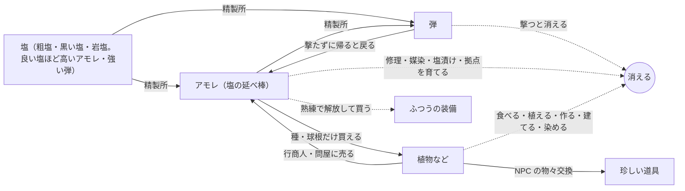

# ナメクジ脱出PvP 仕様メモ

Oct 3, 2026 · @わく（Oct 6 にまとめ直し）

雨の夜、塩を撃ち合うナメクジたちの一人称PvP脱出ゲーム。見た目はシック×ポップ、失う痛みはハード。

凡例：【決定】話し合いで確定、【仮】方向性は決まったが数字などを調整する、【未決定】これから決める、保留：決めずに取っておく。「案」は出たがまだ採用していないアイデア。

- 実装の状況と次にやることは `progress.md`。ほかの資料（話し合いの記録、作り方のメモ、キャラの経緯）の一覧は `README.md`
- バッグまわりの細かい仕様は `bag_spec.md`

---

## 1. 概要と柱

- 【決定】ジャンルは一人称のPvP脱出（エクストラクション）。自然物を採取して換金し、プレイヤー同士で奪い合う
- 【決定】カジュアル要素はなし。失う痛みが大きいほど、持ち帰る喜びも大きい
- 【仮】最終目標はSteamでオンライン。可能ならSwitch・PS5でも
- 【決定】（Oct 11）一番喜ばせたい人は「友達と2〜4人で、重い荷物を持って帰るのが好きな人」。ただし目安にとどめ、とらわれすぎない（桜井さんの「ターゲティングとマーケティング」）。ソロで撃ち合いたい人は二番目。話し合い：`discussions/who_what_scope_discussion.md`
- 【決定】（Oct 11）島づくりを一度止めて、「奪い合いは面白いか」を先に確かめる。順番は、追ってきて撃つボット1体 → 2人で同じ場所に入る（ホストする人のパソコンがサーバー）→ 友達数人。場所は灰色の島の岩塩の山のまわりだけ。「面白い」の目安：撃ち合いで逃げ切れた・倒した・隠れて見逃した、が全部起きる／撃たれていなくても重い荷物で帰るのが怖い／終わって「もう1回」と言う
- 【決定】（Oct 11）最初の版は試合型で始める（出撃ごとに島はまっさら。時計と天気は島の時刻のまま）。ずっと続く島（3章）は、人が集まったあとの大きな更新で。ボットだけの島（PvE）は作らない
- 【決定】（Oct 11）最初の版から外す：ずっと続く島、島のコピー、群島、動く相場、行商人（問屋1人だけ残す）、拠点の設備（精製所と観測所だけ残す）、熟練・体を鍛える、染め、苗床。植物は3〜4種類。残す：乾きと天気と島の時計、塩の弾と経済（数字は小さく）、死んで失う、地面のバッグ、カタツムリ（ボットとして）
- 【決定】（Oct 11）ネットワークは Fish-Net ＋ Steam のロビーと中継（ホストする形から専用サーバーまで同じコード。`tech/network_notes.md`）
- 【決定】開発はUnity（URP）。Claude Code＋Unity CLI（MCP）で進める。Built-inレンダーパイプラインは使わない

### はじめての1時間（agenda 2-1。話し合い：`discussions/first_hour_discussion.md`）

- 【仮】（Oct 14）最初から、ほかのプレイヤーがいる島に出す。初心者用のマップは作らない（カタツムリは失う物がなく、倒しても稼ぎにならないので、ベテランに狩る理由がない。人が少ない時期に島を分けない）
- 【仮】（Oct 14）ベースキャンプから初めて脱出できるまでは、キャンプまでの道が光る
- 【仮】（Oct 14）最初はカタツムリで出撃する。3回までは待ち時間なし。3回出たら（帰れても倒れても数える）ナメクジが使えるようになる。カタツムリのうちも、ナメクジの友達と同じパーティで出られる。カタツムリには体の隠し場所がなく、殻がバッグの代わりなので、最初に覚える物が自然に減る
- 【仮】（Oct 14）指さしを、エモートのような動作として足す（12章の合図のアクション）
- 【仮】（Oct 14）パーティは一斉に帰る。生きている全員がベースキャンプにそろったら、みんな一緒に脱出する（ばらばらに帰ると終わりがはっきりせず、ハラハラしない）。帰ったら、全員でバッグの中を見る。（Oct 16 わくさん）それぞれで帰るのは、やっぱりなし。島は終わりがないからこそ、パーティの帰りでメリハリを付ける
- 【仮】（Oct 14）倒れた仲間は待たない。生きている全員がそろえば帰れる。倒れた人も拠点で一緒にバッグを見る。一人だけ先には帰れない（抜けるとその場で丸まって眠る。キャンプで抜ければ安全）
- 【仮】（Oct 14）全員で帰ったときの報酬は、お金や物ではなく、みんなでバッグを広げる場面そのもの（お金を付けると、倒れた一人が「みんなの報酬を潰した」と感じる）。【仮】（Oct 25 わくさん）全員が広げたあと、帳面に「今日のみんなの合計」を1行だけ出す（お金は配らない。`discussions/economy_bag30_discussion_2.md`）
- 不採用（Oct 14）：死んだ場所に自分だけの印を残す

### ゲームの柱

1. 【決定】アイテムをゲットした高揚感、バッグが埋まっていく充足感、保持の緊張感
2. 【仮】雨に濡れた自然を、這って、採って、持ち帰る手触り
3. 【決定】自分らしさ。範囲（見た目だけか、戦い方も含むか）は【未決定】

柱1は「気持ち」、柱2は「世界の手触り」、柱3は「自己表現」を担う。迷ったらここに立ち返る。

---

## 2. 世界観

人類が滅んだ後の自然の中で、ナメクジたちが自分たちの文明を築いて暮らしている。

- 【決定】人類滅亡後の世界。人間の痕跡はほぼ残っていない
- 【決定】ナメクジが主役。親戚のカタツムリもいる（11章）。人・ドラゴン案は不採用
- 【決定】ナメクジは独自の文明を持ち、技術は人間の技術を受け継いだもの。「粘液工学」は不採用
- 【決定】採取の中心は自然物（作物、鉱石、自生する花、木など）
- 【決定】島は年々乾いていく。雨季が短くなり、湿った土地と資源が減るので奪い合う。ゲームとしては「自分で集めるより、集めた相手を倒す方が早い」も理由になる
- 【仮】なぜ島が乾くのかは謎のままにして、ストーリーの縦軸にする（植物の図鑑の古い名前に、なぜか海の言葉が残っている、などで少しだけ手がかりを出す）
- 【仮】雰囲気は「世界はシック、キャラはポップ」

参考：スプラトゥーン、星のカービィ ディスカバリー、ピクミン（人間が消えた後の自然）、Grounded（小さい視点での自然採取）。Rain Worldとは思想もグラフィックも違うので気にしない。

---

## 3. 島と区画

舞台は熱帯の群島。島はいくつかあり（最初は1つ）、どの島も試合で区切られない続いた世界で、いくつかの区画からなる。島の中の区画どうしは地続きで、這って行き来できる。島と島の間は拠点を通る。拠点（10章）から島へ出撃し、その島の自分のベースキャンプから帰る。最初の島の地図：`island_map.svg`（わくさんの絵は `island_sketch.webp`）

### 島のつくり

- 【決定】島全体を1つの続いた世界にする（試合で区切らない。ただし最初の版は試合型で始める。1章、Oct 11）。天気と昼夜と湿り気がペースを作り、制限時間はない。大干ばつ（ワイプ）で島がリセットされる。話し合い：`discussions/persistent_island_discussion.md`
- 【決定】群島にする。1つの島は 800 m 四方くらい（端から端まで軽くて約13分、雨カブでいっぱいで約16分。索敵しながら這うのが楽しいので、500 m から広げた。Oct 8）。島の中はシームレス（区画どうしを這って行き来できる）、島と島の間は拠点を通る（島の間の海がメリハリになる）。島の数は最初1つ、あとから足す。話し合い：`discussions/archipelago_discussion.md`（その前の「島ひとつ、東西 1.5 km」は `seamless_island_discussion.md`。灰色の島を這って、オープンワールドの大きさで一人では作り込めないと分かった）
- 【決定】小さくて深く：ゼルダの「三角形の法則」（丘や山の向こうが隠れ、登ると次の目印が見える）を島の小ささに合わせて使う。目安は、這って1分ごとに新しい物が見える密度
- 【決定】島ごとに性格を変える（色違いにしない。1つの島に2〜3の性格）。天気は全部の島で共通の時計。高い島が雨雲をさえぎって、隣の低い島が乾く（ハワイのカウアイとニイハウ）。どの島からも海の向こうに隣の島が見える（借景）
- 【決定】最初の島は、今の地図（岩塩の山、溶岩原、砂漠、森、花の草原の全部入り）を 800 m にしたもの（高さは縮めずに作り直した。`discussions/island_height_discussion.md`）。2つ目からは性格を偏らせる（雨陰の乾いた島、若い火山の島、珊瑚の低い島など）
  - 案：大潮のときだけ歩いて渡れる小島（珍しい物が採れる）
- 【決定】区画は5つ。山を囲む輪（案B'）：真ん中に岩塩の洞窟の山（一番稼げて一番危ない）、東に雨の森、西に砂漠（低い砂丘の砂漠と、山寄りの赤い台地・岩山。台地を枯れた谷が割る。南は低い土地で、川の行き止まりに塩田）、北に黒い溶岩原（冷えた火口の丘と溶岩の流れ。溶岩洞が主役の近距離。前は「黒い溶岩台地」）、南は森の続きと花の草原（低い土地。稼ぎは少ないが静か。夜だけ咲く花などで、たまに人が来る理由を作る）。真ん中の山が雨雲をさえぎるので、東は雨、西は晴れ（雨陰）。話し合い：`discussions/regions_discussion.md`
- 【決定】島の形はわくさんの絵：真ん中の岩塩の山がどの区画とも陸でつながる。区画の広さは絵の比率（森（東と南）と砂漠が約3割ずつ、岩塩の山が約2割、溶岩原が約1.5割、花の草原が1割弱）。島のまわりの海は塩水で、入ると傷む（体力が減る。ナメクジは塩で溶ける）。泳いで遠くへは行けない（島の端）
- 【決定】川は2本。東の川：溶岩原のふちの泉（森に降った雨が溶岩に染み込んで、ふちから湧く）→ 森 → 東の海。南の川：岩塩の山の南の中腹の平場にある、たまり池（雨水がたまる）→ 滝 → 花の草原の北 → 低い土地を西へ → 塩田で干上がる（海へ抜けない行き止まり）。溶岩原の上には川がない（溶岩は水を吸う）。【仮】形は本物の小川に寄せる：平らな所ほど蛇行し、下流ほど広く深い。川床はいつも下流へ下がり、盛り上がった所は削って小さな谷、急に下がる所は早瀬と滝。曲がりの外側は削れた急な岸と淵、内側は砂利の州。東の川は森の浅瀬で広く浅く、河口で広がる。南の川は塩田で薄く広がって消える（灰色の島 `IslandTest800Rivers.cs`）。【仮】滝：たまり池から 16 m 下流で 12 m 落ちる。滝つぼは直径 15 m の丸い岩の壁で、下流へ短い峡谷。滝の真後ろに岩棚（水際から 1.8 m 上、奥行き 3 m）があり、西の壁沿いの崩れた坂から上がれる。滝の裏はしぶきでいつも濡れている（灰色の島 `IslandTest800Falls.cs`。崖・張り出し・空洞・水はモデル）
- 【決定】**枯れた谷**は、赤い台地（高さ 50 m）を東西に割る短い谷（奥の北東の脇の谷から台地の上へ這い上がれる裏口がある）（西の海岸から 200〜350 m）。谷底は西の口（約 9 m）から奥へ 6 m だけ上り、深さは 40〜45 m。西の口で低い砂漠へ開き、山側の奥は涸れ滝の行き止まり（壁に塩が白く吹いて、山の中が塩だと分かる）。昔は川が山から西へ流れて台地を削った。あるとき川の流れが変わり（低い南へ流れる沢が山の近くで川を奪った。河川争奪）、今は南の川になって、谷には水が流れていない。谷の中は曲がり角2つと石橋で景色が3回変わる。【仮】本物の砂岩の谷の形にする：壁は地層の段（下から、崖から落ちた岩のすそ、下の崖、岩棚、柔らかい岩の斜面、細い岩棚、上の硬い崖）で、両側とも同じ層が並ぶ。谷底は砂で、涸れ川の筋がうねる。谷は蛇行して、ふくらむ所（岩の窪み）と細る所があり、奥ほど細い。脇の短い谷が3本、壁の高い所で終わる。ところどころ壁が崩れて坂になり、谷から登れる。口から砂漠へ扇状地が広がる。壁は赤と白っぽい縞
  - 案：大雨が続くと、南の川からあふれた水が昔の谷にも流れ込む（天気で変わる地形）
- 【決定】高さ（800 m の島。わくさんが図で調整）：岩塩の山 113 m（すその広がり 190 m、北は少し急）、低い土地・花の草原・砂漠 8 m（砂丘 3 m）、塩田 1〜2 m、赤い台地 50 m、枯れた谷の底 9〜17 m、火口の丘の縁 55 m（火口の底 40 m）、溶岩原 11 m（海の崖 8 m）、山と火口の丘の鞍部 34 m、森のうねり 12 m。区画どうしの高さの差を小さくして島をひと続きの地面に見せ、雄大さは山と枯れた谷と火口の丘に絞る。話し合い：`discussions/island_height_discussion.md`
- 【決定】山には平場（高さ 19 m ごと、1段の 3 割が平ら、所々にまとまって）。斜面が続きすぎないように、休める所、湧き水、見晴らし、キャンプの場所にする
- 【仮】塩の流れが島の筋書き：岩塩の山の塩が雨で溶け、南の川で運ばれ、低い土地の行き止まりで水が蒸発して粗塩の塩田になる（死海・デスバレーと同じ）。手本はカウアイ島（雨の多い真ん中の山、乾いた西、川が削ったワイメア渓谷）。冷えた火口の丘の切れ目から、溶岩原の下を通って海へ溶岩洞が延びる（天窓が3つ）
- 【仮】気候は熱帯のサバナ気候のイメージ。貿易風で風上側（東）は雨が多く沢と森、風下側（西）は乾いて砂漠。山や洞窟には岩塩と鉱石。地形で地点ごとの天気と資源が決まる（参考：ハワイ島）
- 【決定】滝は区画にせず、名所にする（区画の中の山場で、マップを覚える手がかり）。倒木、マングローブ、霧なども名所に回す
- 【決定】区画ごとに目印になる大きな物を1つ。開けた区画でも 15〜30 m おきに隠れる物を置く
- 【決定】区画の目印：雨の森は大ガジュマル、岩塩の山は山そのもの、溶岩原は火口の丘、砂漠は赤い台地と枯れた谷、花の草原は菌輪
- 【決定】雨の森の目印は**大ガジュマル**（嵐の実の木）。【決定】（Oct 20）高さ 40 m、傘の差し渡し 80 m の傘の形で、遠くからは森の上に広がる傘に見える。垂れた根が地面に刺さって柱になり、木の下は柱の林（物陰だらけで、近い距離の戦いの場所）。根は曲がった管なのでコードで並べる。話し合い：`discussions/forest_landmark_discussion.md`
- 【決定】大ガジュマルは、斜めの根や枝の付け根を伝って上に出て、島を見渡すところまで登れる（木の上を渡り歩く道や、上での採取はなし）。降りるのは根を滑り降りて速い。東の川は木の下を通さない。（Oct 20）登る道は3本（約 120° ずつ離す）、てっぺんは葉の上に出る見晴らし台（開けていて、見られもする）、木の下の柱は林の中で 3〜5 m おき。形はモデル票 `modeling/big_banyan.md`
- 【決定】嵐の実は大ガジュマルだけに落ちる。大雨の間は枝になった実が見えていて、落ちてから拾う
- 【決定】大ガジュマルの下は、晴れの昼でも日陰で乾きにくい（森の安全地帯。そのぶん人も集まる）
- 【決定】花の草原の目印は**菌輪（妖精の輪）**：草原の真ん中に直径 60〜80 m のキノコの輪。キノコの菌が地下で輪に広がり、輪の上だけ草の色が濃い（本当にある現象）。山や台地から見下ろすと輪が見えて、だいたいの位置が分かる。キノコは草より少し低いので草原の中からは見えず、足元にキノコが見えたら輪の上にいると分かる。話し合い：`discussions/meadow_landmark_discussion.md`
- 【決定】輪のキノコはウゴタケとは別の種類で、採れる（採っても輪の草の色は残る）。名前、値打ち、生える条件は【未決定】
- 【決定】ツキシロは輪の上に咲く。満月の夜は、かすかに光るツキシロが輪の形に点々と並ぶ
- 【決定】区画を増やすときは、天気や季節で開く区画にする（枯れ川は乾季だけ、海岸の磯は大潮のときだけ、霧の高原は霧の朝だけ、など）
- 【決定】区画どうしは天気と水でつながる。上流（山や森）で大雨が降ると、遅れて下流の川が増水する。川の水位も時刻から計算する
- 【決定】大干ばつのたびに、地形は同じまま、採取場とキャンプを建てられる場所の配置だけ少し変わる
- 【未決定】縦に重なる区画（岩塩の洞窟の山を何層にも）。50° まで登れるのと合わせて考える
- 【未決定】将来、有志の島（プレイヤーが立てるサーバー、進行は島ごと）を用意するか

### 区画の境目と道

- 【決定】区画どうしはどこでも越えられる（前は境目を 50° より急な崖で区切り、越えられる場所を2〜3か所に限っていた）。崖は短いものをときどき（長さ 40〜60 m、高さ 5〜15 m。横へ回れば 30 秒）で、通せんぼではなく隠れる場所と目印。大きい崖は北の海（火口の丘の西の裾が海に削られた崖）と枯れた谷だけ。話し合い：`discussions/island_height_discussion.md`
- 【決定】山へは、濡れた東と南からは楽、乾いた西と溶岩の北からは少し急（雨陰がそのまま近づきやすさになる）
- 【仮】動線：区画の中は自由に這える。区画の間と山の上に「門」（2〜4本、種類を変える）。岩塩の山の上の方（62〜88 m）を崖の帯で囲み、**尾根4本**（北：鞍部と火口の丘から、東：森から、南：たまり池から、西：赤い台地から。幅 10 m くらい、約 33°）だけが帯を抜けて山頂の頭（112 m）へ。帯の下に**肩**（幅 25 m くらい、62 m）と**肩の道**（南の尾根 → 東 → 北 → 西の尾根。南西は滝の峡谷と谷の奥で切れる）。通りは3段：山を越える（尾根。速いが見られる）、肩を回る、低い所を大回り（遅いが隠れる）。枯れた谷の奥には台地の上へ這い上がれる裏口があり、行き止まりは北の黒い砂の浜だけ。話し合い：`discussions/island_flow_discussion.md`
- 【決定】（Oct 10 わくさん）雨の日でも登れる角度は変えない（崖の帯は尾根からだけ）。山頂に採れる物（岩塩）を置く。肩の道は一周させる（南西は谷の頭を石橋で渡る）。滝の裏の奥は岩塩の洞窟の入口にする
- 【決定】洞窟は大きくしない：出入り口2つ、中は少しごつごつした半球の部屋。岩塩の洞窟は滝の裏の岩棚から入り、東の斜面へ抜ける（`IslandTest800Caves.cs`）
- 【仮】溶岩原の海岸は波にえぐられた崖で、崖の下に波食台（海から 1 m くらい、幅 6 m くらい）。溶岩洞は流れの下を通り、海の崖に口が3つ。陸からは火口の切れ目の崩落口と、天窓の1つ（崩れた岩の山）から出入りできる。ほかの天窓は飛び降りるだけ
- 【決定】（Oct 10 わくさんの絵）溶岩洞の海の側は、口3つをやめて **入江** 1つにする。場所は東の海の崖（なめらか溶岩の流れが海に落ちる所、溶岩洞の終点）。天井のない細い湾に海が入り、まわりを岩棚（波食台と同じ高さ）が馬てい形に囲んで、口で外の波食台に南北へつながる。奥から上る通路2本（溶岩洞で火口へ、南のキプカのふちの落ち穴へ）。湾の奥の水の真上に天窓があり、飛び降りれば近道だが塩水に落ちる。しぶきが乾いて岩棚の壁に黒い塩が育つ（海沿いを一周する動機）。【仮】湾は幅 約18 m・奥行き 約22 m・水深 2.5 m、岩棚 幅 4.5 m。天窓は半径 3.4 m、水から上がれるのは天窓の下のゆるい所だけ（灰色の島 `IslandTest800Inlet.cs`）。天窓のために、湾の奥の数 m だけ天井（溶岩洞の終わり）を残す（Oct 10 わくさん確認）。上る通路2本は天井のある洞窟の通路（溶岩洞で火口へ、もう1本は南のキプカの落ち穴へ）
- 【未決定】島の外周（海沿い、約 2.1 km、軽くて 30 分）をひと回りしたくなる動機
- 【仮】道は2種類：整備された道（昔の塩運びの道。つづら折りで坂は 15° まで。迷わないが、開けていて人と出会う）と、けものみち（細い近道。40° までの急な所もある。見つかりにくい）。道を這っても速さは同じ（坂がゆるくて迷わないだけ）。灰色の島（IslandTest_800）に、道3本（塩の道、東の道、北の道）とけものみち5本を作った：15° を超えない所だけを通る道を探すと、山ではひとりでにつづら折りになる（東の道 590 m、まっすぐ登る 262 m の2倍以上。`tech/island_test_notes.md`）
- 【仮】境目の様子：

| 境目 | 様子 |
| --- | --- |
| 山と砂漠・赤い台地（西） | 台地の東の端が山のすそに乗る |
| 赤い台地と砂漠・塩田 | 台地と岩山の壁は谷と同じ地層の崖（崖下に岩のすそ）。ところどころ崩れて坂になっていて、そこから登れる（必ずある所が3か所：北西の角、南、北） |
| 枯れた谷（北と南） | 谷の両側の 40〜45 m の崖。西の口から谷底へは平らに入れる。天然の石橋 |
| 山と溶岩原（北） | 火口の丘と山の間の鞍部（34 m）。溶岩流のふち（3〜8 m）がときどきの崖 |
| 溶岩原の北の海岸 | 8 m の低い崖。黒い砂の浜が1か所（北の玄関）。火口の丘の西の裾は高い海の崖 |
| 山と森（東）、山と草原（南） | ゆるい。南の中腹の平場から滝 |
| 森を南北に | 東の川（浅瀬。大雨で増水すると渡れない） |
| 溶岩原と森、森と草原、砂漠と草原 | ゆるい（古い溶岩に森が戻った所、草地から林へ） |

### 見え方（ゼルダの三角）

- 【決定】ナメクジの目の高さ（0.47 m）は人の約 1/3.6。砂丘 1〜3 m は人の 4〜11 m の丘、赤い台地 50 m は 180 m の岩山、山 113 m は 400 m の山に感じる。中くらいの三角は 2〜5 m で足りる
- 【決定】大きい三角は4つで、地図の代わりにする（地図とコンパスは拠点だけ）。シルエットをはっきり変える：岩塩の山（真ん中。段のある白い山、南の中腹から滝）、火口の丘（北。黒い左右対称の円すいで、東北東だけ欠けている）、赤い台地（西。てっぺんが平らな赤い箱と岩山）、大ガジュマル（東。森の上に突き出る木）。低い土地のどこからでも、どれか1つは見える（森の中は川の上でだけ空が開ける）
- 【決定】中くらいの三角（2〜12 m）を 50〜100 m ごと（砂丘の背、岩山、森のうねり、溶岩流のふち、平場のふち、谷の曲がり角）、小さい三角（0.5〜1.5 m）を 15〜30 m ごと（岩、倒木、草むら、ごつごつ溶岩）。森は木と下草で 6〜11 m ごと、草原は草むらで 6 m ごと、塩田は真ん中の大岩1つだけ（灰色の島で自動で並べた。区画ごとの間隔は `IslandTest800Paths.cs`）
- 【決定】地面に沿った見通し：森 20〜40 m、砂漠・溶岩原・草原 60〜120 m、塩田と台地の上は開けている（危ない場所）、山頂は全部
- 【決定】珍しい物は中くらいの三角の陰に置く（大きい三角のてっぺんからまっすぐ見えない所）。景色が開ける場所（中腹のたまり池、石橋、台地のふち、山頂、火口の縁）は、そこへ行くまで前が見えない道にする（隠してから見せる）
- 【決定】山の平場のふちは凸にして、上の段から下の坂の人が見えないようにする。山頂からは島が全部見えるが、遠くのナメクジは点にしか見えず、見えるのは気配（雨雲、ぬめり跡の光、焚き火の煙、群れの動き）まで。山頂は偵察の場所で、狙撃の場所ではない
- 【決定】黒い溶岩原：火口の丘（縁 55 m、斜面 30〜33° でどこからでも登れる、火口は幅 70 m・深さ 15 m、東北東の切れ目から平らなまま中へ入れる）から、溶岩の流れ3本が海と森へ（厚さ 3〜8 m）。ごつごつ溶岩（アア。隠れやすく遅い）と、なめらか溶岩（パホイホイ。見通しがいいだけで速さは同じ）。流れの間に古い森の島（キプカ）。なめらか溶岩の下に溶岩洞、天窓3つ
- 地点ごとの景色（塩田、砂漠、枯れた谷、台地の上、花の草原、たまり池、山の段々、雨の森、溶岩原）：`discussions/island_height_discussion.md` の3章

### 大きさと地形

- 【決定】世界は普通の大きさ（ナメクジにとって等身大）。巨大な自然にすると天気予報が破綻するため。ばかでかい木や岩を置くのはあり（目印・遮蔽・日陰）
- 【決定】1つの島は 800 m 四方くらい（群島。島の中の区画の広さは、最初の島はわくさんの絵の比率）。前は東西 1.5 km の島1つだった
- 【決定】川に乗れる。生身で入って流される（舟や流木は使わない）
  - 【仮】岸や浅瀬から入ると流れに運ばれる。ふつうは這う速さの1.5〜2倍、大雨のあとの増水で3倍くらい。左右に少し寄れるが、上流へは進めない
  - 【仮】水の中は湿り気が満タンに戻る。流されている間は道具を使えない（手で水をかく）。速いけれど、川岸から狙われる読まれる逃げ道
  - 【仮】上がれるのは浅瀬、よどみ、岸のゆるい所だけ。増水するとよどみが減る。南の川はそのまま流れると塩田に出る（塩の上なので乾く）。東の川の河口は海（塩水）なので、手前で上がらないと危ない
  - 【仮】バッグの塩は水で溶けない（「雨でバッグの塩が溶ける」は不採用にしたのと合わせる）
- 【決定】砂漠の大きさはそのまま。晴れの昼でも渡れるように、乾く速さを調整する（今は晴れ・昼・日なたで5分で乾ききり、砂漠を横切るのは軽くて約8分。数字は灰色の島で這って決める）
- 【決定】雄大さは広さではなく高さと見晴らしで作る（グランドキャニオン、ヴィクトリアの滝の規模感）。体高 0.5 m のナメクジには深さ 40〜50 m の谷でも体高の約 90 倍（800 m の島の枯れた谷は 45 m。1.5 km の島のときは 100〜150 m としていた）。遊べる範囲が小さくても、隣の区画の山や滝が遠くに見える（借景）。谷は低密度で縦、森は高密度。話し合い：`discussions/grand_nature_discussion.md`
- 【決定】ナメクジは 50° くらいまでの斜面を登れる（前は 80° まで張り付いて登れる、だった）。それより急な所は登れない。上り下りの速さは今のまま。ほとんどの崖は Unity の地形（Terrain）で作れる。モデルが要るのは洞窟、溶岩洞、石橋、滝の裏の岩棚
- 【決定】名所の間はコードで並べ、生成した物は固定して人が直す。地形の侵食はまず Unity 上（コード）で作り、Unity で微調整する。どうしても完成度が足りなければ Gaea に切り替える
- 【仮】地形は島全体の高さを1枚で作る（高さ → 侵食の計算 → 風と高さから雨の地図 → 森と砂漠の境目）。描くときは 250〜500 m の四角に分け、遠くは荒い形で描く
- 【仮】地形は現実の決まりに合わせる（砂丘は風向きに沿って並ぶ三日月形、塩田は六角形のひび割れ、谷は地層ごとの段々）
- 灰色の島（IslandTest）：東西 1.5 km で一度作って這い、300・400・500 m に縮めた版も作った。800 m 版は話し合った形で作り直した（IslandTest_800、`IslandTest800Builder.cs`。見る場所ごとにナメクジの目の高さで撮った絵と、這った時間は `tech/island_test_notes.md`）

### 出撃と帰還

- 【決定】出撃＝拠点から島へ出る（自分のベースキャンプから出る）。脱出＝自分のベースキャンプから拠点に帰る（モンハンワールドのようなベースキャンプ）。帰るまで持ち物は確定しない。行きと帰りのキャンプが違っていい
- 【決定】ベースキャンプの役割は出撃と帰還だけ（装備を替える・治すのは拠点）。島に2つまで（区画ごとではない）。最初は自分で選んだ2か所。そのあと、出撃中にキャンプを建てられそうな場所を見つけ、その区画の材料だけで建てると（お金は要らない）、そこへ移せる
- 【仮】キャンプは開けた人（とパーティ）にしか見えない（ほかの人には崖の窪みなどにしか見えないので、待ち伏せが分散する）。良い場所ほど行きにくい（崖の中腹、滝の裏、塩田の真ん中の大岩の上）
- 【未決定】最初に選べる場所と、あとで建てられる場所の数・置き方（島を一度作ってから決める。必ず通る場所の近くに集めない）
- 【決定】島で抜けると、その場で丸まって眠る。眠っている間は撃たれうる。眠る時間は 10 分くらいから試す。ベースキャンプで抜ければ安全

### 人数とサーバー

- 【決定】島1つ＝1つのサーバー。人が多いときは島ごとコピーを増やし、少ないときは減らして人を集める。コピーは自分で選べず、空いている所に入る。区画の境目でサーバーを渡す仕組みは作らない
- 【仮】1つの島に 12〜18 人（800 m の島で、這って5分の範囲にいつも数人いるくらい。同じ密度なら約10人、500 m の島と同じくらい出会うなら25〜35人。遊んで決める）、パーティは4人まで、1回の出撃の長さは遊んで決める
- 【決定】（Oct 25 わくさん）ソロとパーティは同じ島に入る（島を分けない）
- 【仮】サーバーの節約：誰もいない場所は眠らせ、入ったときに時刻から天気と資源を計算して起こす
- 【決定】採取場で覚えるのは、生える場所ごとの「最後に摘まれた時刻」と、根ごと掘られた場所の「掘られた季節の番号」だけ。季節が変われば計算でもう生えている（リセットの作業なし）
- 見直し中：珍しい花の記録は島のコピーごと（人が増えれば花も増える）。コピーの渡り歩きは、珍しい花の咲く時間を短くして防ぐ（帰って出直すと間に合わない）。全部のコピーで共通にする案と、島の1日のあいだ同じコピーに入る案はやめた（手に取れる人が少なすぎる、人がいない時間ができる・同じ人に出くわす）。`discussions/plant_uses_discussion.md`
- 【仮】人の多さが読める（ぬめり跡、音、雨の強さ、予報）。区画ごとに稼ぎと危なさが違い、静かな区画もある。人の偏り（混む山、静かな草原）はそのまま遊びにする

出た案（未採用）：島の中を区画ごとに拠点で区切る（前の決まり。島の中はシームレスにした）、島ひとつを大きく（東西 1.5 km。オープンワールドの大きさで、一人では作り込めない）、100 m の小島をたくさん（人が散る）。

---

## 4. 天気・時間・湿り気

雨雲の下が安全地帯で、その雲が風で流れていく。Fortniteのストームの逆。

### 天気と季節

- 【決定】雨雲がマップ上を移動する天気システム
- 【決定】天気予報は全員共通（地点と時間ごとに晴れ・曇り・雨）。天気は島全体の共通の時計で動き、時刻から計算できる。出撃前に予報を見られ、細かさは拠点の観測所で順に開く（10章）。【仮】予報は外れることもある
- 【仮】天気ごとに稼ぎと危なさが入れ替わる。雨は乾かず足音が消え、植物が育つ（近い戦い）。晴れは塩が浮いて取り放題、遠くまで見えて狙撃が強いが、水と日陰が要り、足音が響く。晴れで塩を稼いで雨で使う流れ
- 【決定】植物などの資源は雨で回復する。塩は逆に雨で流され、乾くと回復する
- 【決定】晴れの日は、巨大な木と岩の影が安全地帯。影は太陽と一緒に動く。影の中でも少しずつ乾くので、居座りは弱い
- 【決定】夜は露で乾きにくい（塩の上は別で、夜でも厳しい）
- 【決定】ぬめり跡が道になる。ほかのナメクジ（自分も）の跡に乗ると速く這える。跡は人がいた手がかりにもなる。晴れると早く乾いて消え、雨の日は長く残る
- 【仮】（Oct 13）ぬめり跡は、地形ができあがってから作る（いまの模様の見た目が微妙なので）。場所（地面の種類）によって残り方が変わるのはあり
- 【仮】雲の端が自然と戦場になる。大雨の場所では足音が雨音に消える
- 【仮】雨の強さでマップの明度・彩度が変わる。大雨では鮮やかな色ほど目立ち、晴れ間の花畑ではカラフルな方が溶け込む。予報を見て着ていく色を決める
- 【決定】数週間ごとに雨季と乾季が切り替わる。全員に平等に起きるので、ワイプ直後に張り付く人が有利になりすぎない
- 【仮】乾季は塩が豊富だが、雨が少なく地上にいられる時間が短い。雨季はその逆
- 【決定】（Oct 25 わくさん）雨雲は風に流されて動く。動き方は雲の大きさと風の強さで変わる。砂漠の上では消えやすい（乾いた空気）。風は島の空気感の柱でもある（雲、ヤシの葉、草が同じ風で動く）
- 【決定】（Oct 26 わくさん）日なたは光の筋で強く伝える（乾きと倒れる原因に直結するから）。晴れの昼に日なたにいる間は、画面の太陽の側から光の筋が差しこむ（撃たれた塩の粒と同じ見せ方。自分だけ）。強さは足元の乾く速さ（土・草は弱め、塩の上がいちばん強い）、日なたに出た瞬間に一度強く光る。島の中にも、日なたの地面から太陽へ向かって光の筋が立つ（影のふちに多い、塩の上は明るい、みんなに見える）ので、どこが日なたか遠くから分かる。曇り・朝夕・夜は出さない（筋が出ていたら危ない、の1つの意味）。作った：`Raid/SunGlare.cs`、`World/SunShafts.cs`
- 【仮】（Oct 25 わくさん）1シーズンは10週で、雨季と乾季が二周：大雨季3週（島の53日）→ 乾季2週 → 雨季2週 → 大乾季3週（10章の大干ばつ）。前は14日ずつの8週

### 島の時計

- 【決定】（Oct 25 わくさんが変更）島の1日は現実の9.5時間。毎日同じ時刻に入ると島の時刻が約半日ずつずれて、毎日同じ1時間だけ遊ぶ人も 19 日で全部の時間帯を回る（前の9時間は、1日の3分の1しか見られなかった。agenda 2-5）。夜が長いので、時間帯を狙った計画が立つ。話し合い：`discussions/island_clock_discussion.md`
- 【決定】朝焼け・夕焼けの時間は変えない（短いから感動が大きい）
- 【決定】月と潮の時計を、太陽の時計とは別に持つ。周期をずらして、「満月の夜」「大潮」がたまにだけ来る。（Oct 25 Claude、わくさんが任せた）月は現実の 72 時間（3日）で一周。島の1日（9.5 時間）では割り切れないので、満月が島の何時ごろに来るかは毎回ずれて、満月の夜はおよそ3日に1回、たまに来る。潮で海辺や河口の地形（渡れる・渡れない）が変わる
- 【決定】季節で昼と夜の長さを変える（乾季は昼が長い、雨季は夜が長い。大干ばつの前が一番昼が長い）
- 【決定】夜でも採取できる明るさにする
- 案：島の時刻と予報を、ゲームの外（Web、スマホ、Discord）でも見られる

### 湿り気

乾きは「体の湿り気」。晴れると減り、水・日陰・雨・夜の露で戻り、ゼロで削れ始める（晴れ＝ゲームオーバーにはしない）。話し合い：`discussions/map_discussion_2.md`、数字は `discussions/moisture_discussion.md`

- 【決定】湿り気は 0〜100。出撃は 100 で出る。雨と水場では 120 までためられ、100 を超えた分は1分に 5 ずつ抜ける
- 【前の数字。下の表で置き換え】1分あたり：晴れ・昼・日なた −20（5分で0）、晴れ・昼・日陰 −4（25分）、曇り・昼 −5（20分）、夜は 0（露で止まる）、小雨 +20、大雨 +50。水に触れる（水たまり・沢・濡れた苔）と1秒に +10
- 【決定】塩の上（塩田、岩塩の洞窟）は、昼は減り方が2倍（日なた −40、日陰 −8、曇り −10）、雨の戻りが半分。夜は1分に −25（夜でも塩は体の水を吸う）
- 【決定】晴れの昼でも砂漠を渡れるように、乾く速さを調整する（砂漠を横切るのは軽くて約8分。数字は灰色の島で這って決める。3章）
- 【決定】30 を切ると見た目が変わる（つやが消え、色がくすみ、少し縮む）。自分にも相手にも見える。能力は変わらない
- 【決定】0 になると這う速さ ×0.8、体力が減り始める（満タンから約90秒で倒れる）
- 【決定】水の苔玉：ベルトに2つまで。1つで +40、使うのに2秒（撃てない）、手を通さずに使う。水場に触れたまま3秒で浸し直す。仲間にも使える。（Oct 18 わくさん）落ちている苔玉は、ベルトに足りなくて近くにあれば、操作しなくても手が伸びてベルトにしまう。両手で銃などを持っていたら、3本目の手がわき腹のあたりから出て拾う
- 【決定】湿り気と体力は別
- 案：乾いていると、ぬめり跡が薄くなる。寄り添うと減りが遅くなる
- 【決定】（Oct 10 わくさん）乾き方は**足元の地面**で決める。覚えるルールは1つ：**光って濡れて見える地面は乾かない、ツヤのない乾いた地面は乾く、真っ白な塩はとても乾く。影は乾きにくい**。地面の見た目と体の乾き方は同じ式から出す（ずれない）。地面の種類は地形のレイヤーに持たせる（新しく塗る物は増やさない）。雨のあとは地面が濡れて光り、日なたから先に乾いて元の種類に戻る（雨上がりに、日陰だけ暗く濡れて残る）。速さは地面で、量は体で見せる（左上の体は今のまま、速さのための表示は増やさない）。乾いている最中は、日の当たる側の体（頭・外套膜・脇腹。背中はバッグの下）から先にツヤが消えて**乾いたまだら**が広がる（湯気は出さない）。一人称のままでよい：自分には左上の体（斜め前の少し上から撮っている）で見え、相手には一人称でそのまま見える。自分が気づく一番の合図は、変わった瞬間の音と触角の動き。変わった瞬間に1回だけ知らせる：日なたに出る・塩に乗ると「ジュッ」と触角がきゅっと縮む、濡れた所に入ると「ぬちゃっ」と体がふわっと伸びる。遠くからは、乾いた地面の上だけ陽炎（晴れの昼）。話し合い：`discussions/moisture_readability_discussion.md`
- 【決定】（Oct 18 わくさん）乾きの見せ方：ゲージは足さない（最初の数回だけの線もなし）。段を4つにはっきり分ける：つやつや（100 超え。ふくらんでピカピカ）／ふつう／乾いてきた（30 未満。くすむ・縮む・まだら）／危ない（12 未満。しわしわ、画面の端がぼやける）。段を越えた瞬間に一度だけ音と触角の動き。這う音の質が湿り気で変わる（ぬちゃぬちゃ → かさかさ。相手にも聞こえる）。左上の体の後ろにぬめり跡を描き、跡の長さが湿り気（細い線の代わり）。一人称で見える触角のツヤも乾きで消える。**縮むのは乾きだけ**（撃たれて縮むのは一瞬の反射だけ、8章）。友達がボットと遊んで「脱水のゲージを見やすく」と言ったのが出発点。話し合い：`discussions/friend_playtest_discussion.md`
- 【仮】1分あたり（上の前の数字を置き換える。砂漠＝今の日なたの数字のままにして、砂漠の渡りやすさは変えない。曇りは影と同じ）：

| 足元 | 晴れの昼・日なた | 影・曇り | 夜 |
| --- | --- | --- | --- |
| 濡れて光る（濡れた苔、泥、しぶき、雨上がりの地面） | +10 | +10 | +10 |
| 土・草 | −12（約8分） | −3 | 0 |
| 砂・黒い溶岩 | −20（5分） | −4 | 0 |
| 塩 | −40 | −8 | −25 |

  雨は今のまま上に足す（小雨 +20、大雨 +50）。水に触れると1秒に +10 も今のまま。【仮】雨上がりに濡れて光っている時間：日なたで砂 約5分、土 約20分、影はその4倍

出た案（不採用）：体に付いた砂・塩の粉・苔・泥でどこを通ってきたか分かる、湿り視点（触角で湿り気が色で見える）、乾きの表示を全部消す。

---

## 5. キャラクター

プレイヤーは這う体のナメクジで、指のない手を生やして物を扱う。

- 【決定】見た目は「そのまま型」。這う体に、ドラえもんのような指のない手が生える
- 【決定】デフォルメは「丸い立ち上がり型」：上体を起こし、尾側だけが地面を這う。小さな黒い目、小さな口、苔色。気持ち悪く見えないことが最重要。経緯と今の値は `character/`
- 【決定】触角は耳。目は顔につく
- 【仮】手は普段しまっていて、採取や射撃のときだけ生える
- 【仮】触角だけ物陰から出して聞き耳を立てられる。触角を撃たれると耳が遠くなる
- 【決定】キャラ本体（種族・見た目）は死んでも失わない（大干ばつでは全部失う。Oct 25 わくさん：体の色だけは、着ている色1つが大干ばつを越す。10章）
- 【決定】カスタム範囲は、銃・ヘルメット・アーマー・バッグ・体の色・体の模様（模様は Oct 26 に足した。育ちで開く。10章）
- 【決定】スキン（持ち主の見た目設定）はなし。見た目は体の色（ゲームの中で染める）と、拾って使う装備そのもの
- 【仮】（Oct 13）値段は買い切りで 1,000円前後。Steam の4本セットも付ける。基本無料＋スキンはしない（見た目＝情報が崩れる、ずるをした人が無料で作り直せる、大干ばつで全部失うとぶつかる、一人では作り続けられない）。専用サーバーの代金が要るようになったら、拠点の中だけの飾り（島では見えない）をおまけの有料品にする逃げ道を残す。参考：めっちゃカメレオンは 790円の買い切り
- 【決定】体の色は変えられるが、コストをかける（DQMJ3のカラーフォンデュのように）。染め場で媒染に塩を使う（10章）
- 【決定】（Oct 25 わくさん）体の色が変わるのは、拠点の染め場で色花を使ったときだけ。染め場で色花を食べ、島から持ち帰った土を体に塗りたくると、その色になる（見ていて面白い所。染め場では外から自分が見える）。倒れても色はそのまま。持ち帰る戦利品は、色そのものではなく色の材料（ウミウシには食べた物の色素で体色が変わる種類がいる）。前は「食べた植物や寄った地点で出撃中だけ色が変わり、生きて帰れば定着、死んだら元に戻る」で、出撃前の食事でも色が変わった（どちらもなし）。話し合い：`discussions/body_color_wipe_discussion.md`
  - 【決定】（Oct 25 わくさん）色ごとに手に入れる難しさを変える。一度なった色は、二回目から材料が少なくて済む（この記録は大干ばつで消える）
  - 【仮】（Oct 25 Claude）色と材料：花の色＝その季節の色花だけ（やさしい）。赤土色＝色花＋枯れた谷の奥（涸れ滝の下）の赤い土。炭色＝色花＋火口の底の灰。灰白＝色花＋塩田の、川の流れ込む端の白い泥（塩の上なので乾きは2倍）。月白（かすかに光る淡い色）＝ツキシロ（満月の夜だけの幻。売れば 18 アモレなので、売るか染めるか）。はじめの苔色にも戻せる。【未決定】材料の数とかさ（例：初めては色花5本＋土3つ、二回目から色花2本＋土1つ）
  - 【決定】（Oct 25 わくさん）保護色：どの色にも、溶け込む場所と目立つ場所がある（いちばん強い色は作らない）。溶け込む色なら、見つかる距離が半分くらい（開けた草原なら 60 m → 30 m、人なら約 220 m → 約 110 m）。止まって伏せていれば、近くでも見えにくい。【仮】（Claude）溶け込み方は主に明るさで合わせる（色の見分けが苦手な人にも同じに効く）。真っ白はなし（体力の白い塩の跡が見えなくなるので、いちばん淡くて灰白）。はじめの苔色は森（島の約3割）で溶け込むので、はじめの人が損をしない
  - 【決定】（Oct 25 わくさん）かくれんぼの名所を作る：背景が一色で開けていて、珍しい物がある所。その色でなければ、ここでは見つかる。【仮】（Claude）枯れた谷の赤い縞の崖（北東の裏口の這い上がり道。赤土色）、夜の火口の底（幅 70 m、人なら約 250 m。炭色）、満月の菌輪（ツキシロの光の輪。月白）、晴れ間の花の草原（その季節の色花の色。ツユリの1時間）
  - 【決定】（Oct 25 わくさん）ボットのカタツムリも、地面と体の色の差で見つける（ボットの「見る」に足す）
- 【仮】モデリングの方針：形は数式やBlenderのスクリプトで作る。テクスチャは描かずシェーダーで、色と模様はパラメータで変える。這う動きはボーンなしでシェーダーで体を波打たせる
- 【未決定】輪郭線・陰影の最終値、左上の小さな体表示での見え方
- 【決定】（Oct 13）走る（速く這う）はなし。伏せたまま斜面を腹ですべるのもなし（地形に詰まってイライラする。斜面でただ伏せたいときに何もできない）
- 【決定】（Oct 13）縮んで伸びるは、押すたびに少し溜めて伸びる（スペース長押しで溜めない）。続けると這うより少し速い。移動中は跳ねながら少し弾をよけ、撃ち合いでは射線から外れる。移動中の暇つぶしにもなる（フォートナイトやエーペックスのしゃがみ・ジャンプと同じ役）。かわりに伸び縮みの音が鳴る。話し合い：`discussions/movement_discussion.md`
- 【決定】（Oct 13）よく使う動き・とっさの動きは6〜7個まで。Switch のコントローラーをふつうに持って指が届くのは L・R・ZL・ZR・左右のスティックの押し込みの6つ（うまい人はモンハン持ちで十字キーとボタンも使う）

デザインの指針（案）：濡れたテカリを描かずマットな単色、輪郭は丸く、目は大きく表情を出す、ぬめり跡は水っぽさよりキラキラで見せる。

出た案（未採用）：キャラの形の候補（大福型、流線型、ぬいぐるみ型、クレイ型、グミ型、頭でっかち型、ウミウシ型、結晶型。`character/history/`）。

参考：R.E.P.O.（腕なしで物を扱う）、Fortniteのフィッシュスティック、城ドラのデフォルメ、ポケモンのカラナクシ、Snake Pass（這う動きの操作感）。

---

## 6. 採取

叩いて採る気持ちよさと、手で摘むやさしさ。塩は重くて小さい、晴れと乾きの資源。植物は軽くてかさばる、雨と湿り気の資源。バッグを重くするのは塩、膨らませるのは植物。

### 採る手触り

- 【仮】採取はFortniteの木・レンガ採取やForest Hustleのような「叩いて採る」感触
- 【決定】採り方は2つ。硬い物・根・苔はピッケルで叩く。柔らかい物（花、キノコ）は手で摘む（近づいて E、0.5秒）。（Oct 25 わくさん）ピッケルで叩いても潰れない（分かりづらすぎるので、潰れて値打ちが下がるのはなしにした）
- 【決定】物はすべて手を通る：採ると1個ずつ出てきて（岩塩なら 20 cm くらい、手に持つと 30 cm くらいに見せる）、それを手でつかんで持ち、手でバッグに入れる。手に持っている間は道具を使えない
- 【決定】（Oct 18 わくさん）掘った物は叩いた人の足元に落ちる（坂の下へ転がっていかない）。E を1回押すと手に持つ。E 長押しは手に持たずにそのままバッグへ入れ、押している間は近くの物を1個 0.5 秒ずつ続けて入れる（入れている間の無防備はそのまま、押す回数を減らす）。友達の感想：押す回数が多く、入れてうれしい音の手応えが薄い。入れた瞬間の音と、世界とつながる手応えを増やす。話し合い：`discussions/friend_playtest_discussion.md`
- 【決定】ナメクジが塩をつかめるのは、いつも手袋をしているから
- 【決定】手に持つと、値打ちが体で分かる（数字や色ではなく、手の動きや小さな声など。「すごく良い」「ふつう」くらい）。（Oct 25 わくさん）見せ方：手に持ったときだけ、値打ちの高い物はレア度に応じてキラキラ光る。いちばんレアでも派手すぎない（地面やバッグの中では光らない）
- 【仮】大物（大きな結晶、嵐の実など）は、ピッケルでもう一段階割って小さくできる。割らずに持ち帰ると、大きさを自慢できる・拠点の拡張に使える。そのままならバッグが大きく膨らんで重い。（Oct 18）拠点の設備のいちばん上の段階の材料になる（10章「家具と器具」）

### 塩

- 【決定】塩＝掘る資源・弾・お金（9章）
- 【決定】塩の産地は区画ごとに分ける
- 【仮】塩の種類（産地）で変わるのは「質」：良い塩ほど、強い弾にも、高いアモレにもなる。撃つか、貯めるかが悩みになる。一番危ない岩塩の洞窟の山の塩が一番良い

| 塩の種類（産地） | 質 | 弾にすると | アモレにすると |
| --- | --- | --- | --- |
| 粗塩（砂漠の塩田） | ふつう | 防具に弱い | 10 |
| 黒い塩（黒い溶岩原） | 良い | 防具にやや強い | 20 |
| 岩塩（岩塩の洞窟の山） | とても良い | 防具に強い | 30 |

- 【仮】（Oct 25）重さ／かさ（雨カブ1個＝かさ 1）：岩塩 1.5／1、黒い塩 1.5／1、粗塩 1.0／1。アモレは10倍で数える（9章）

- 【仮】岩塩の採る場所は「塩のきのこ」。設定：塩は雨で溶け、乾くと育つので、根元（はね返りの雨と流れる水が当たる）が先に細り、乾きやすい上に塩が育ってかさが広がる。死海にも本当に塩のきのこがある
- 【仮】塩のきのこは叩く6回で岩塩3個（2回ごとに1個）。出るたびに形が「満タン → 掘りかけ → 切り株」と減り、掘りきると切り株が残る。乾いた天気が島時間2時間続くごとに一段育って戻り（切り株から満タンまで現実の約1時間35分）、雨の間は育たない（塩が戻る様子が形で見える）。（Oct 25 わくさん）岩塩の山に90本（山全体にならすと約 35 m に1本、人なら約 125 m。雨の東の斜面は少なく、乾いた西と洞窟の奥は多く）。島に15人なら、山へ行った1回で岩塩 12〜19 個（大雨季〜大乾季）。島じゅうの岩塩は大雨季から大乾季で約3.6倍に増える。最初の版（試合型）は、試合の始めに満タンのきのこを人数×6本にする（1人あたり約18個。残りは掘りかけか切り株。ボットは数えない）。前は「40くらい、一段3時間」で、続く島では1回4〜6個しか採れなかった。計算：`tech/economy_bag30.py`
- 【仮】「塩だ！掘ろう！」の手がかり（見比べ中）：かさの上の立方体の結晶（冠）、欠けた割れ口から真っ白な新しい塩がのぞく、足元の欠片、柄の水位の跡の輪
- 【仮】粗塩は叩けば1個ずつすくえる（軽い、安い、たくさん）
- 【仮】掘れる量の上限は、きのこの数ではなく湿り気が決める。塩の上は2倍で乾くので、岩塩の山で掘っていられるのは苔玉込みで約20分。雨の日は長く掘れる
- 【仮】塩を扱う危険を仕組みにする。案：岩塩の洞窟に長居すると体が縮む

### 植物

話し合い：`discussions/plants_discussion.md`、名前は `plant_names_discussion.md`、使い道は `plant_uses_discussion.md`（場所・条件・数字は Claude が決めた【仮】）

- 【決定】レア度は確率ではなく条件で決まる。いつ生えるかは島の時計（天気・時刻・月・季節）から計算し、予報と図鑑を読めば狙える。どこに生えるかだけ、候補の場所から選ぶ（珍しい物は毎回候補の一部だけ）
- 【決定】レア度の段（ふつう・ときどき・まれ・幻）は作る側の目安だけ。ゲームには色や星で出さない。珍しい物は形（大きさ、花の形、かすかな光）で分かる
- 【決定】香りで探すのはなし（画面がうるさくなる）
- 【決定】1種類ごとに「その植物だけの理由」を1つ持たせる。値段だけ違う植物は作らない。売る以外の使い道は1〜2つまで
- 【決定】ツユリとツキシロは、花だけ摘むとまた咲き、ピッケルで根ごと掘ると球根・根株（安いが傷まない、拠点の苗床に植えられる）。掘った場所には次の季節まで生えない
- 【決定】名前の決まり：ふだんの呼び名はカタカナ中心で、漢字が少し入ってもいい。3〜5音、語尾を重ねない。「いつ・どこで出会うか」か「ナメクジにとって何か」から付ける。図鑑の古い名前（人間から受け継いだ言葉）は、ストーリーに関係する物だけ（例：ヒデリベニの古い名前「サンゴソウ」。なぜ陸のナメクジが海の言葉を？）
- 【決定】食べて変わるのは湿り気と体の色だけ（数字の強化はしない）。島で使える植物は3〜4つまで：雨カブ（かじると湿り気 +15）、しぶき苔（苔玉に足すと浸し直し1回ぶん）、色花（Oct 25 に島での使い道は外した。色が変わるのは染め場だけ、5章）、ベースキャンプの材料（その区画の植物）
- 【仮】ふつうの植物は、採ったあと雨で戻る（島時間で合計1時間の雨、大雨なら半分）。乾季は生えている場所が半分
- 【仮】拠点での傷み方は、しおれて見せる（島では数字なし。拠点の帳面には期限が出る）。花とキノコは早い、雨カブ・ヒデリベニ・嵐の実は遅い（Oct 17 わくさん）、球根・種・根株・しぶき苔は傷まない。傷みは島の夕方に一段ずつ進む（10章「拠点」の傷み方）
- 【仮】図鑑には、採った場所・天気・時刻・月が自動で書かれる。まだの物は形の影とヒント1行だけ

| 名前 | 段 | 区画と場所 | 出る条件 | 採り方 | 重さ／かさ | アモレ | その植物だけの理由 |
| --- | --- | --- | --- | --- | --- | --- | --- |
| 雨カブ | ふつう | 雨の森の林床、河口・沢の岸 | いつも（雨で戻る） | ピッケル | 0.5／1 | 10 | その場でかじると湿り気 +15（2秒、撃てない） |
| ウゴタケ（雨後茸） | ときどき | 雨の森の倒木・巨大な木の根元・日陰。1か所に3〜5本 | 雨が上がって島時間2時間後に出て、日なたが2時間続くと消える | 手 | 0.15／0.4 | 1本 10 | 雨上がりの短い時間だけ。拠点ですぐしぼむ（干すと長持ち） |
| ツユリ | まれ | 花の草原、塩田のふちの湿った窪み | 大雨が止んで晴れ間が出たら島時間1時間だけ。毎回候補の3分の1 | 手／球根はピッケル | 花 0.05／0.15、球根 0.3／0.3 | 花 120、球根 40 | 晴れ間の1時間。摘むか掘るか |
| ツキシロ（月白） | 幻 | 花の草原の菌輪の上 6 か所 | 満月の夜、月が高い島時間2時間だけ（2〜3日に一度、時刻は毎回ずれる）。毎回2〜3か所。かすかに光る | 手／根株はピッケル | 0.1／0.25 | 360 | 静かな草原が満月の夜だけ取り合いになる |
| ヒデリベニ（日照り紅） | ふつう〜ときどき | 砂漠の塩田の、川の流れ込む端と割れ目 | いつも。雨季は緑、乾季が深まるほど赤い | ピッケル | 0.2／0.7 | 緑 10、赤 20 | 季節で姿が変わる。塩の上なので採るほど乾く。白い塩田の赤い目印 |
| しぶき苔 | ときどき | 滝のしぶきが届く崖、洞窟の入り口の湿った壁 | いつも。晴れが島で1日続くと縮む | ピッケル | 0.1／0.8 | 10 | 工房でいい苔玉を作る材料。崖の高い所ほど多い |
| ヒバナ | まれ | 黒い溶岩原の割れ目、溶岩洞の天窓の下 | 溶岩原に雨が降った翌日（島時間）だけ | 手 | 0.1／0.25 | 120 | 雨陰の区画の雨を予報で読む。赤い色（染め場） |
| 色花 | ふつう | 花の草原一面、森の明るい所 | いつも。色は季節と場所で | 手 | 0.02／0.1 | ふつう 1本 2、まれな花は高く（染めるか売るかで迷える） | 染め場で食べると体の色が変わる（Oct 25。5章）。（Oct 25 わくさん）「色花」ひとまとめをやめ、区画ごとに咲く花にそれぞれ名前を付け、どれも染め場で使える。名前・値打ちは【未決定】 |
| 種の房 | ときどき | 花の草原 | 乾季の後半 | 手 | 0.05／0.1 | 10 | 拠点の苗床に植える |
| 嵐の実 | まれ | 雨の森の大ガジュマルの下（この木だけ） | 大雨が島時間3時間以上続いたあと1〜2個 | 拾う（大物、ピッケルで4つに割れる） | 4.0／4.0 | 丸ごと 400、割ると 60×4 | 割らずに持ち帰ると高い（自慢・拠点の拡張）。バッグが大きく膨らむ |

- 【仮】（Oct 25）表のアモレは10倍で数えた値（9章）。重さ／かさは雨カブ＝かさ 1 の単位。珍しい物（ツユリ・ツキシロ・ヒバナ・嵐の実）は、バッグ 30 で1回の稼ぎが2倍になったので、さらに2倍にした（一番の当たりでも稼ぎ1回分くらい）。話し合い：`discussions/economy_bag30_discussion.md`
- 【仮】雨カブの畑は1株から1個。植わっているカブの玉がそのまま出てくる（同じ玉・同じ大きさ、叩く2回）。葉は畑では大きく、出てきたら小さい
- 【仮】作る順番：手で摘む操作＋ウゴタケ（済）→ ツユリ → ツキシロ → ヒデリベニ。残りは区画を作るときに一緒に作る。形は Blender のスクリプトで作り、Slug/Toon で描く

出た案（未採用）：触角で花の香りの方向が分かる（画面がうるさくなる）、植物が地形の役割を持つ（背の高い草で隠れる、乾いた草は音が鳴る、ねばつく草で遅くなる）、大干ばつの前に区画ごとに1本だけ咲く大きな花、カタツムリが珍しい花に集まる、ヒデリベニを煮ると少し塩が取れる、種を隠し場所に入れて大干ばつを越す（大干ばつでは全部失うので不採用）、食虫植物が襲ってくる（作る量が敵1種類ぶん）。

---

## 7. バッグと持ち物

バッグが物理的に埋まっていく充足感（柱1）。細かい仕様は `bag_spec.md`、話し合いは `discussions/bag_ui_discussion.md` → `_2` → `_3` → `tool_carry_discussion.md`。

### 操作

- 【決定】出撃中の操作は **つかむ・摘む・入れる・出す・落とす・投げる・体に突っ込む・覗く**、それと **バッグを地面に下ろす・背負う・交換する**。整理（並べ替え）は拠点で
- 【決定】インベントリ画面は作らない。覗くときは頭だけを右へ 90° 回して背中を見ようとする姿（体はそのまま）で、バッグのふたが外側へ開く。自分の画面だけ、バッグが視点に向かって傾いて大きく見え、口の中に上から 2 つ（パンパンなら 3 つ、あふれそう）が見える。その間は前が見えず、遅い
- 【決定】手に持つ道具はスロット（数字キー）。【仮】持ち替えは数字キーとホイール

### バッグ

- 【決定】いっぱいになるまで採る満足を優先する（柱1「バッグが埋まっていく充足感」）。島が小さく帰り道が短いので、バッグを大きくする方向。どう作るか（積み重ねの形、重さで遅くなる）は `discussions/bag_full_discussion.md`。経済の数字は Oct 25 にバッグ 30 で作り直した（9章、`discussions/economy_bag30_discussion.md`）
- 【決定】塩も採取物も同じ袋にごちゃまぜ。取り出すのは一番上から
- 【仮】どのバッグにも、入るかさの上限がある（いっぱいになるまで採る）。かさの単位は雨カブ1個 ＝ 1：布の袋 30、革の袋 36、殻の箱 40、網バッグ 30、カタツムリの殻 12。岩塩はかさ 1（雨カブと同じ）、ウゴタケ 0.4（Oct 8 に試しで変えた。`discussions/bag_full_discussion.md`）
- 【仮】重さで遅くなる：閾値は重さ 20。雨カブでいっぱい（重さ 15）で ×0.81、閾値ちょうどで ×0.75、そこから重さ 20 超えて ×0.45。岩塩が混ざるほど重い（雨カブ 20個と岩塩 10個で ×0.67）。手に持っている物の重さも入る（Oct 8 に試しで変えた。`discussions/bag_full_discussion.md`）
- 【仮】重さの閾値は、体を鍛える（重い荷物で這う）と上がる。銃の重さもバッグの重さに足す
- 【決定】バッグは中身の「かさ」で膨らんでいく（重さとは別。作物は軽いがかさばる、塩は重いが小さい）。【仮】膨らむほど背中の当たり判定が大きくなる。【仮】いっぱいの割合で膨らみ、いっぱいで背中に横へ大きく広がる（幅 1 m くらい）。いっぱいなほど丸くパンパンになる。ふたと口は大きさそのまま。どのバッグも膨らむ（殻の箱は少し）（Oct 8 に試しで変えた。`discussions/bag_full_discussion.md`）
- 【決定】中身は外から見えない（網バッグを除く）
- 【決定】バッグに耐久値。耐久はバッグの種類だけで決まる。背中に当たった弾で減り、バッグの種類によって弾が貫通したり、体へのダメージが減ったりする。0になると壊れて、中身が全部その場に落ちる（自分も相手も拾える）。（Oct 18 わくさん）傷みは次の出撃まで残る。直すのは拠点でワンボタン（帰ってきたときに自動で直すのは設定で選べる）
- 【決定】荷崩れはなし。漏れるのもなし
- 【仮】網バッグ：中身が見える代わりに良さ（軽い・大きいなど）がある。後回し

### 地面のバッグ

- 【決定】背中のバッグを地面に下ろせる（C 長押し、0.8 秒）。地面のバッグは口が開いていて（背中のバッグと同じ形、ふたが後ろへ倒れる）、出し入れがとても速い（0.12 秒、背中は 0.5 秒）。中身の重さは入らない
- 【決定】地面のバッグは誰でも出し入れでき、背負える（C 長押し）。他人の地面のバッグのそばで C 長押し（1.2 秒）すると、背中のバッグと交換する（自分のバッグはその場に置く）
- 【決定】地面のバッグも弾やナイフで耐久が減り、0 で破れて中身が散らばる
- 【決定】盗みはなし（背負っている他人のバッグから取る操作はない）

### 隠し場所とベルト

- 【決定】体の中の隠し場所は、はじめ1つ。物を体の中に突っ込む。死んでも残る（大干ばつでは失う）。（Oct 26 わくさん）生きて帰るほど広がり、2つ → 3つになる（10章）
- 【仮】隠し場所に塩は入れられない（ナメクジは塩で溶ける）。植物、種などは入る（小さくて高い花をどれにするかの悩みになる）
- 【決定】道具の置き場所：背中に大きめの銃1丁とピッケル、腰に小さめの銃かナイフ
- 【決定】背中から取るのは時間がかかる（伸びる腕が肩越しに回る）。腰の物は速い（差は 0.2〜0.5 秒から試す）
- 【決定】予備の弾はベルトに入れる（バッグとは別）
- 【仮】道具は背負い紐とベルトに付く。袋が壊れても、バッグなしで出撃しても、紐とベルトと道具はある（失わない）
- 【決定】拠点で、持ち帰ったバッグの中身を広げる演出を作り込む（柱1）
- 【仮】オンラインでの同期：中身は順番つきのリスト。壊れて落ちた物だけ物理で落とす

出た案（未採用）：折り畳みエコバッグ（バッグが壊れたあと少し拾い直せる。分かりづらいので Oct 6 に一旦削除）、弱点を叩くと速く採れる（Fortnite型）、採取の音で位置がバレる、バッグの断面図で重い鉱石の下の花が潰れる、後ろから忍び寄って荷物を盗む、実物が背中に積み上がり荷崩れする、撃たれた穴から中身が漏れる、塩袋と背負い袋を分けて採った塩をその場で弾にする、中身で耐久が変わる、道具は1つしか持てない（持てる数を絞る考えだけ採用）、手ぶらだと少し速い、大物を両手で抱えて運ぶ（代わりに一段階割れるようにした）、中身は帰るまで自分にも分からない（拠点で開ける演出の考えだけ採用）、雨でバッグの塩が溶ける、バッグ＝殻（殻はカタツムリの目印にした）。

---

## 8. 戦い

### 銃

- 【決定】銃の動力は炭酸ガス（カラーボール銃のように）。火薬を使わないので雨でも撃てる。撃つと銃口からガスが吹く（光らない）
- 【決定】銃の使い方（構え・連射・ポンプ・ボルト・リロード）は今のまま。ただしライフルだけは、上から塩を注いでリロードする（小さな注ぎ口。手袋の手で塩を直接つかんで注ぐ）
- 【決定】（Oct 26 わくさん）ライフルは1秒に5発・弾倉 20 発（前は1秒10発・30発）。持ち込む弾はどの銃も弾倉3本ぶん（銃に入っている1本を含む：ライフル 60、散弾銃 18、狙撃銃 15、拳銃 30）。なくなったら込められない。ボットも同じ数で、撃ち尽くすと隠れる。【仮】倒れた相手の残りの弾は、横に落ちた袋の上を這うと拾える（同じ塩を撃つ銃を持っているとき）。【未決定】残りの弾の見せ方（いまは右下の数字に「残り」を足しただけ）
- 【決定】（Oct 21 わくさん）どの銃も右ボタンで覗ける（ADS）。【仮】覗くと視野が少し狭まり、ばらつきが小さくなり、這うのが遅くなる。覗いている間は縮んで伸びるを出せない。狙撃銃は今のスコープのまま
- 【決定】メイン銃（散弾銃・ライフル・狙撃銃）は全体を小さくし、そのぶん銃身を長くする。炭酸ガスのボンベが見える
- 【仮】弾の形（散弾・連射・狙撃）は、どの塩からでも精製所の挽き方で作る（粗く砕く＝散弾、細かく挽く＝連射、塊のまま削る＝狙撃）
- 【仮】（Oct 25 わくさん）弾の形と重さは1発の値段に比例する。ベルトを見れば持ち出したお金が分かり、撃つたびに減るのが見える。狙撃の弾（30）は岩塩1個と同じ大きさと重さの塊で、ベルトに3〜4発しか挿せず、ずしっと垂れる。散弾（10）はその3分の1の粗い粒の包み。ライフル（3）と拳銃（2）は小粒で、何十発も並ぶ。良い塩の弾（2〜3倍）は大きさでなく塩の色で見分ける。【未決定】弾の重さを動き（バッグの重さ）にも効かせるか。値段を見せる所は9章
- 【仮】良い塩の弾ほど防具に強い（防具の上から ×0.6 → 黒い塩 ×0.7、岩塩 ×0.8）。むき出しの体に何発で倒れるかは塩の種類で変えない

- 【決定】（Oct 10 わくさん）狙撃が強くなりすぎないように：遠くまで見えるのは晴れの昼と月の夜だけ（**狙撃の窓**。雨・朝の霧・暗い夜は見通しが短い。晴れの昼は日なたで5分で乾く時間）。狙撃銃の弾は飛んだあと**白い筋**を数秒空に残し、撃った所が分かる（一発目は狙撃手のもの、二発目からは撃ち合い）。狙撃銃の弾を遅くして、遠いほど落ちで当たりにくくする（【仮】300 → 200 m/s。100 m で 1.2 m、150 m で 2.8 m 落ちる）。【仮】地形の決まり：開けた所に 0.5〜1 m の地面のうねり、高い所のふちは凸（撃つには縁に出て空を背にした影になる）、どの狙撃の場所も別の狙撃の場所から見える、物陰から 60 秒以内に横から近づける。【未決定】高い所は風で乾きやすく、触角が揺れてスコープが揺れる。出た案（不採用）：外れた弾を岩塩のかけらとして地面に残す、見通しを測る道具。話し合い：`discussions/sniping_discussion.md`

出た案（不採用）：ナメクジの体に合わせて構造から作り直す4案（ふいご砲・塩噴き・ゴム弓・スポイト銃。`discussions/slug_gun_discussion.md`）、銃のパーツ交換。

### 体力とダメージ

話し合い：`discussions/health_damage_discussion.md`

- 【決定】何発で倒れるかは型B（むき出しの体に当てて：ライフル8発、拳銃12発、散弾銃は近くで全部当てて2発、狙撃銃は体2発・頭1発）。狙撃銃だけは、防具のない頭に1発で倒れる
- 【決定】部位の倍率：触角 1.4倍、むき出しの頭・体 1倍（顔の倍率は上げない）、防具の上から 0.6倍（防具ごとに変える予定）。背中のバッグに当たると、バッグの耐久が減り、種類によって体へのダメージが減る（布は通る、革は半分）
- 【決定】（Oct 26 わくさん）ナイフは作らない（腰は拳銃）。前は「【仮】ナイフは1突きで体力の4分の1」。コードには残してあるが、出撃の準備画面からは外した（Oct 27）
- 【決定】乾いている相手には塩が少し効きやすい（例：湿り気 30 未満で 1.2 倍）
- 【決定】部位ごとの効果：触角に当たると耳が遠くなる、顔に当たると視界が白くなる（塩が目に入る）
- 【決定】撃たれた量は見た目でも分かる：当たった所に白い塩の跡が残る（赤は使わない。色覚）。（Oct 18 に変更）体が縮むのは当たった瞬間の反射だけ。ずっと縮むのは乾きだけ（1つの見た目に1つの意味）。前は「体が少し縮んで、塩で白くなる」
- 【決定】（Oct 18 わくさん）1発目で撃たれたと気づける：当たった瞬間に体がぎゅっと縮んで戻り、視点が撃たれた側へ少し押され、当たった音（パシッ）と声が鳴る。方向は、飛んできた側の画面の端にこびりつく白い塩の粒（雨で流れる）と、画面の方向の印の両方で見せる。撃った音はその方向から届く。防具に当たった音（カツン）は体に当たった音と分ける。乾きの合図（ジュッ）と撃たれた音は重ねない。「一人称なのにゲージなしは情報が少なすぎる。音と画面の情報を大事にしたい」（わくさん）。友達はボットに撃たれていたことに気づかずに倒れた。話し合い：`discussions/friend_playtest_discussion.md`
- 【決定】（Oct 25 わくさんが変更）体力の見せ方：**白い塩の跡がそのまま体力**。当たった所の白い跡は、体力が戻るぶん薄くなって流れ落ちる（雨では早く）。白いほど弱っている（相手からも遠くから見える）。自分には、飛んできた側の画面の端にこびりつく塩の粒を体力が戻るまで残し、減るほど縁が白く狭まる（作った：`Assets/Raid/SaltCrust.cs`。戻るときは古い粒から消える。乾きで減った分は塩を残さない）。左上の体も同じ白。呼吸孔（外套膜の右わきの息の穴）の息が、弱るほど速く大きく鳴る。一人称の触角は出さない。仲間の布は背負い紐の肩に結ぶ（下の「敵と仲間の見分け」）。体の触角は耳と乾きのツヤ、垂れと撃たれて引っ込むのはおまけ。前は「一人称の画面の上の端に自分の触角の先が見え、体力が減るほど垂れる」（Oct 18）。案：`ideas/body_signal_ideas.md` の 4-1・4-5
- 【決定】体力の回復：湿り気が一定以上のとき、体力がほんの少しずつ戻り、そのぶん湿り気が減る。拠点に帰れば全部戻る。（Oct 25 わくさん）湿り気が 70 以上のときにだんだん戻る。【仮】倒れる寸前から全部戻るまで3分
- 【決定】ダウン（倒れたら丸まって仲間が起こす）はなし。体力がゼロで倒れる
- 【仮】（Oct 14）同士討ちはあり（仲間も撃てる、当たれば減る）
- 【決定】（Oct 14、Oct 25 に場所を変更。Oct 25 わくさん：見分けはこれで足りる）敵と仲間の見分け：パーティの布（バンダナ）を背負い紐の肩に結ぶ（前からも後ろからも見える。紐は袋が壊れても、バッグなしで出撃しても残るので、布もなくならない。当たり判定はない。前は触角）。色だけに頼らない形にする。知らない人とその場で組める合図は後で。話し合い：`discussions/friend_or_foe_discussion.md`
- 【仮】塩の希少性は、体力ではなく弾の値段で調整する。体力の数字はシーズンを通して同じ
- 【仮】1人を倒すのに使う塩の目安は、（Oct 25 に弾を3倍にして）岩塩2〜4個分（ライフルで、むき出しなら約70アモレ、防具の上なら約110。1回の稼ぎの2〜3割）。当てれば黒字、外し続ければ赤字。空っぽの相手を撃つとはっきり損。前は「岩塩1個分くらい」
- 【決定】（Oct 18 わくさん）倒れたときは方向だけ教える（「後ろから撃たれた」のように）。ナイフでやられたときは武器の種類も。撃った人の位置・名前・距離は出さない。前は「拠点に戻ってから、どこから何で撃たれたかが見られる」。（Oct 26 わくさん）画面の端の塩の粒に、短い言葉を添える（「うしろから撃たれて、倒れた」。ナイフは作らないので武器の種類は出さない）

### 装備と、倒れたとき

- 【決定】防具はヘルメットと胴防具。塩の貫通を防ぐ。シールド型にはしない
- 【決定】（Oct 25 わくさんが変更）ヘルメットは2つ：触角を出す鉄の鍋（聞こえやすいが、触角の弱点 ×1.4 を撃たれやすい）と、触角の形の兜（頭の鍋から触角の形の角が2本伸びた、ひと続きの兜。中で触角が動くので角も垂れる・引っ込む。弱点が消えて ×1.0、かわりに音がこもる：高い音が消え、遠くの小さな音が聞こえない）。どちらも触角の垂れ（おまけ）は見える。前は「触角を覆うタイプは音が聞こえにくい」。防具に乾きにくさは足さない。話し合い：`discussions/helmet_tentacle_discussion.md`
- 【仮】胴防具は「殻アーマー」（外套膜にかぶせる殻の板）。耐久を持ち、削れ具合が見える。割れたら素の体に通る。直すのに塩がかかる。（Oct 18 わくさん）削れ具合は、1枚の殻に増えていくひびで見せる。傷みは次の出撃まで残り、直すのは拠点でワンボタン（帰ってきたときに自動で直すのは設定で選べる）
- 【決定】（Oct 18 わくさん）銃に耐久はない（寿命は倒れるまで）。生きて帰るたびに銃に刻み目が1本増える（見た目だけの来歴。拾った銃の刻み目で、相手がどれだけ生きて帰ってきたかが分かる）
- 【決定】（Oct 18 わくさん）出撃の前に、自分の装備と姿を見せる画面を挟む（傷んだ防具やバッグに気づかずに出ないように。その場でワンボタンで直せる）。パーティなら、モンハンのように全員が「準備OK」を押して出る
- 【決定】（Oct 11 に変更）死んだら失うのは、バッグ（中身ごと。地面のバッグになって交換できる仕組みはそのまま）と銃と防具。基本の道具（ピッケル、苔玉、布の袋など）は失わず、毎回選んで買わなくてよい（毎回の買い直しは面倒でストレスになる）。保険はない（代わりに体の中の隠し場所1つ）。前は「装備は全部失う」
- 【決定】倒れたナメクジは、持ち物（バッグを中身ごと、手に持った物）をその場に落として、体は跡形もなく消える。バッグは口の開いた地面のバッグになる
- 【決定】（Oct 25 わくさん）バッグ・殻アーマー・銃・ヘルメットは、倒れた形のまま抜け殻のように残る（体だけが消える）。塩爆弾や苔玉のような小物は、抜け殻の横にばらけて落ちる。【未決定】拾った装備をその場で着られるか（交換か、持ち帰る荷物か）、仲間が持ち帰った形見。話し合い：`discussions/fallen_gear_discussion.md`
- 【決定】倒された物は、その場に島時間2時間（約45分）残り、そのあと雨と乾きで消える。倒した人や通りかかった人は拾える・交換できる。倒された本人は取りに行けない（リベンジなし）
- 【仮】死んだ相手の弾は拾える

---

## 9. 経済

塩は「掘る資源」「弾」「お金」を兼ねる。撃つたびに財布が減るのがこのゲームの経済の軸。話し合い：`discussions/market_discussion.md` → `economy_balance_discussion.md` → `economy_review_discussion.md` → バッグ 30 での作り直し `economy_bag30_discussion.md`・`_2`（方向は決定、数字は【仮】。計算は `tech/economy_bag30.py`）

### お金の流れ

- 【仮】お金の名前は「アモレ」（塩の延べ棒）。エチオピアでは本当に、アモレという塩の延べ棒がお金として使われていた
- 【決定】拾った物は拠点で量って値打ちが決まる。塩は精製所でアモレにする。塩の値は動かない（お金そのもの）。植物は行商人に売る
- 【決定】弾は拠点の精製所で作って持ち込んだ物だけ。出撃中に採った塩は持ち帰る荷物。撃たずに帰った弾は、作った塩の値打ちで財布に戻る
- 【決定】アモレは塩に戻さない（弾はアモレから直接作れる）。アモレで買える植物は種と球根だけ。物々交換は植物 → 珍しい道具の一方通行
- 【決定】（Oct 25 わくさん）1発の値段が高い銃は、高いと拠点で分かるようにする（帰ったらアモレがいつのまにか減っていた、をなくす）。【仮】見せる所は3つ：①銃の札（行商人の店と拠点の銃掛け）に「狙撃銃 180 ／ 1発 30」のように1発の値段も並べる（人が作った物なので数字でよい）。②精製所で弾を作るとき、アモレの延べ棒が削れて弾になるのを見せる（狙撃は延べ棒1本がまるごと1発、ライフルは1本から10発）。③帰ったときの帳面に「撃った弾 −120」の1行を足す。あわせて、弾の形と重さを1発の値段に比例させる（8章の銃）
- 保留：お金を島に持ち出せるか（今は持ち出さない。キャンプは材料だけで建てるので、要らない）

塩が通貨になる理由（仮）：ナメクジを倒せる唯一の力なので誰もが欲しがる。腐らない。粒にすれば細かく分けられる。前例はメトロ2033（軍用弾が通貨兼最強の弾）。

### 店と取引

- 【決定】店はカタツムリの行商人が3人。拠点に来る（町は作らない）。【仮】役割：問屋（いつもいる。植物をふだんの値段で買う）、花と草の行商人（島の1日に1回、夕方の島時間2時間。植物をふだんの値段の1.3倍くらいに、その日の相場をかけた値で買い、種・球根を売る）、道具の行商人（島の2日に1回、朝の島時間2時間。装備をアモレで売り、珍しい道具を物々交換で出す）。（Oct 25 わくさん）問屋は10割、行商人は1.3倍くらい（待つと得、の言い方にする）。前は問屋が7割、行商人が相場の値。相場が下がって行商人の値が問屋より安くなったら、問屋に売ればいい（植物はふだんの値段より安くは売れない）。話し合い：`discussions/economy_bag30_discussion_2.md`
- 【決定】植物の値段は島じゅう共通で動く。みんなが売ると下がり、誰も売らないと少しずつふだんの値段に戻る（【仮】0.5〜2.0倍、島の1日で差が半分戻る。基準の量は前の日に実際に売れた量から）。季節でふだんの値段が変わる（乾季の後半は植物が 1.5倍）。品薄のときに放出して稼げる
- 【決定】値動きはグラフにせず、行商人の値札とひとこと（「近ごろ○○が入らなくてねえ」）、拠点の帳面に前に売った値段
- 【決定】なじみ（タルコフの信頼の段）：取引するほど深まり、少し高く買う、珍しい品を見せる。数字は出さず、態度と品ぞろえで分かる。大干ばつでリセット（【仮】取引の合計 600／2000／5000 で +5／10／15%）
- 【決定】NPC との物々交換あり。珍しい道具はアモレでは買えず、植物などとの交換でしか手に入らない（例：殻の箱 = 嵐の実の殻 2、大きい苔玉の型 = しぶき苔 10）
- 【決定】装備は問屋が4割で買う（削れたものは安い）。倒した相手の装備がお金になる
- 【決定】プレイヤー同士は手渡しだけ（島で落とす・投げる、拠点に招いたときに渡す）。出品して知らない人が買う市場は作らない。【仮】渡せるのは物だけで、お金は渡せない
- 保留：注文の札（行商人が「○○を3本、5日のうちに」と注文を持ってくる）

### 値段の目安（仮）

単位はアモレ。（Oct 25 わくさん）**10倍で数える**：小さい物がだいたい 10、岩塩 30 で、全部「岩塩何個分か」で言える（端数が出ない。弾が1発いくらで言える）。採れる物の値は 6 章の表。

（Oct 25 わくさん）経済の形は**「装備はいまの値段のまま（10倍の単位で）、弾を3倍」**。失う痛みは装備より、パンパンの袋に置く。遊ぶ時間が違う友達とも同じ装備で行ける。膨らんだ袋（遠くから見える）がそのまま値札になる。前の「出ていく側を全部2倍」は選ばなかった

| 物 | アモレ |
| --- | --- |
| 弾（1発） | ライフル 3、拳銃 2、散弾銃 10、狙撃銃 30（ふつうの質。黒い塩の弾は2倍、岩塩の弾は3倍） |
| 基本の道具 | 布の袋 10、ピッケル 10、苔玉 1つ 10（ベルトと背負い紐は体に付いていて失わない） |
| 銃 | 拳銃 40、散弾銃 80、ライフル 120、狙撃銃 180（熟練で解放してから買う） |
| 防具 | 殻アーマー 80（直すのは 25% ごとに 10）、ヘルメット 触角を出す 40／触角の形の兜 60 |
| バッグ | 革の袋 50、網バッグ 40、殻の箱は物々交換だけ |
| 苗床の球根 | 買うと 80、売ると 40。苗床育ちの花は島の物の6割 |

- 【仮】（Oct 25）装備一式の目安：軽い（布の袋、ピッケル、拳銃、弾15発）約 120（倒れてなくすのは拳銃と弾だけ、約 85）、ふつう（ライフル、殻アーマー、鉄の鍋、革の袋、弾40発）約 440（うち弾 120）で稼ぎの 1.2回分（装備だけなら 0.8回分）。岩塩でいっぱいの袋（900）はふつうの一式2式分。前は「約31（いまの単位で310）で稼ぎの 1.5〜2回分」で、バッグ 30 では稼ぎ約1回分になっていた
- 【仮】（Oct 25、バッグ 30）出撃1回のふつうの稼ぎ（生きて帰って）：雨の森 240〜370、花の草原 170〜410（ツキシロが出れば +360）、砂漠と塩田 300〜420、黒い溶岩原 340〜600、岩塩の山 350〜580、カタツムリ 100〜150。ふつうの人の1時間の手残りは 約380（植物の半分を行商人に売ると 約430）
- 【仮】安全な所に軽い装備の方が平均は高い。危ない所は大きく当てに行く場所。岩塩の山を「損な罠」にしないよう、お金以外の理由を持たせる（良い塩の弾の材料は岩塩の山だけ。足りなければ大きいきのこ。Oct 26 に「秘伝書が出やすい」を外した）
- 【仮】一番の当たり（ツキシロ、嵐の実）でも、ふつうの稼ぎ1回分くらいに収める
- 【仮】あとで回すつまみは4つ：弾1発の値段、塩をアモレにする比率、相場の基準の量と戻る速さ、塩のきのこが育ち直す時間

### お金の出口と、遊び方

- 【決定】出口は、死んで失う装備（すでに大きい）、撃った弾、修理、媒染、塩漬け、拠点を育てる費用
- 【決定】拠点の必須の育て方は全部で 150〜250（1シーズンの手残りの2割くらい）。【仮】（Oct 25、10倍の単位）3000〜4500（ふつうの人の約10時間）。全部の目安は 約10200（約27時間）：観測所 2段目 600・3段目 1600、苗床の枠 +1 が 400・+2 が 800、乾燥室 500、染め場 400、工房 600、飾り枠 200ずつ（書斎 800 は Oct 26 に秘伝書と一緒に外した）。媒染・塩漬けなどの小さい出口も前の20倍
- 【決定】遊び方ごとに好きに使える先を用意する（撃ち合い：良い弾・装備・修理、集める：図鑑の棚・飾り枠・苗床の枠、見た目：染め、相場：苗床・寝かせ、探検：ベースキャンプ）
- 【決定】一部の成長はお金でなく遊んだ量で開く（図鑑の棚、なじみ）
- 【決定】シーズンの始めは雨季で塩が少なく弾が貴重（採取中心）、終わりは乾季で塩が多く弾が安い（撃ち合い）。終盤の「祭り」は弾1発の値段を下げて作る
- 【仮】乾燥が進むほど塩が増え、シーズン終盤はインフレしてもよい。植物は希少になって値上がりする
- 保留：雨乞い（シーズンの後半、島じゅうで塩を持ち寄ると、大干ばつ前に一度だけ大雨が来る。お金持ちの終盤の出口、島の謎ともつながる）

出た案（不採用）：最低限の道具はタダ（カタツムリと区別できず、物の値打ちが薄れる）、雨季に塩蔵のアモレが湿気る、店に出品するプレイヤー同士の市場、値段を全部（装備も弾も）相場で動かす、お金なしの物々交換だけ。

---

## 10. 拠点と成長

長期の目的は、拠点を育てて暮らしを安定させること。キャラは「使って育つ」「体を鍛える」の2つで強くなる（Oct 26 に秘伝書を外した）。

### 拠点

- 【決定】長期目的は「拠点を育てて安定して暮らす」。進歩が目に見えることが大事
- 【決定】拠点は島全体で1つ。襲撃されない。拠点の場所で予報がブレる、は外した
- 【仮】（Oct 17）最初は、岩に掘った洞窟の拠点だけ。ほかの種類はあとから
- 【仮】（Oct 17）拠点の構造（わくさんに質問しながら決めた。午後にわくさんの絵で2階建てに変えた。見取り図：`modeling/reference/cenote_base_viewer.html`、Argon への頼み：`modeling/base_cenote.md`）
  - 場所：群島の真ん中の小島。洞窟の中は直径 10 m・高さ 6 m くらい（人の感覚なら直径 36 m・高さ 22 m の大広間）
  - 岩：白っぽい石灰岩（隆起したサンゴ礁）。床・回廊・手すり・籠は、流木と編んだつる
  - 向き：上から見て、奥が北（12 時）、海が南。海側の口と桟橋は南南西（7 時）
  - 1階（底）：真ん中の西寄りに地図の台（下に編んだつるの敷物）、東寄りに雨水の池、その間の南に釣瓶。帰ったら一人ずつバッグを上下ひっくり返して地図の台に広げる。倒れた理由（どこから何で撃たれたか）も、地図の台の上に印で出して、みんなで見る。地図の台にはふちを付ける（転がって池に落ちないように）
  - 天井の穴：池の真上に直径 2 m くらい。光と雨のためだけ（晴れは光の柱、雨は雨の柱が池に落ちる）。鳥は通らない
  - 2階：吹き抜けを囲む馬てい形の回廊（北西から時計回りに、北・東を回って南東の釣瓶まで）。部屋は回廊の外側の壁に掘った横穴。真ん中は吹き抜けで、地図の台と池を見下ろせる
  - 階の行き来：上りは、1階の西の壁ぞいの坂（北西で2階の回廊に着く）か、釣瓶（つるの綱でつり合う板が2枚。乗れば数秒で2階へ）。下りは、回廊の東の飛び込み板から池へ飛び込めば一瞬で1階。釣瓶は上り専用で、籠ではなく縁のない板（1.0 m 角）（Oct 18 わくさん）。低いほうの板に乗ると、少し待って自動で上がる（約 3 秒）。2枚の板は回廊の南の端の内側に並んで吊られ（4時45分と5時39分）、片方が上がるともう片方が下りてくるので、1階にはいつも板が1枚ある。回廊の手すりはそこだけ空ける
  - 桟橋：海側の口から南へ突き出す流木の桟橋。行商人の舟だけが着く（Oct 18 わくさん。鳥の籠はデッキへ）。舟は丸木舟にアウトリガーと蟹のはさみ形の帆、ヤシの葉の小屋根、壺と籠の荷（Oct 18 Claude）
  - 口の形：海側の口とデッキへの口は、上が丸いアーチ（Oct 18。四角い穴をやめた）
  - 地図の台の地図：平面で、古びた海賊の地図のような羊皮紙の絵（Oct 18 わくさん）。拠点の物でここだけ絵（テクスチャ）を使う
  - 拠点の音楽：`Assets/Audio/BGM/base_music1.wav` を繰り返し流す（Oct 18）
  - デッキ：2階の回廊の南の端（釣瓶の横）から、外へ突き出す。桟橋の東どなりで、桟橋と海を見下ろす。いまの空を見る所。観測所はこのデッキの上に育つ。桟橋と反対の東へ広げて、横 7.55 × 奥 4.6 m。東は崖が北へ下がるので、デッキも崖まで北へのびる（Oct 18 わくさん）。**鳥の籠の発着場**：鳥は海から来て、デッキの東の四角（ヤシ縄の枠、籠より一回り大きい 2.6 m 角）に籠を下ろす。出発もここで籠に乗る。西に観測所の屋根と腰掛け・予報の板・風見・ホラガイの台。帰ったら、回廊を飛び込み板まで這って池へ飛び込み、地図の台へ。鳥の籠は**四角**で、2.4 m 角・高さ 0.4 m（Oct 19 わくさん。丸い籠は違和感があった。四隅の流木の柱と縁の横木に、つるを編んだ壁。四隅から綱が上の輪に集まり、鳥はその輪をつかむ）（4匹がバッグを背負ったまま向きを変えられる。よじ登れる 0.45 m より低く、どこからでも這って入れる）。比べた4案：`modeling/reference/basket_landing_options.html`
  - 鳥の巣：外の崖、海側の口の上（Claude が決めた。桟橋とデッキから見える）
  - 部屋（Claude が湿り気で割り振った）：1階（湿った、毎回使う）＝問屋の窓口・秤・植物の籠（口の東どなり）、苗床（池の北のふち、穴の光と雨しぶきが当たる所）、染め場（池の東の壁）。2階（乾いた）＝図鑑の棚・飾り枠（北。坂を上がった正面、1階からも見える）、工房（北東）、乾燥室（東）、精製所と塩の置き場（南東、釣瓶の上の着き場の隣）。乾いた部屋の敷居には古びた銅の細い帯（ナメクジは銅を嫌う。乾いて危ない部屋の印）。前の案の「休む隙間」は、わくさんの一覧になかったので外した
  - 片付け：手で一つずつ運ぶことも、ボタン一つで送ることもできる。置き場所は塩（2階の精製所の脇）と植物（1階の問屋の脇）の2つに散らす（Oct 17）
  - 灯り：油の灯（Oct 17。人間の技術を受け継いだ、暖かい橙色の灯）
  - 家具と器具（Oct 18。Claude が決めた。`modeling/base_furniture.md`、話し合い：`discussions/base_furniture_discussion.md`）：部屋ごとに主役を1つ（横穴の口に出す）と小物2つ、段階ごとに1つ足す。最初からある棚や段は岩の作り付け、育つと流木の家具が足される。出撃前の食事は地図の台を囲んで食べる。秤の重りはアモレで、売るときにつり合わせて見せる。植物の籠は種類ごとに1つ（初めて持ち帰ると増える）。飾りの場所は、海側の口の暖簾1枚（自分が染めた色）。桟橋の付け根にクジラの肋骨の門。秤は演出だけ（値打ちは帳面で決まる。Oct 18 わくさん）
  - 【仮】（Oct 18 わくさん：段階の材料に島の大物を使う。どれに何を使うかは Claude の案）いちばん上の段階（S3）は、アモレに加えて島の大物を1つ持ち帰ると上がる：精製所の大きい石臼＝黒い溶岩の大きな塊（黒い溶岩台地）、染め場の色の池＝シャコガイ（浅い海）、観測所の観測の台＝大きなホラガイ（海岸）、工房の殻を削る台＝割らずに持ち帰った嵐の実（雨の森）。S2 はアモレだけ。【未決定】シャコガイ・ホラガイ・溶岩の大きな塊を島のどこに置くか、大きさと重さ
- 【決定】拠点の種類は3つ（岩の隙間、木の根っこ、倒木の中）。最初に雰囲気で選び、大干ばつのたびに選び直せる。性能の差は3%くらいで、あくまで見た目の違い
- 【仮】設備：観測所（天気予報）、精製所（塩をアモレと弾にする）、乾燥室、工房、染め場、苗床、図鑑の棚、飾り枠、カタツムリの小屋（11章）
- 【決定】観測所を育てると、予報の時間の刻みが細かくなり（半日ごと → 1時間ごと）、天気の強さ（小雨・大雨など）が分かる。【仮】月の満ち欠けも載る
- 【決定】乾燥室で「干す」（安い、値打ちが少し落ちる）か「塩漬け」（塩がかかる、値打ちが落ちない）を選ぶ
- 【決定】染め場：体の色を定着させるとき、媒染（灰、岩塩、黒い塩など）で色が変わる。塩を媒染に使う（塩の使い道）。赤い花で銃やバッグも染められる。（Oct 25 わくさん）体の色が変わるのはここだけ：色花を食べ、島から持ち帰った土を体に塗りたくる。色ごとに難しさが違い、一度なった色は二回目から材料が少なくて済む（5章）
- 【決定】苗床：根ごと掘った球根・根株、種を植える。苗床で育った物には「苗床育ち」の札が付き、島で採った物より安く、図鑑の「初めて採った」にもならない。品薄のときに放出して稼げる。枠は少ない（最初は2〜3つ）、ゆっくり増える（1つが1季節で2つくらい）。苗床の花も島と同じ条件で咲く（満月の夜に拠点で光る）。成長は時刻と天気から計算する（ログアウト中も進む）
- 【決定】工房で作るのは今ある道具の上の版だけ（しぶき苔で大きい苔玉、嵐の実の殻で殻の箱）
- 【決定】出撃前の食事：拠点で1回、その出撃だけ効く。効果は「湿り気があふれた状態（110〜120）で出る」だけ（Oct 25 わくさん：「色」は外した。色が変わるのは染め場だけ、5章）
- 【決定】植物・石の図鑑（体験で埋まる）
- 【決定】飾り枠をいくつか用意し、飾った物に来歴の札（いつ・どこで・どんな雨で・どう持ち帰ったか）を付ける
- 【仮】マルチでは自分の拠点に友達を招き、出撃口の地図の台を囲んでそのまま一緒に出撃する（集会所）
- 【未決定】家具の自由配置（あつ森のように飾れるか）、拠点の場所を選ぶ意味を残すか、引っ越し
- 【未決定】（Oct 15）本版の拠点の形（大きさ、形、材質、部屋の並び、デッキから天気と時間を見る）。話し合い：`discussions/base_layout_discussion.md`（わくさんに決めてほしいことは記録の最後）
- 【仮】（Oct 15）デッキで分かるのは「いまの空」だけ（空、雨、太陽と月、潮）。この先の予報は観測所
- 【仮】（Oct 15）地図の台はデッキに置く。帰ったら、パーティみんながこの台にそれぞれのバッグをぶちまける（バッグを広げる場所＝デッキの地図の台）。Oct 17 に、地図の台は1階（底）へ移した
- 【未決定】（Oct 15）島へ出発する瞬間の遊びと、そこから考える拠点の形（吹き抜けを打ち上がる、など）。話し合い：`discussions/sortie_launch_discussion.md`
- 【仮】（Oct 16）拠点に一匹、飛ぶ生き物がいて、島への行き帰りを籠で運んでもらう。シーズンの始めに卵を選び、孵るところを見て育てる（孵った時点ですぐ乗れる大きさ。育つのは見た目）。出撃中はキャンプで帰りまで待っていて、パーティ全員がそろったらすぐ帰れる。待っている生き物は、キャンプと同じく開けた人とパーティにしか見えない（Oct 17）。拠点の籠の発着場所は2階のデッキ（Oct 18 わくさん。Oct 17 は桟橋。天井の穴は通らない）。帰ったら籠から降りて、一人ずつ自分のバッグを上下ひっくり返して地図の台に広げる（籠ごと傾けてぶちまけるのはなし。Oct 17）。大干ばつで飛んでいく。話し合い：`discussions/flying_carrier_discussion.md`
- 【決定】（Oct 18 わくさん）飛ぶ生き物は、首をちぢめたデフォルメのペリカン（わくさんの絵とペリカンの絵から。魚を食べ、ナメクジは食べない）。首は見せず頭が胸に乗る、長いくちばしは先だけ丸める（とがらせない）、黄色ののど袋、頭の後ろに房、しずく形の体と上向きの短い尾、水かきの足、立って約 2.1 m（ナメクジの目の高さの約4.5倍、人なら約 7.5 m。はじめ 2.4 m だったが威圧感が強くて下げた）、翼を広げて約 7 m。羽毛感は翼の段の色（クリーム・茶・炭色）と房で出す。はじめの色はクリームの体、オレンジのくちばし、黄色ののど袋と足（あとで染められる）。モデル票：`modeling/carrier_bird.md`
- 【未決定】（Oct 16）飛ぶ生き物を選べるようにするか（ほかの種類を足すか）
- 【仮】（Oct 17）拠点での物の扱いは「中身は数、見た目は現物」（わくさん）：種類ごとの容れ物（籠・壺・塩箱）に山が育つ。一点物は1つずつ来歴の札、自分の装備は工房の壁。数字は帳面で全部、帳面から売れる。マス目のテトリスと、一つずつ物理で置くのはなし。置き場所は塩と植物の2つに散らす（上の「拠点の構造」）。話し合い：`discussions/base_storage_discussion.md`
- 【仮】（Oct 17）傷み方と、その見せ方（話し合い：`discussions/base_storage_discussion_2.md`、ガチ勢の帳面が長すぎる問題の多数決で B 案。わくさんの判断は記録の頭）
  - 傷みは、島の夕方（花と草の行商人が来る時）に、全部がそろって一段進む（島の時計なので、ログアウト中も進む）。持ち帰ってから島で半日（現実 4.5 時間）たっていない物は、その夕方には変わらない
  - 籠の中は3つの仕切り（採れたて・張りがない・しおれ）。夕方ごとに、物が一つ隣の仕切りへ移る。売る・使う・干すは、傷んだ仕切りから（帳面からは選べる）。籠の前につるす見本は、いちばん傷んだ仕切りと同じ姿
  - 帳面は「今夜の夕方に何が変わるか」の予定表。種類ごとに1行で、仕切りごとの数と、今夜変わる物を出す。行を開けば、仕切りの中の物を「いつ・どこで持ち帰ったか」で見られる
  - 段階は形で見せる：採れたて → 張りがない → しおれ（垂れてしわ、色が抜ける）→ 腐る
  - 【仮】速さ（夕方の回数。島の1日＝現実の9.5時間）：花とキノコは 1回で張りがない・2回でしおれ・3回で腐る。雨カブ・ヒデリベニ・嵐の実は 4回・8回・12回。値打ちは 張りがない ×0.9、しおれ ×0.6（Claude の仮の数字。遊んで調整する）
  - 腐った物は「くされ」になり、苗床の肥やしになる（植物の種類を問わず1つの物）。苗床の脇に、くされの山

### シーズン（大干ばつ）

- 【決定】ワイプは「大干ばつ」。乾季が極まると全部リセットされ、新シーズンは大雨季から始まる
- 【決定】大干ばつでは全部失う（拠点、持ち物、隠し場所、熟練、なじみ、図鑑）。新しいナメクジとして始まる
- 【決定】（Oct 25 わくさん。前は体の色も失った）体の色だけは、大干ばつのときに着ている色1つが次のシーズンへ越す。集めた色の記録（一度なった色は二回目から材料が少なくて済む）は消える。【仮】（Claude）話の通し方：大干ばつの前に、ナメクジは湿った土の奥に卵を残し、新しいシーズンの大雨で親の色の子が孵る（本物のナメクジの卵も土の中で乾きを越える）。話し合い：`discussions/body_color_wipe_discussion.md`
- 【仮】（Oct 25 わくさん）1シーズンは10週：大雨季（3週）→ 乾季（2週）→ 雨季（2週）→ 大乾季（3週、最後の1週が祭り）の終わりに大干ばつ。始めの大雨季が長いので、塩が少なく弾が貴重な「集める時期」に、平日1時間・土日3時間（週11時間）の人も拠点の必須（約10時間）を終えて少し貯められる。終わりの大乾季が長いので、塩が多く弾が安い撃ち合いの時期に、たまったお金の使い道が多い。テストの週に1週遊べなくても取り返せる。一人で作っても2か月半に1回の区切りなら更新が追いつく。値段は「何時間遊ぶと買えるか」で決めたので、長さを変えても値段は変えなくていい（ふつうの人の1時間の手残り 約380。週11時間の人の10週の手残り 約4万）。前は8週（2週ずつ）。最初の版（試合型）にはシーズンはなく、大きな更新ごとに「試しのシーズン」として全部消す（遊ぶ人に先に言っておく）
- 【決定】シーズンの始めは、軽い装備一式（布の袋、ピッケル、苔玉2つ、拳銃、弾15発）と 150 アモレ（1回だけ。Oct 25 に10倍の単位と弾3倍に合わせた。前は 10）
- 【仮】リセットのきっかけは、大干ばつが終わって雨季に切り替わるときの大雨。島じゅうが流される。川の流れや中州が変わり、採取場とキャンプの場所が少し動く理由にもなる

### 熟練と体

- 【決定】次の2つを組み合わせる
  - 使って育つ熟練（WARDOGS型）：散弾で倒すと近距離熟練、狙撃すると狙撃熟練、採取すると採取熟練が伸びる
  - 体を鍛える（タルコフの筋トレ型）：重い荷物で這うと筋力、雨の中を長く這うと乾燥耐性
- 【決定】（Oct 26 わくさん）秘伝書はなし（このゲームにピンとこない）。前は「採取場でまれに拾い、使うと熟練が一段上がる。持ち帰らないと使えず、売れる」（妖怪ウォッチ型）。Oct 25 の「刻み殻（カタツムリの古い殻に刻んだ技）で技を覚える」案も一緒に外した
- 【決定】（Oct 26 わくさん）育ちは死んでも残る（その出撃で伸びた分も）。Oct 25 の「生きて帰って初めて身につく」はなし
- 【決定】強さの幅は大きく（Oct 25 わくさん）。ただし撃ち合いの差は小さく、育ちきっても銃の反動とブレが −15% くらい（Oct 26 わくさん）。大きく差が出るのは荷物と乾き
- 【仮】（Oct 25 Claude）育つ所：力（重い荷物で這う → 重さの閾値 20 → 28）、潤い（乾いた所を這う → 乾く速さ ×0.65、ためられる上限 120 → 140）、腕（銃で当てる → 反動とブレ −15%、リロードと覗くのが少し速い）、手先（採る → 採るのが ×1.5 速い、割れにくい）。伸び方は尻すぼみ（ふつうの人で 10時間で3割、30時間で6割、60時間で9割）。1回の出撃で伸びる量に上限を置き、伸びは遊びの中身（重い荷物で這った距離、当てた弾）で数える。カタツムリで出ても力と潤いは伸びる。数字は見せない
- 【決定】（Oct 26 わくさん）生きて帰ると、体の中の隠し場所が広がる：1つ → 2つ → 3つ（7章）。生きて帰ることだけに応える育ち。足音が聞こえやすくなる、はなし。【仮】（Claude）10回帰ると2つ、30回で3つ。何か持ち帰ったとき（かさ 10 以上）だけ1回と数える（入ってすぐ帰るのを繰り返しても広がらない）。比べた案：体力の戻りが速い、ペリカンがなじむ、苔玉のベルト
- 【決定】（Oct 26 わくさん）育ちで変わる見た目は**模様**。色は染め場で、模様は育ちで手に入れて、二つを重ねて自分の姿を作る（5章）。育つ前の見た目も残し、着ける模様と段を選べる（なしも選べる）。盛るのはなし：選べるのは自分が育ったところまで（育って見える人は本当に育っている。地味に見える人が育っていることはある）。選ぶのは染め場（外から自分が見える所）。【仮】（Claude）模様は育つほど濃く広がる。テクスチャを描かずシェーダーの数字で作る。保護色には効かせない（溶け込みは明るさで決めるので、模様は細く薄く）。白い模様はなし（体力の白い塩の跡と見分けるため）。【未決定】どの育ちにどの模様か（本物のナメクジにいる、背中の黒い縞・豹柄の斑点・背中の稜など）
- 【決定】レベルアップの演出（音・光）も世界観の一部として作り込む。【仮】（Oct 25 Claude）帰って池に飛び込むと水面に姿が映り、育ったところが光る
- 【仮】熟練はキャラ本体に付くので死んでも残る。大干ばつでリセット
- 【仮】熟練で装備が解放され、アモレで買う二段構え（WARDOGS型）
- 【未決定】変な稼ぎ方（タルコフのジャンプ連打のような）を防ぐ条件
- 話し合い：`discussions/progression_discussion.md`（Oct 25〜26。わくさんに決めてほしいことは記録の最後）
- 【未決定】商人クエスト（後回し。注文の札で小さく始める案）

---

## 11. カタツムリ（スカブ枠）

ナメクジの親戚。体はナメクジと同じで、見分けは背中だけ（ナメクジはバッグ、カタツムリは殻）。

- 【決定】NPC として島にいて、プレイヤーが失う物なしで出撃するときの姿でもある（タルコフのスカブ）。人がまったくいない時間のために、常設でも要る
- 【仮】カタツムリでの出撃が初心者・全部失った人の救済。殻がバッグと防具の代わりで、遅いが硬い。隠し場所はない
- 【決定】カタツムリでの出撃は、戻ると疲れて殻にこもる（島時間3時間、現実で約70分）。拠点の小屋で休む姿が見える。稼ぎ（100〜150。Oct 25 に10倍の単位で）は、待ち時間込みでナメクジの軽い装備より少し下。1回で、倒れてなくした軽い一式（拳銃と弾、約85）を買い直せる。初めて全部なくしたとき、拠点のカタツムリの小屋でそれを一言で教える
- 【仮】殻のバッグ：渦巻きの奥から詰まり、口に近い物から出す。小さいが硬い（耐久が高い）
- 【仮】湿り気の減り方は ×0.5（殻にこもれる）
- 【決定】NPC のカタツムリの殻には、ふだんは少し（50〜90アモレ分。Oct 25 に10倍の単位と弾3倍に合わせた。前は1〜3）、ときどき珍しい物（ツキシロなど）が入っている。倒すのに使う弾とほぼ同じで、狩りは稼ぎにならない

---

## 12. 画面と数字

- 【決定】一人称視点。自分の姿は、背中を覗き込むときと、左上の体表示で見せる
- 【決定】左上に常に自分の体を表示。体力・状態表示を兼ねる：撃たれた所に白い塩の跡（赤は使わない。Oct 18。白いほど体力が少ない、Oct 25）、殻アーマーのひび、後ろのぬめり跡の長さで湿り気（Oct 18。4章・8章）
- 【決定】この世界にはあまり数字を乗せない。数字は人が作った物（お金・道具）にだけある。自然の物（体、重さ、湿り気、体力）は見た目・音・画面の端で伝える。話し合い：`discussions/no_numbers_discussion.md`、`_2`
- 【仮】お金（アモレ）だけは数字。天秤・分銅・秤（解放？）で量る
- 見直し中：バッグの覗き画面の数字（Oct 26 の話し合い：`discussions/peek_numbers_discussion.md`）、常時の荷物の影。湿り気の表示は Oct 18 に決めた（4章：ゲージなし、細い線の代わりにぬめり跡）
- 【未決定】一人称での手の見せ方、視点の低さや這うときの揺れの表現（触角は一人称に出さない。Oct 25）
- 【決定】（Oct 25 わくさんが変更）ゲームの中の声（ボイスチャット）はなし。代わりに、エモート（指さしなど）や、空に向けて撃つなどの動きで伝える。前は「近くの人にだけ聞こえる声を入れる」（Oct 11）
- 【決定】地図とコンパスは拠点だけ（出撃口の地図の台）。出撃中は見られないので、目印の形（3章）と、山や目印との位置関係で場所をつかむ
- 【未決定】場所の名前（ボイスチャットで通じる地名。「石橋」「涸れ滝」「輪の東」など）を、ゲームの中で決めて見せるか

---

## 13. 音と見た目のトーン

音には強くこだわり、モデルとテクスチャはあえてシンプルにする。

- 【決定】効果音にこだわる。参考：妖怪ウォッチ、あつ森のボタン音。わくさんが作る（それまでは仮の音。差し替えは `tech/sound_list.md`）
- 【決定】BGMにこだわる。参考：妖怪ウォッチ（和風のVS曲、街の曲）、どうぶつの森シリーズの時間帯ごとの曲、Undertale、Fortniteの待機画面、ペルソナの戦闘曲
- 【決定】モデリング・テクスチャは高度にしない。【仮】ローポリ＋フラットな色＋トゥーン調。色変更はパラメータだけで
- 【決定】世界の物（岩塩、植物など）は、形はポップ、質感はリアル度 0.2（透明感なし）。ナメクジと同じ Slug/Toon で、輪郭線と段のある陰影はナメクジに近く、少しだけやわらかい。共通の値は `Assets/Art/Editor/WorldLook.cs`
- 【仮】世界は雨に濡れたくすんだ色、キャラだけが鮮やか
- 【仮】（Oct 14）最初に作る音（わくさん）は、`discussions/sound_map_discussion.md` の音の表の音：這う（足元の地面で変わる）、伏せて這う、縮んで伸びる（伸び・着地）、跳ねたときの重いバッグの中身、手で摘む・バッグに入れる・覗く、ピッケルで岩塩・植物を叩く、撃たれた声、塩の弾が当たる、銃声、狙撃銃。届く距離と、表のそのほかの案（段分け）はまだ決めていない
- 【決定】（Oct 25 わくさん）採取の音は届く。岩塩を掘る音は、ふだんの移動で 10 秒で着けるくらいの所まで聞こえる。キノコを摘むなど柔らかい物の採取は 3 秒で着けるくらいまで。【仮】距離はふだんの移動（縮んで伸びるを続けて押す）の速さで測って合わせる（岩塩 約 15〜20 m、摘む 約 5 m）。音の強弱で距離が分かるように、近いほど大きく、離れるほどはっきり小さくする。採取の音で位置を知らせる特別な仕組み（6章の不採用の案）は作らない
- 【未決定】場面ごとにどんな気分にさせたいか（拠点、採取中、接敵、脱出直前など）

---

## 14. 未決定リスト

- [ ] 柱2の確定、柱3の範囲
- [ ] ベースキャンプの場所の数・置き方
- [ ] 区画ごとに咲く花の名前と値打ち（色花をひとまとめにせず、どれも染め場で使える。まれな花は高く。Oct 25 わくさん）
- [ ] 経済の数字は遊んで回す（形は Oct 25 に決めた）
- [ ] 数字の見せ方（お金だけは数字、ほかは見直し中）
- [ ] 拠点を飾れるか、商人クエスト（後回し）
- [ ] 変な稼ぎ方の防止
- [ ] 島の人数（1つの島に 12〜18 人は仮）
- [ ] 場所の名前（地図とコンパスは拠点だけ、は決定）
- [ ] 晴れの砂漠の乾き方の数字
- [ ] 菌輪のキノコ（名前・値打ち・生える条件）
- [ ] 体の色の材料の数とかさ。保護色が輪郭線のままで効くか（灰色の島で4色を置き、ナメクジの目の高さから 15・30・60 m で撮る。`discussions/body_color_wipe_discussion.md` 4節）
- [x] 季節の長さ（10週：大雨季3・乾季2・雨季2・大乾季3）、経済をバッグ 30 で作り直す（10倍で数える、装備はいまの値段・弾3倍、問屋10割・行商人1.3倍、山のきのこ90本・一段 島時間2時間、潰れるのはなし）（Oct 25）
- [x] 雨雲の動き方（風に流される。雲の大きさと風の強さ、砂漠で消えやすい）、月の周期（72 時間）、島の1日（9.5 時間）（Oct 25）
- [x] 回復の量（湿り気 70 以上で、3分で全部。Oct 25）
- [x] 手に持ったときの値打ちの見せ方（レア度に応じたキラキラ。Oct 25）
- [x] 体の色の使い道（保護色とかくれんぼの名所、ボットも色で見つける。変わるのは染め場だけ、倒れても残る。Oct 25）
- [x] ソロとパーティ（同じ島）、声（なし。エモートと空に撃つ）、採取の音（岩塩 10 秒・摘む 3 秒で着ける距離）（Oct 25）
- [x] 拠点と採取場の具体的な場所
- [x] プレイヤーの長期的な目的と、奪い合う理由
- [x] キャラの具体的なデザイン（丸い立ち上がり型。細部の残りは `character/character_design.md`）
- [x] 特性・ギアの仕組み
- [x] 1回の出撃の時間・人数（試合で区切らない続いた島。1つの島に 12〜18 人（仮）、パーティ4人まで。出撃の長さは島が小さくなったので見直す）
- [x] 島の大きさと区画のつなぎ方（群島。1つの島は 800 m 四方くらい、最初は1つ。島の中はシームレス、島の間は拠点を通る。区画どうしはどこでも越えられ、崖はときどき。最初の島の地図は `island_map.svg`）
- [x] 区画の目印（森は大ガジュマル、草原は菌輪、山は山そのもの、溶岩原は火口の丘、砂漠は赤い台地と枯れた谷）
- [x] 初心者・貧乏の救済（保険はなし。カタツムリでの出撃と、シーズンの始めの装備一式）
- [x] 1人を倒すのに使う塩の目安（岩塩1個分くらい。数字は遊んで回す）
- [x] 塩採掘の効率（掘れる量の上限は湿り気）
- [x] 大干ばつで何が残るか（全部失う。新しいナメクジとして始まる。Oct 25：体の色だけ、着ている色1つが越す）
- [x] バッグのUI（地面に下ろす・交換まで。`bag_spec.md`）
- [x] 島に生える植物（10種類、名前・場所・条件。菌輪のキノコを足す）
- [x] 店と取引（カタツムリの行商人3人、動く値段、手渡しだけ）
